# Inconsistent handling of exceptional input

## Lab Description :
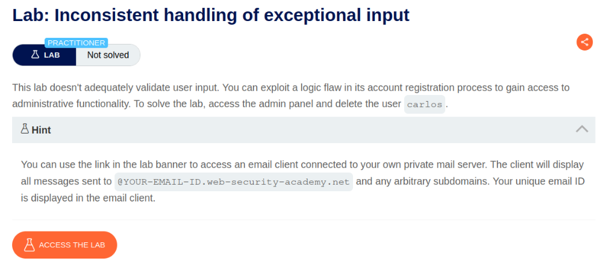

## Solution :
Finding admin panel -
First we need to find the URI of the admin panel inorder to delete the user carlos.

Go to Target -> Sitemap. Right click on the lab domain & select Engagement tools -> Discover content. to find what pages and directories are available in the website.

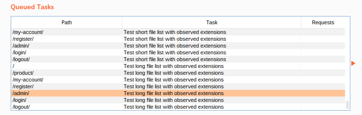

When we try to browse to /admin, it says onnly persons belonging to DontWannaCry company can access this page.

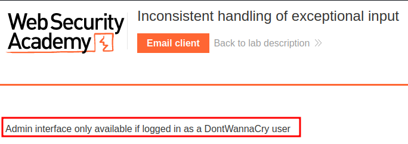

Account registration -
Go to registration page to create an account with the email id given to us - attacker@exploit-0ab1009903bcf40b8008753f01b300db.exploit-server.net

In the registration page, it is mentioned that we can use @dontwannacry.com if we are an employee of that company.

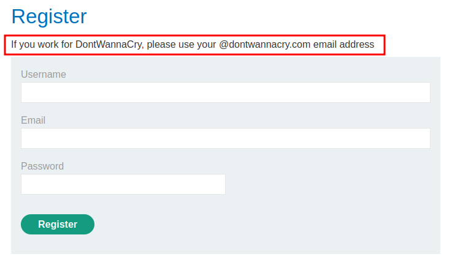

Create an account with very long email address ending with @exploit-0ab1009903bcf40b8008753f01b300db.exploit-server.net.

Example - `` very-long-string@YOUR-EMAIL-ID.web-security-academy.net ``

NOTE - The very-long-string should be at least 200 characters long.

So I created an account with a very long string - aafafasighfiyuqabryuawgfibasifnkajsdbgiuafgijaeboifnaijfaokjfiuahfjiahgr90ipqjro89sygfduygsfdtuvdtGUYEDFGWYTDVUYVDuyGDUYucvuavcuyvauyvdfuaycvuayvcuyasvcuyavcuyavcuucauvcuayvclu2o3i1hri97uuc89273r89hiug987niuch89qn397yr89hiu7ay89qah45uiyr0q@exploit-0ab1009903bcf40b8008753f01b300db.exploit-server.net

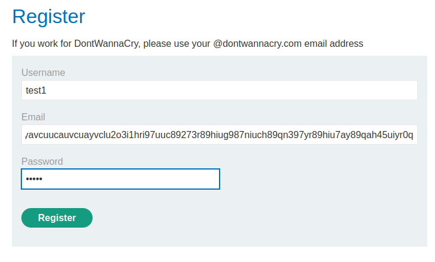

Once registered, we get an email .

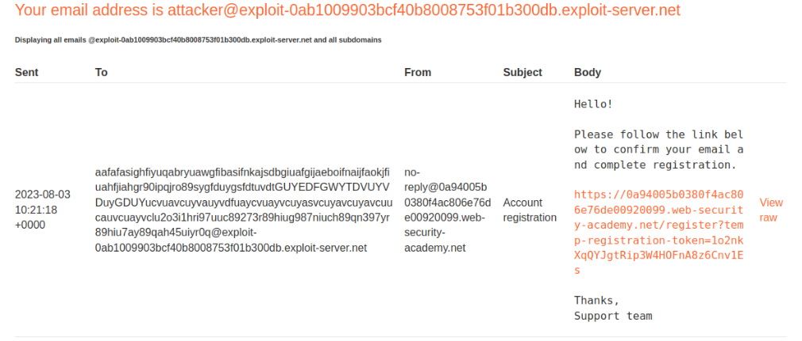

Click on the link & our registration is sucessful.

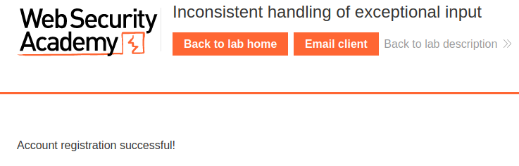

Now login as that user using the creds that we've created - test1:1234

Once logged in we get this message but notice that the email address was truncated to 255 characters-

``aafafasighfiyuqabryuawgfibasifnkajsdbgiuafgijaeboifnaijfaokjfiuahfjiahgr90ipqjro89sygfduygsfdtuvdtGUYEDFGWYTDVUYVDuyGDUYucvuavcuyvauyvdfuaycvuayvcuyasvcuyavcuyavcuucauvcuayvclu2o3i1hri97uuc89273r89hiug987niuch89qn397yr89hiu7ay89qah45uiyr0q@exploit-0ab1009``

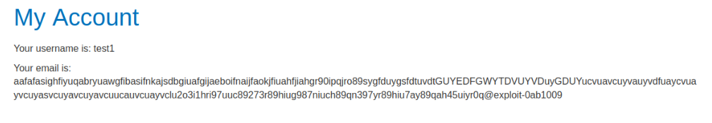

KEY INFORMATION TO NOTE -
Total characters in original email used to register an account - 299 characters
Total characters in email after signing in - 255 characters
Register an account with @dontwannacry.com -
Now taking note of this behaviour, we can create a new account with more than 255 characters long & ends with our email-id but when the application truncates it, the last characters should be @dontwannacry.com

The email id to be used now is

``aaafasighfiyuqabryuawgfibasifnkajsdbgiuafgijaeboifnaijfaokjfiuahfjiahgr90ipqjro89sygfduygsfdtuvdtGUYEDFGWYTDVUYVDuyGDUYucvuavcuyvauyvdfuaycvuayvcuyasvcuyavcuyavcuucauvcuayvclu2o3i1hri97uuc89273r89hiug987niuch89qn397yr89hiu7ay89qah45uiyr0q@dontwannacry.com.exploit-0ab1009903bcf40b8008753f01b300db.exploit-server.net``

Create an account with the above email-id

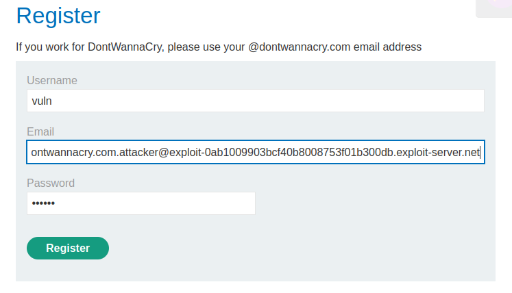

In the email inbox, click on the link to confirm registration.

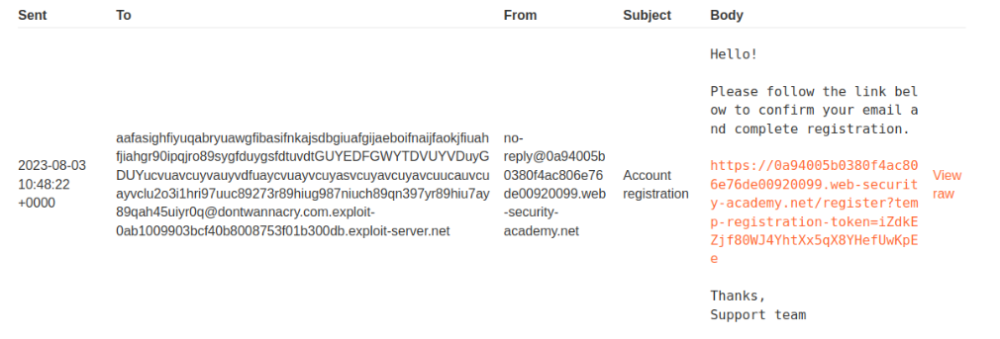

Now finally when we login, we can see that after it truncated , our rmail address ends wiht @dontwannacry.com.

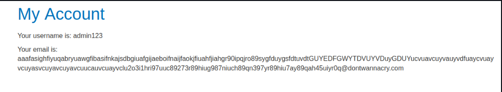

We can now access the admin panel at /admin.

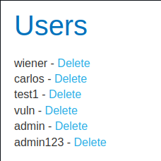

Delete the user carlos to solve the lab.

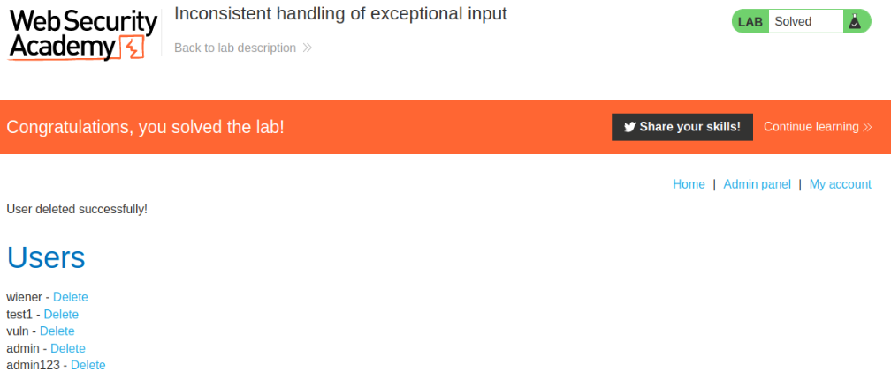

#### Visit The Next Page For The Next Level :)

