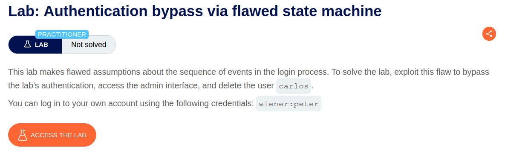
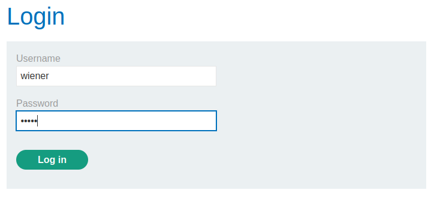
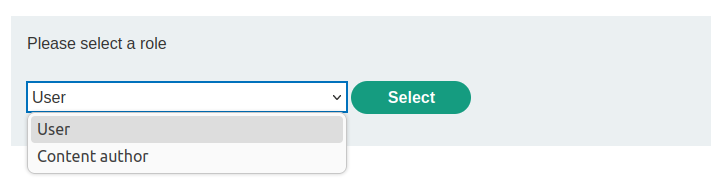
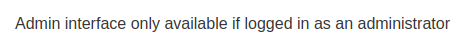
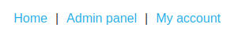
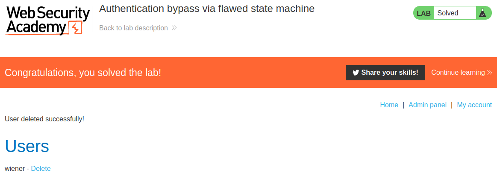

# Authentication bypass via flawed state machine

## Lab Description :


## Solution :
We need to exploit the flawed workflow validation to login as administrator & delete the user carlos.

Using the content discovery tool in burpsuiter, we find that the admin directory is at /admin.

Application workflow -
Enter the given credentials for wiener and login.



The following request is sent.
```html
POST /login HTTP/1.1
Host: 0a4f00ab04e5dc728274d9b300b300d9.web-security-academy.net
Cookie: session=SE1TCvF0mzP7xQoiEn37HfZlytI3sx38
User-Agent: Mozilla/5.0 (X11; Ubuntu; Linux x86_64; rv:109.0) Gecko/20100101 Firefox/116.0
Accept: text/html,application/xhtml+xml,application/xml;q=0.9,image/avif,image/webp,*/*;q=0.8
Accept-Language: en-US,en;q=0.5
Accept-Encoding: gzip, deflate
Content-Type: application/x-www-form-urlencoded
Content-Length: 68
Origin: https://0a4f00ab04e5dc728274d9b300b300d9.web-security-academy.net
Referer: https://0a4f00ab04e5dc728274d9b300b300d9.web-security-academy.net/login
Upgrade-Insecure-Requests: 1
Sec-Fetch-Dest: document
Sec-Fetch-Mode: navigate
Sec-Fetch-Site: same-origin
Sec-Fetch-User: ?1
Te: trailers
Connection: close

csrf=ULitWAu6ydx5d9LffWoSigiVWcjBHuVa&username=wiener&password=peter
```
The following is the follow-up GET request made to /role-selector , which fetches the page to select the role which we want.
```html
GET /role-selector HTTP/2
Host: 0a4f00ab04e5dc728274d9b300b300d9.web-security-academy.net
Cookie: session=IJLP66FvNM7IyqPhcqvhtmbRmjjFHWPU
User-Agent: Mozilla/5.0 (X11; Ubuntu; Linux x86_64; rv:109.0) Gecko/20100101 Firefox/116.0
Accept: text/html,application/xhtml+xml,application/xml;q=0.9,image/avif,image/webp,*/*;q=0.8
Accept-Language: en-US,en;q=0.5
Accept-Encoding: gzip, deflate
Referer: https://0a4f00ab04e5dc728274d9b300b300d9.web-security-academy.net/login
Upgrade-Insecure-Requests: 1
Sec-Fetch-Dest: document
Sec-Fetch-Mode: navigate
Sec-Fetch-Site: same-origin
Sec-Fetch-User: ?1
Te: trailers
```
Now we're presented with this page where we can select a role for the user.



On selecting a role , the following request is sent.
```html
POST /role-selector HTTP/2
Host: 0a4f00ab04e5dc728274d9b300b300d9.web-security-academy.net
Cookie: session=nfj0xdMMPRYjHKsseu3uqCaqhWulhGal
User-Agent: Mozilla/5.0 (X11; Ubuntu; Linux x86_64; rv:109.0) Gecko/20100101 Firefox/116.0
Accept: text/html,application/xhtml+xml,application/xml;q=0.9,image/avif,image/webp,*/*;q=0.8
Accept-Language: en-US,en;q=0.5
Accept-Encoding: gzip, deflate
Content-Type: application/x-www-form-urlencoded
Content-Length: 47
Origin: https://0a4f00ab04e5dc728274d9b300b300d9.web-security-academy.net
Referer: https://0a4f00ab04e5dc728274d9b300b300d9.web-security-academy.net/role-selector
Upgrade-Insecure-Requests: 1
Sec-Fetch-Dest: document
Sec-Fetch-Mode: navigate
Sec-Fetch-Site: same-origin
Sec-Fetch-User: ?1
Te: trailers

role=user&csrf=wuxcQYkIOd5GkUbiEFaHIKkEAbIakcip
```
Now we're wiener with the role of user.

Since we're just a user , we still can't view the /admin page.



Abusing flawed workflow logic -
Thinking from an attacker's perspective, we can try to just drop the GET request made to /role-selector and see what role we are assigned by default.

Simply to say, we skip the 2nd step in the workflow to see what role we are assigned by default.

After dropping that particular request, we now see a link to Admin panel at the top right side.



This means that by default the application assigns administrator privileges to the user unless he specifies any role of his choice!.

Go to the admin panel and delete the user carlos to solve the lab.



#### Visit The Next Page For The Next Level :)
