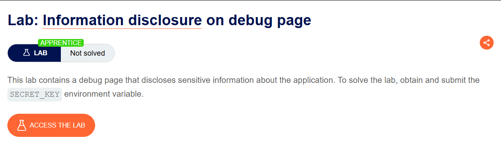
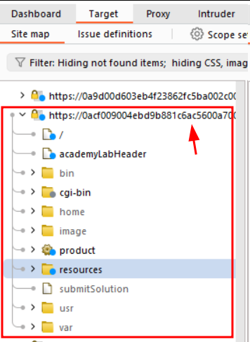
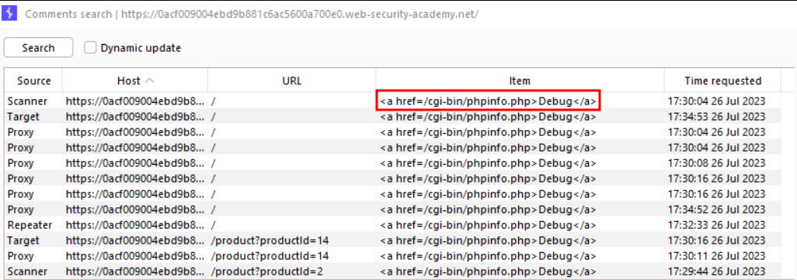
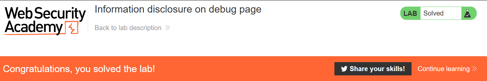

# Information disclosure on debug page

## Lab Description :


## Overview :
Debug messages can sometimes contain vital information for developing an attack, including:

- Values for key session variables that can be manipulated via user input
- Hostnames and credentials for back-end components
- File and directory names on the server
- Keys used to encrypt data transmitted via the client
Debugging information may sometimes be logged in a separate file. If an attacker is able to gain access to this file, it can serve as a useful reference for understanding the application's runtime state.

## Solution :
After the lab website loads, we can see the products listed there. Now to see if there is any Debug page info that is leaked.

Go to Burpsuite , Target -> Sitemap . Right click on the top level entry for tha lab website shon.


Click on Engagement tools - Find comments. The following dialog box appears.


From that , we can see that there is a href pointing to /cgi-bin/phpinfo.php.

Send the request to repeater(add the path /cgi-bin/phpinfo.php),
```html
GET /cgi-bin/phpinfo.php HTTP/2
Host: 0acf009004ebd9b881c6ac5600a700e0.web-security-academy.net
Cookie: session=3Y9b24AoTm8tC85I8NxLp0pXbmPiOYIi
User-Agent: Mozilla/5.0 (Windows NT 10.0; Win64; x64; rv:109.0) Gecko/20100101 Firefox/115.0
Accept: */*
Accept-Language: en-US,en;q=0.5
Accept-Encoding: gzip, deflate
Sec-Fetch-Dest: empty
Sec-Fetch-Mode: cors
Sec-Fetch-Site: same-origin
Te: trailers
```

In the response we can see that lot of information is revealed including the value of SECRET_KEY - pmgzklwq00nifvg9px4drvkmy40249p5

```html
<tr>
  <td class="e">SECRET_KEY </td>
  <td class="v">pmgzklwq00nifvg9px4drvkmy40249p5 </td>
</tr>
```

Submit the key to solve the lab.



#### Visit The Next Page For The Next Level :)
