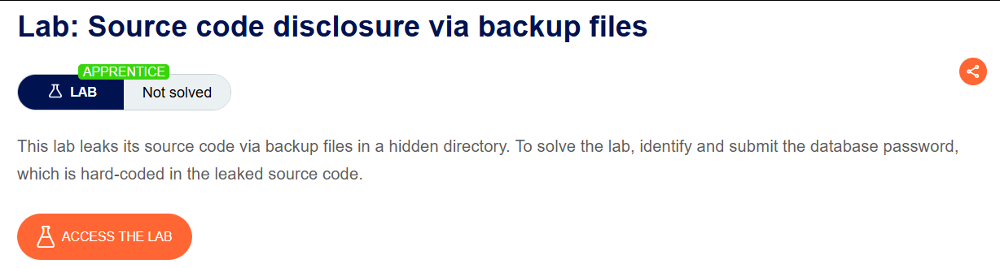
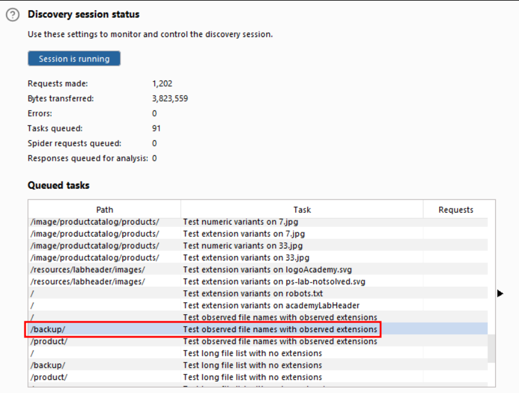
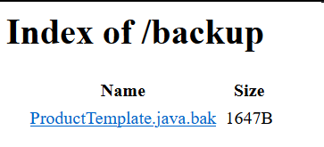
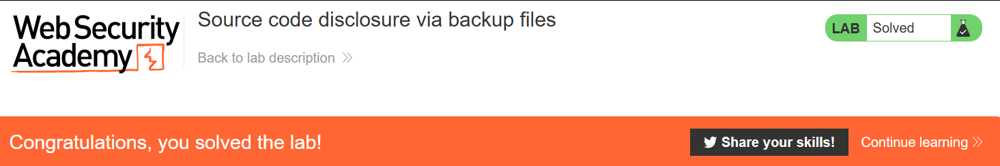

# Source code disclosure via backup files

## Lab Description :


## Overview :
When mapping out a website, you might find that some source code files are referenced explicitly. Unfortunately, requesting them does not usually reveal the code itself. When a server handles files with a particular extension, such as .php, it will typically execute the code, rather than simply sending it to the client as text.

However, in some situations, you can trick a website into returning the contents of the file instead. For example, text editors often generate temporary backup files while the original file is being edited. These temporary files are usually indicated in some way, such as by appending a tilde (~) to the filename or adding a different file extension. Requesting a code file using a backup file extension can sometimes allow you to read the contents of the file in the response.

Solution :
Turn intercept off and browse through the website.

Go to Target-> Sitemap.

Right click on the lab domain name -> Select Engagement Tools-> Discover Content

This will scan the website & gives all the contents present in it like files, directories etc..,



The scan results reveal that there is a /backup directory.

/backup directory -


Here we have a file named ProductTemplate.java.bak. Let's download the file & view its contents to retreive the database password

On analysing the source code, we find this piece of code particularly interesting.
```
private void readObject(ObjectInputStream inputStream) throws IOException, ClassNotFoundException
    {
        inputStream.defaultReadObject();

        ConnectionBuilder connectionBuilder = ConnectionBuilder.from(
                "org.postgresql.Driver",
                "postgresql",
                "localhost",
                5432,
                "postgres",
                "postgres",
                "jjawytpaw5kvygxne0411djzetf2oto8"
        ).withAutoCommit();
        try
        {
            Connection connect = connectionBuilder.connect(30);
            String sql = String.format("SELECT * FROM products WHERE id = '%s' LIMIT 1", id);
            Statement statement = connect.createStatement();
            ResultSet resultSet = statement.executeQuery(sql);
            if (!resultSet.next())
            {
                return;
            }
            product = Product.from(resultSet);
        }
        catch (SQLException e)
        {
            throw new IOException(e);
        }
    }
```
    
The above code uses ConnectionBuilder class to establish a connection to a PostgreSQL database. There we can see a random string ``[jjawytpaw5kvygxne0411djzetf2oto8]`` which might be the database password that is used to establish the connection.

Submit the db_password to solve the lab.



#### Visit The Next Page For The Next Level :)
