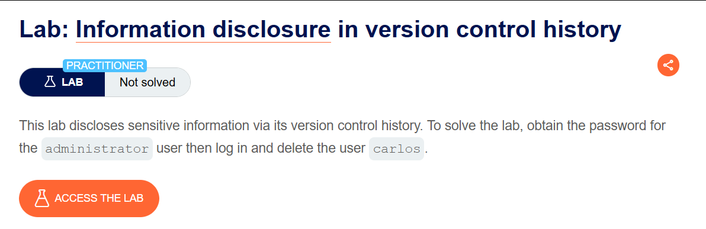
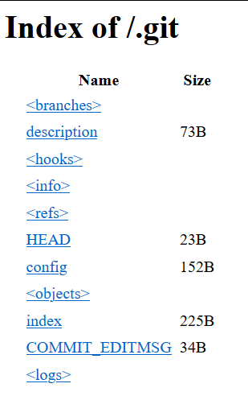
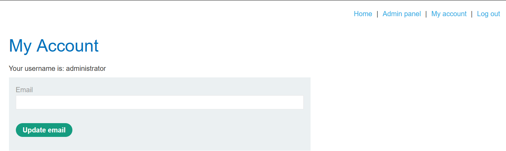

# Information disclosure in version control history

## Lab Description :


## Overview :
Virtually all websites are developed using some form of version control system, such as Git. By default, a Git project stores all of its version control data in a folder called .git.
Occasionally, websites expose this directory in the production environment. In this case, you might be able to access it by simply browsing to /.git.
Solution :
Once the website loads, check out the .git directory . ie - ``https://<id>.web-security-academy.net/.git.`` The page discloses some files like this,



Retreive the admin's password -
To analyse these .git files we can use a tool called Git-dumper

Use the command - ``python3 git_dumper.py https://0a1e0026040c2e3f8297b0dc00ec003c.web-security-academy.net/.git  websecurity/.`` to save the files along with the .git directory in the folder of our choice in our linux machine.

git log shows these two commit logs.

```text
commit 63085ffc69c9cab7029684ec63ba9219cb96f851 (HEAD -> master)
Author: Carlos Montoya <carlos@evil-user.net>
Date:   Tue Jun 23 14:05:07 2020 +0000

    Remove admin password from config

commit 19dd0c8f15df85cd3526e0d51e9f912d3e52c556
Author: Carlos Montoya <carlos@evil-user.net>
Date:   Mon Jun 22 16:23:42 2020 +0000

    Add skeleton admin panel
Running git diff 19dd0c8f15df85cd3526e0d51e9f912d3e52c556 63085ffc69c9cab7029684ec63ba9219cb96f851 gives us the following result which contains the admin password which was removed - administrator:kw9sxvjbf1eqp40vwm6d.
diff --git a/admin.conf b/admin.conf
index ec58905..21d23f1 100644
--- a/admin.conf
+++ b/admin.conf
@@ -1 +1 @@
-ADMIN_PASSWORD=kw9sxvjbf1eqp40vwm6d
+ADMIN_PASSWORD=env('ADMIN_PASSWORD')
```
Login & delete user carlos -
Login as admin with the passwrod found.



Go to the admin panel & delete user carlos to solve the lab.


