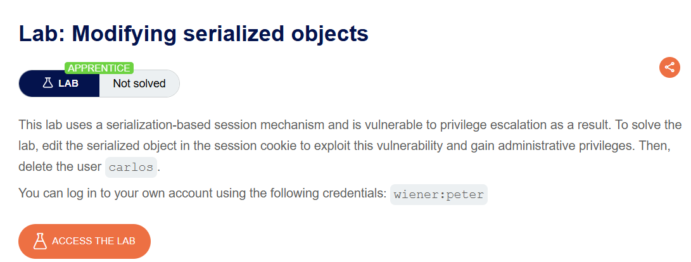
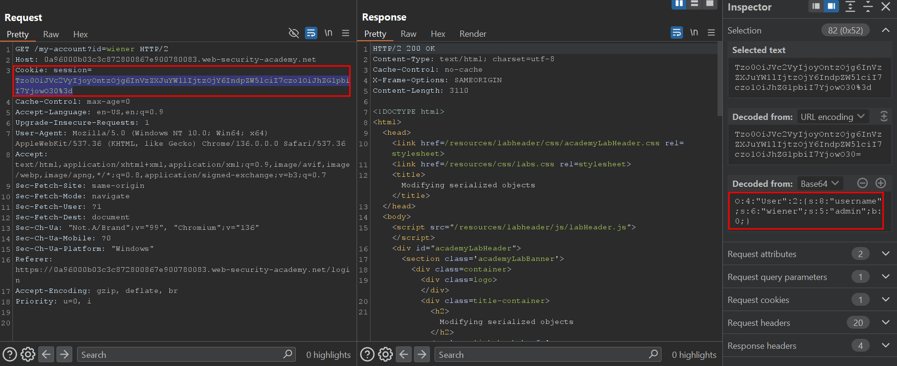
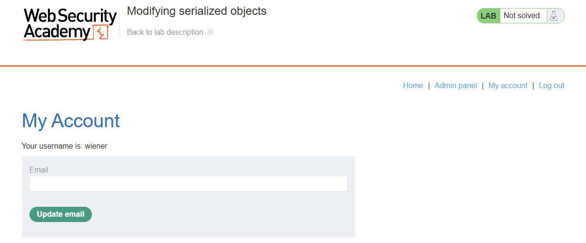
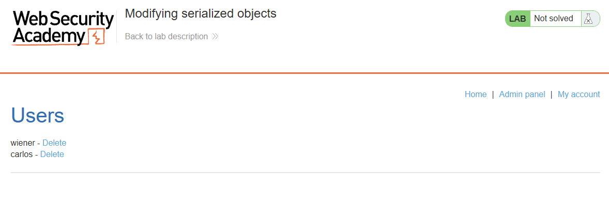

# Modifying serialized objects

## Lab Description :

## Solution :
Login with the credentials provided - wiener:peter.

Upon login we see that the user's cookie is a PHP serialize object.

The cookie contains a attribute called admin:0 which means false.

Change the boolean attribute to 1 & convert it back to proper encopding as it was before.

`` O:4:"User":2:{s:8:"username";s:6:"wiener";s:5:"admin";b:0;} ``

Upon replacing the old cookie in dev tools with the cookie that we have created , we can now see the hyperlink to access the admin panel. image

We now have privilege to delete user accounts.

Delete the user carlos to solve the lab.

#### Visit The Next Page For The Next Level :)
