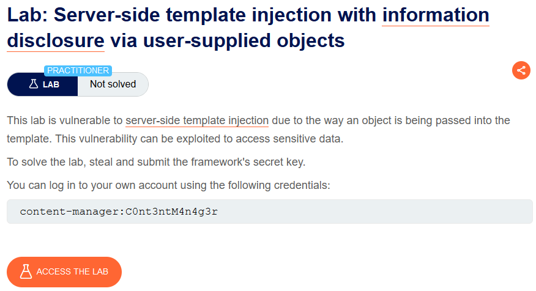
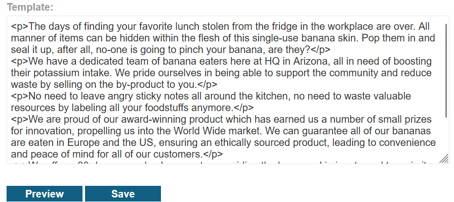
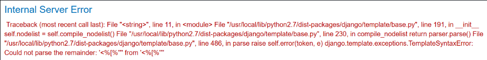
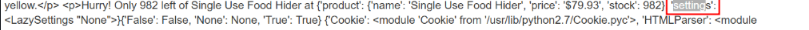
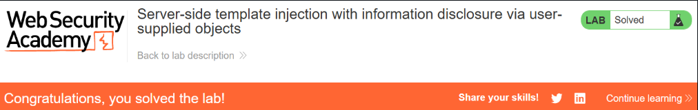

# Server-side template injection with information disclosure via user-supplied objects

## Lab Description :



## Overview :

#### Developer-supplied objects

It is important to note that websites will contain both built-in objects provided by the template and custom, site-specific objects that have been supplied by the web developer. You should pay particular attention to these non-standard objects because they are especially likely to contain sensitive information or exploitable methods. As these objects can vary between different templates within the same website, be aware that you might need to study an object's behavior in the context of each distinct template before you find a way to exploit it.

## Solution :
Login using the credentials - ``content-manager:C0nt3ntM4n4g3r``

Clicking on any of the post, we have an option to Edit Template.



Identifying the template engine -
Entering the payload - ``${{<%[%'"}}%\.`` in one of the template expressions results in an error.



Taking a close look at the error, we can understand that it uses django template.

#### Retreive sensitive info -

Payload all the things - https://github.com/swisskyrepo/PayloadsAllTheThings/blob/master/Server%20Side%20Template%20Injection/README.md#django-templates

We can use ```` to leak information on what objects and properties that are allowed.



We see that there is settings object.

We can search online from the Django documentation to see if there is any ``SECRET_KEY`` which has a value as mentioned in the lab description..

#### DJANGO documentation
 
 . https://docs.djangoproject.com/en/4.2/ref/settings/#debug
 
 . https://docs.djangoproject.com/en/4.2/ref/settings/#secret-key

So now we can retreive the value of the ``SECRET_KEY`` by using the payload ,

```text
{{settings.SECRET_KEY}}
```

We have the ``SECRET_KEY`` now - eripvie8dlk2b1fg9n3wg0xbyw6ufkdn

Submit the secret_key value to solve the lab.


