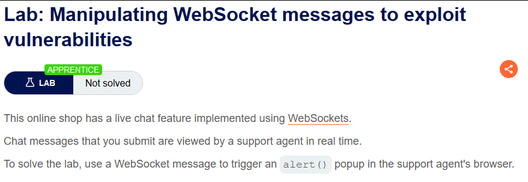
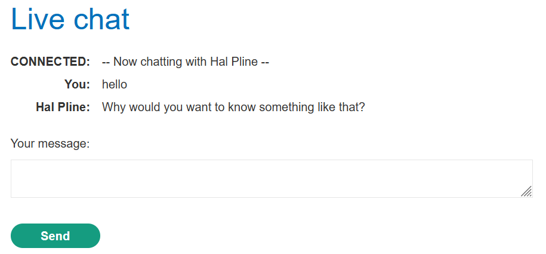
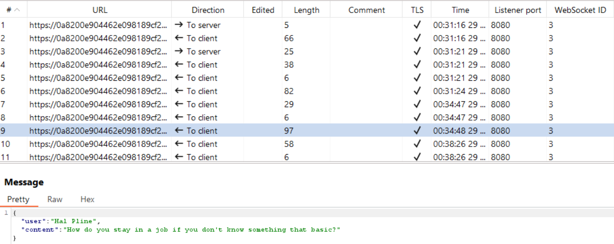
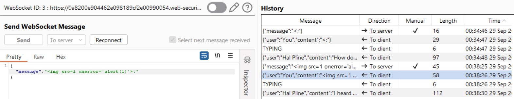
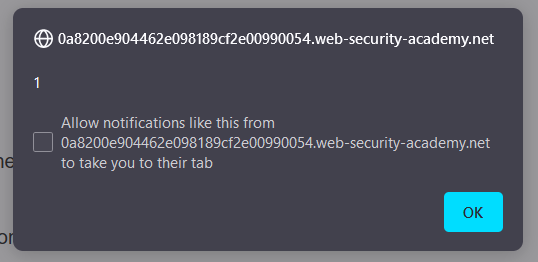
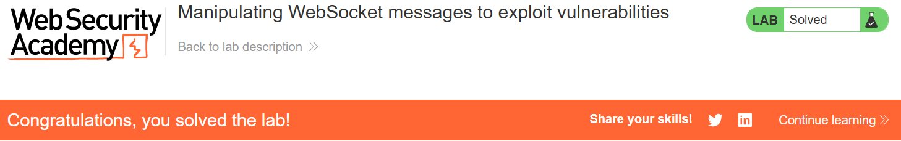

# Manipulating WebSocket messages to exploit vulnerabilities

## Lab Description :


## Overview :
The majority of input-based vulnerabilities affecting WebSockets can be found and exploited by tampering with the contents of WebSocket messages.

For example, suppose a chat application uses WebSockets to send chat messages between the browser and the server. When a user types a chat message, a WebSocket message like the following is sent to the server:

``{"message":"Hello Carlos"}``

The contents of the message are transmitted (again via WebSockets) to another chat user, and rendered in the user's browser as follows:

``<td>Hello Carlos</td>``
In this situation, provided no other input processing or defenses are in play, an attacker can perform a proof-of-concept XSS attack by submitting the following WebSocket message:

``{"message":""}``

## Solution :
The lab's home page has a link to Live chat.


There we have an option to chat or send message to another user.



We can view all the websocket requests & responses that have been sent and received under the Web Sockets history tab in Burp.



Since there is no sanitization of user input, we can send the following xss payload by intercepting the request & changing the value of message field in the JSON data.

````



Now both the client & the server users will get an XSS alert poopup.



And now we have solved the lab.



#### Visit The Next Page For The Next Level :)
